# Omabook

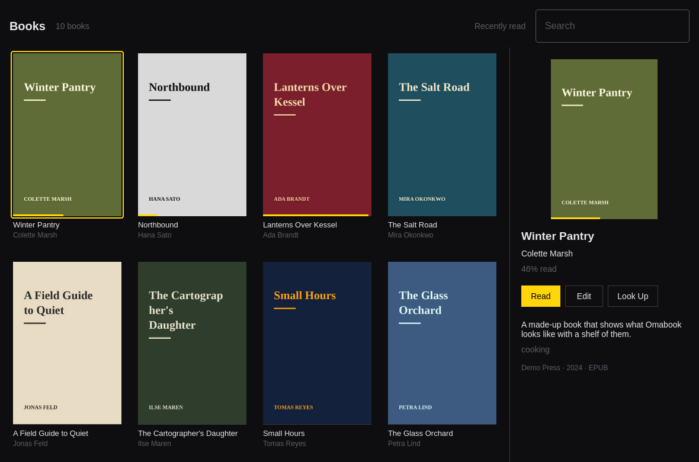

Your ebook library and reader for [Omarchy](https://omarchy.org). Add books of any kind, keep their details straight, and read them, from the keyboard, in the desktop's theme and language. AI is built in rather than bolted on: it reads along with you, names the books no catalog knows, and every part of the library is a command an agent can run.

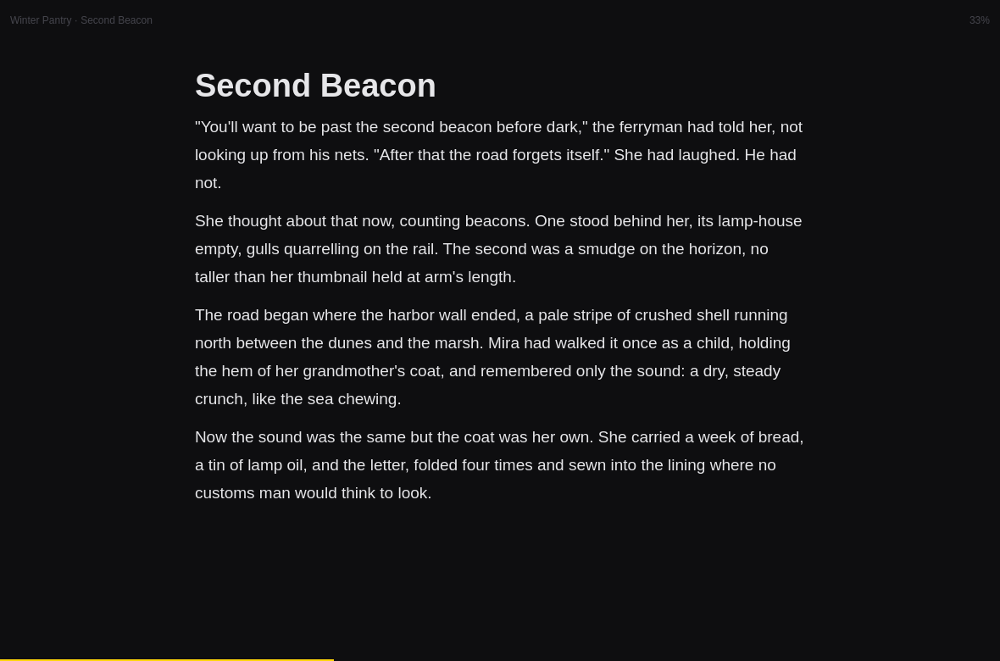

## What it does

- **A library that is a folder.** Books are copied into `~/Books` under `Author/Title (id)/`, with their cover beside them and one SQLite file for the rest. The file you added is never touched, and the folder can be backed up or synced as it is. Keep several libraries and switch between them.
- **Reads what you have.** EPUB, FictionBook (`.fb2`, `.fb2.zip`), Markdown, HTML and plain text flow in your own font and the desktop's colors. PDF and comics (`.cbz`, `.cbr`, `.cb7`, `.cbt`) are shown page by page. Kindle (`.azw3`, `.azw`, `.mobi`), Word, OpenDocument, RTF, DjVu and the other formats Calibre knows are converted to EPUB the first time you open them, which needs Calibre's `ebook-convert`; the original stays beside the result.
- **Takes over from Calibre.** Omabook finds your Calibre libraries and offers to import them; every book comes across with the details you curated there, its cover, all its formats, and what Calibre knows of your reading: what you have read and are reading, your stars, highlights, and what Goodreads and others call the book. Calibre's folder is only read. See [Calibre](#calibre).
- **Several libraries, several computers.** `O` switches between libraries. `Y` syncs the open one with another computer over ssh (see below).
- **Works with fingers.** On a touchscreen, tap a cover to open it; while reading, a button in the corner shows the contents, find, the AI and the rest; swipe sideways to turn the page (it follows your finger) or tap the right or left edge, pinch to resize, and tap mid-page for buttons to everything else.
- **Gets the details.** `M` asks every source that is switched on (Open Library, Google Books, Apple Books, Crossref, Calibre's own metadata plugins, and any you add), shows how each one answered, and says for every result what it would add to the book and what it would change. The AI then weighs those results against the book's own opening pages and puts its recommendation, with its reason, at the top. `E` edits by hand.
- **Two pages when the window is wide.** A landscape window is an open book: two pages side by side, cut between lines, with the right page carrying on from the left. A portrait window is one page that scrolls. PDFs and comics pair up the same way.
- **An index beside the page.** `T` opens the book's chapters as a tree at the side: click one to go there, fold the ones with parts, and see which you are in. `F` is the opposite: the book and nothing else, on the whole screen.
- **Remembers your place**, your bookmarks, and how far through each book you are.
- **Yours to change.** Every key, color, view and panel is a file in `~/.config/omabook/`, followed while the app runs (see *Make it yours*).

## Views

The library is one shelf looked at five ways. `1` to `5` pick one, `V` goes to the next, and so do the small drawings beside the search; each library remembers its own. Whichever it is, the same keys move, open and edit, a click selects and a double click opens, and a finger opens with a tap.

| | |
|---|---|
|  | **Covers** (`1`). Every book face out. A book on paper or only wished for says so in a corner, a finished one is checked, and stars show where you rated it. |
|  | **Spines** (`2`). A bookshelf: each spine as thick as the book is long and bound in its cover's color, a few lying flat in piles, always the same ones. The selected book is pulled out to show its face. Paper books carry a label at the foot; a wish is an outline. |
| 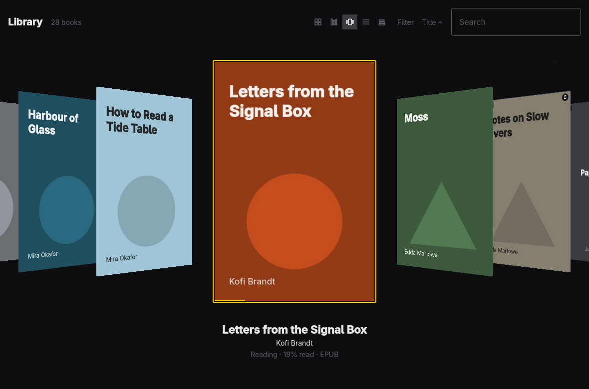 | **Carousel** (`3`). The selected cover large in the middle and what it is underneath; `H` `L`, the arrows or a swipe slide the row. |
| 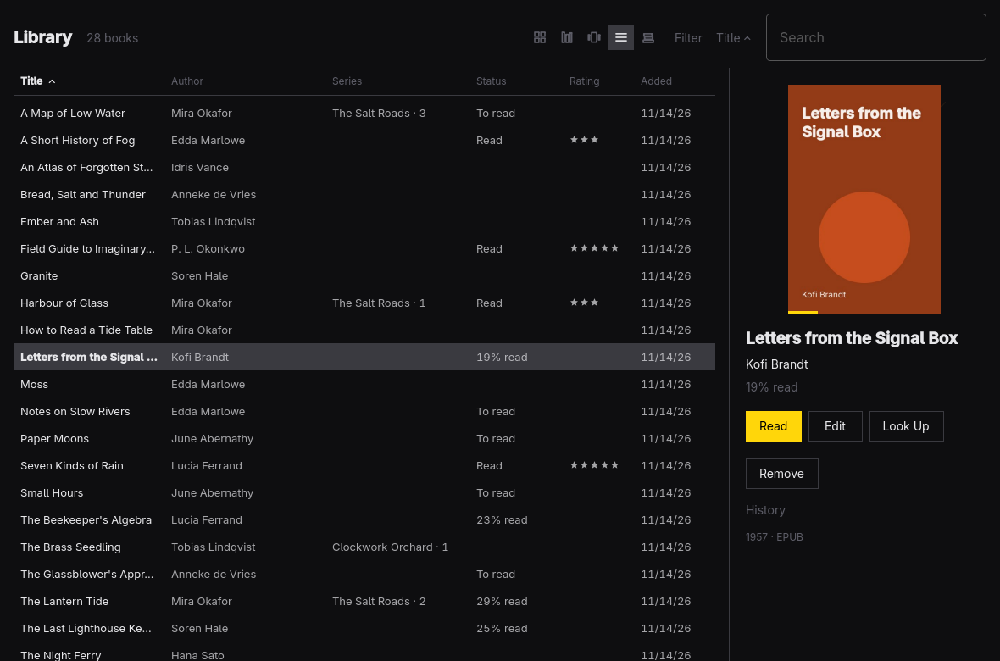 | **List** (`4`). A line a book: title, author, series, status, rating, format, added. Click a heading to sort by it and again to turn it round; `H` `L` walk the order along the headings. |
|  | **Stacks** (`5`). A pile per series; `G` piles by author, tag or reading status instead. `Space` opens a pile into its books, `Esc` closes it. |

The shelf is ordered with `S` (recently read, title, author by last name, series, recently added, progress, rating, published, finished) and `Shift+S` turns the order round. `F` filters it: type a few letters of a reading status, paper, digital or wishlist, a format, a language, a tag, an author, a series or a rating, and Enter takes the match. Filters add up, show as chips that a click removes, work together with the search, and `Shift+F` clears them. The order is kept for every library, the view and the filters for each.

It follows the theme, light or dark:

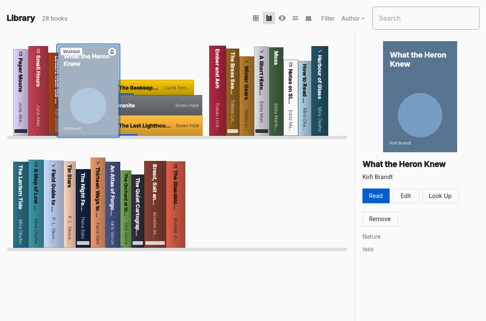

## Keys

These are the keys as shipped; every one can be changed in `keys.json` (see *Make it yours*), and `?` always shows the ones in force.

| Library | | Reading | |
|---|---|---|---|
| `Space` | Read the selected book | `Space` | Page down, and on to the next chapter |
| `H` `J` `K` `L` | Move around the shelf | `Shift+Space` | Page up |
| `/` | Search (`author:`, `title:`, `series:`, `tag:`, `format:`, `lang:` look in one field) | `J` `K` | Scroll a few lines |
| `A` | Add books | `H` `L` | Previous or next chapter |
| `Shift+A` | Add a folder of books | `G` `Shift+G` | Start or end of the chapter |
| `E` | Edit the book's details | `T` | Show or hide the contents beside the page |
| `M` | Look the details up, online and with AI | `/` | Find in the book |
| `X` | Save a copy of the book elsewhere | `B` | Bookmark this place |
| `D` | Remove the book (it asks first) | `A` | Ask the AI about what you are reading |
| `S` `Shift+S` | Change the order, or turn it round | `+` `-` | Larger or smaller |
| `F` `Shift+F` | Filter the shelf, or clear the filters | | |
| `1` `2` `3` `4` `5` | Covers, spines, carousel, list or stacks | | |
| `6` `U` | The library, or the selected book, as a graph of what is known | `M` | The map of the book so far, beside the page |
| `V` `G` | The next view, or stack by something else | | |
| `O` | Open another library | `F` | The book and nothing else, full screen |
| `P` | Plugins | `C` | Have the AI catch you up |
| `Shift+T` | Tidy the library | `W` | Who is who so far |
| `W` | Ask about your library | `V` | Select words with the keyboard, to ask about them or find them |
| `N` | Suggest what to read next | `Shift+M` | Mark the map's things in the text: while the map is open, always, or never |
| `Ctrl+K` | Change Omabook (anywhere) | | |
| `Y` | Sync with another computer | `Esc` | Back to the library |
| `I` | Show or hide the details | | |
| `<` `>` | The pane beside the shelf or the page, narrower or wider (or drag its edge; a double click puts it back) | `<` `>` | The same |
| `,` | Settings | | |
| `?` `F1` | Help: every key, pages on how things work, and the tour | | |
| `Q` | Quit | | |

Books can also be dropped on the window.

## Help and the tour

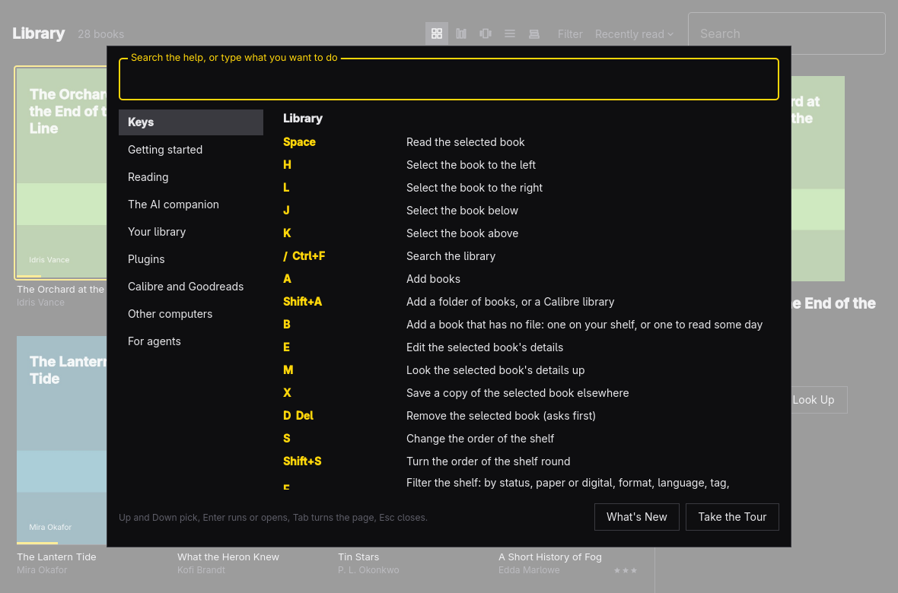

`?` (or `F1`) opens the help wherever you are. It lists every key **as it is bound now**: change one in `keys.json`, or add a plugin with a command of its own, and the help shows it without anyone having written it down. Type what you want to do ("add a folder", "how do I bookmark") and the list narrows to the commands and pages that match; Up and Down pick one and Enter runs it, so the help is also a way to do things. Typing only ever searches. Opened over a book, the reading keys come first.

Beside the keys are a few short pages: getting started, reading, the AI companion, your library, plugins, Calibre and Goodreads, other computers, and one for agents. Tab turns to the next. Each lists the commands it mentions, and the same pages print in a terminal:

```bash
omabook help             # the commands, and the topics
omabook help reading     # one page; --json for an agent
omabook help keys        # every key, as keys.json has it now
omabook help new         # what this version brought
```

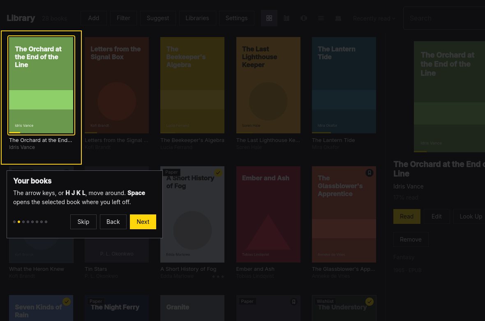

**The tour** is a short walk through the real window: it dims everything but the part a card is about (the search, the views, a book, its details, and in a book the contents and the companion), a sentence or two each. Arrows, Space or Enter go on, Backspace goes back, Escape leaves at any step, and all of it works with a finger. On a first start it is offered once, in a note at the bottom that takes no focus; whatever you answer, it is not offered again, and it stays under `?` ("Take the Tour"). With no books yet it starts with how to get some.

**What's new.** When a newer Omabook has something to show, the same quiet note offers a tour of just the new things. "What's New" in the help shows them again at any time.

## Plugins


`P` opens the plugin manager (`omabook plugins` lists the same): what Omabook is made of and what has been added to it, sorted by what each plugin does (sources of book details, reading sites, your scripts, Calibre and what it found, formats, catalogs, AI) with a quiet mark for each one's state: on, off, needing something, or broken. Beside the list are the selected plugin's details: where it comes from and its version, the fields a source brings, what a script registered (commands with their keys, panels, hooks, sources) and what it asked to be allowed, in plain words, and its last error with file and line and a way to try again. When something needs attention (a script that stopped, a program plugin whose program is missing, Calibre switched off while its library is here) one line at the top says so and leads to the plugin.

Everything in it has a key; `?` shows them all in the dialog.

| Key | In the plugin manager |
|---|---|
| `Up` `Down` `J` `K` | Move through the plugins |
| `Space` | Switch the selected plugin on or off |
| `Enter` | Show its details (where the window is too narrow for both) |
| `/` | Find a plugin by name, kind, origin or state |
| `N` | Start a plugin from a template, and open its folder |
| `I` | Install a plugin from a `.zip` or a folder |
| `T` | Try one look-up against a source and see what comes back |
| `Alt+Up` `Alt+Down` | Ask a source earlier or later |
| `A` | Show the next plugin that needs attention |
| `O` | Open the plugin's folder |
| `R` `Shift+R` | Read the plugin folder again; load this script again |
| `D` | Remove a plugin of your own (it asks first; to the trash) |

- **The order sources are asked in** is the order of the list, and yours to change; it is kept in `config.json` as `plugin_order`.
- **Installing** a plugin someone else wrote (`I`, or `omabook plugin install <folder|zip>`) checks it first: it must hold a `plugin.json` naming a script or a command, ask only for permissions Omabook knows, and stay inside its own folder (no `../`, absolute paths or links) and under 64 MB. Nothing is put in the plugin folder until then, you are shown what it asks to be allowed, and it stays switched off unless you say otherwise (`--enable`). One that replaces a plugin of the same name (`--replace`) sends the old one to the trash and keeps its `data/`.
- **Removing** (`D`, or `omabook plugin remove <name>`) is for your own plugins and moves the folder to the trash. What is built in, and what Calibre brings, can only be switched off.
- **From GitHub, and kept up to date.** `I` and a repository's address (`owner/repo`, a link to it, or a link to one of its releases, tags, branches or folders), or `omabook plugin add <address>`, fetches a plugin from a public GitHub repository without git, over HTTPS from GitHub's own addresses only, and puts it through the same check. Where it came from is remembered in `sources.json` beside the plugins (not in `config.json`, which is yours to edit; this is Omabook's bookkeeping, rewritten at every check). A source follows the repository's latest release, or its default branch where it has no releases; `omabook plugin pin <name> <tag|branch>` stays at a tag or follows another branch. Once a day, after the window is up, each source is asked whether there is something newer (an unchanged one costs GitHub nothing, and when GitHub asks to wait, Omabook does), and what happens next is a setting (`,`, or `omabook plugin sources --updates auto|tell|never`):
  - *Install by themselves* (the default): an update that asks for **no new permission** goes in, keeping the plugin's `data/` and whether it was on or off, and a line says so ("Storyteller was updated from 1.0 to 1.1"). The version before is kept for one step back (**Roll Back**, `omabook plugin rollback <name>`), and an update that doesn't load is rolled back by itself.
  - An update that asks for a **new permission**, or goes by another name, is never installed by itself: the line at the top of the plugin manager says "Storyteller has an update that asks for the network: review", and it waits for you (`omabook plugin update <name> --yes`).
  - A repository that is gone, has moved, or no longer holds a plugin leaves the installed plugin untouched and is reported the same way. **Forget the Source** (`omabook plugin forget-source <name>`) stops the updates and keeps the plugin.
  - Private repositories need a token: `omabook plugin token` reads one from standard input into the desktop's keyring (never `config.json`), and it is sent to `api.github.com` only. There is no list of plugins to browse; you bring the address.
- **Which Omabook a plugin needs.** `plugin.json` may say `"omabook": "0.1.0"`, the oldest version it runs on. An older Omabook doesn't load or install such a plugin and says "Needs Omabook 0.3.0 or newer; this is 0.1.0"; an update that needs a newer Omabook waits, and the version you have stays.

Sources of book details can be switched on and off; they come from three places:

- **Built in:** Open Library, Google Books, Apple Books, Crossref. None needs a key.
- **From Calibre:** when Calibre is installed, its metadata source plugins are run inside Calibre itself, so the ones it ships with (Amazon.com, Edelweiss, ...) and any you installed there (Goodreads, Kobo, ...) work as they are. One whose catalog Omabook already has built in stays off until you turn it on. All of them sit under the one [Calibre](#calibre) plugin, which switches everything Calibre at once.
- **Your own:** a folder in `~/.config/omabook/plugins/` holding a `plugin.json` and a program in any language. The program is handed the book as JSON on standard input and answers with candidates:

```json
{"name": "Shelfmark", "version": "1.0", "author": "You", "type": "metadata",
 "description": "My own catalog.", "fields": ["title", "series", "cover"], "command": ["./lookup.py"]}
```

```text
stdin:   {"title": "dune", "authors": ["Frank Herbert"], "isbn": "", ...}
stdout:  {"candidates": [{"title": "Dune", "authors": ["Frank Herbert"], "series": "Dune", "series_index": 1,
                          "published": "1965", "description": "...", "tags": ["..."], "cover_url": "https://..."}]}
         or {"error": "why it could not answer"}
```

### Script plugins

A plugin can also be a script that runs inside Omabook, and then it can do far more than answer look-ups: add sources of book details, catalog formats, importers that have a say in every new book, commands with a key of their own, panels in the window, and hooks on everything that happens to a book (added, changed, removed, opened, closed, a page turned, a look-up finished, another library opened).

```text
~/.config/omabook/plugins/finished/plugin.json   {"name": "Finished", "script": "main.js", "permissions": []}
~/.config/omabook/plugins/finished/main.js
```

```js
// Marks a book as read, with today's date, when it is closed on its last page.
omabook.on("book.closed", (event) => {
    const book = omabook.library.get(event.id);
    if (!book || event.percent < 99)
        return;
    omabook.library.setReading(book.id, {shelf: "read", finished: new Date().toISOString().slice(0, 10)});
    omabook.say("Finished " + book.title + ".");
});
```

Scripts are **JavaScript, on the engine Qt already brings** (`QJSEngine`). That was chosen over ChaiScript and an embedded Lua or Python for four reasons: it adds no dependency, since Omabook links Qt's QML module anyway; the engine starts with nothing in it (no files, no network, no processes), so what a plugin can reach is exactly what Omabook hands it; its values are JSON, which is what the library, the command line and the MCP server already speak; and it is the language every coding agent writes most fluently. ChaiScript is header-only but no longer maintained, slow to compile and little known. What the engine runs is ECMAScript 2016 with promises, and without `async`/`await`, modules, a DOM or Node.

- **One object.** A script sees `omabook` and nothing else: `omabook.library`, `omabook.metadata.register`, `omabook.commands.register`, `omabook.on`, `omabook.ui`, `omabook.settings`, `omabook.ai`, and so on. `omabook plugin api` prints all of it.
- **Permissions.** Reaching the network (`http`), files in its own folder (`files`, written only under its `data/`) and starting programs (`run`) are asked for in plugin.json and shown in the Plugins dialog; without the permission the function isn't there.
- **Live, and safe to get wrong.** The running window follows the folder: save a file and the plugin is loaded again. A script that doesn't load, or throws later, writes why (file and line) to `plugins/<name>.error` and the last version that loaded keeps running; one that never comes back is stopped after five seconds. Each plugin has an engine of its own.
- **Written by agents.** `omabook plugin new <name> --template metadata|command|hook|catalog|panel|format` starts one, `omabook plugin check <name>` loads it with no window and reports errors with line numbers, `omabook plugin run <name> <function> [json]` runs part of it, and the whole reference, with worked examples, is in `~/.config/omabook/AGENTS.md`, in the agent skill and behind the MCP tool `plugin_api`.

### Adding a format

A format that flows (chapters of text) is added as a *provider*, and never has to draw a page or know the reader. A provider says two things: which files are its books, and what the book in them is, as plain data:

```cpp
FormatProvider provider;
provider.id = "plugin:chapters";
provider.name = "Chapters";
provider.extensions = {"chapters"};          // files of this format; the first is what a folder is packed as
provider.claims = [](const BookSource &source) { … };   // optional: is this folder or zip one of mine?
provider.describe = [](const BookSource &source, QString *error) -> std::optional<BookDescription> {
    BookDescription book;                    // meta, a cover's file name, and chapters:
    book.chapters.append({"One", "<p>Any HTML.</p>", "one.txt", 0});   // title, html, file, depth in the contents
    return book;
};
Formats::addProvider(provider);
```

Omabook does the rest from that description: it cleans the HTML and sets it in the reader's font, finds the pictures a chapter refers to among the book's files, makes a link to another chapter's file lead to that chapter, and gives search, the command line, the MCP server and the AI the chapter's text. `BookSource` is the book's files whether they are a folder, an archive or one file, so a folder of chapters and the same folder zipped are one format with no extra work; a folder a provider claims is packed into one file when it joins a library, which holds a book as a file.

**Markdown books** are a provider and nothing more (`src/markdownbook.cpp`, the example to copy): a folder of Markdown files, or that folder zipped (`.mdz`, or any `.zip` that holds only Markdown and its pictures). Chapters follow `SUMMARY.md` where there is one (mdBook, GitBook), with its titles and nesting; otherwise `README` or `index` first and the rest by name. Title, authors, series, tags and the rest come from the front matter of the first file or from mdBook's `book.toml`, and a picture called `cover` is the cover. `omabook add ~/notes/my-book` or dropping the folder on the window adds it; `omabook toc ~/notes/my-book` reads it where it lies.

**From a script, with no C++ at all.** A [script plugin](#script-plugins) registers a format the same way, and is given the book's files as `source`:

```js
omabook.format.register({
    name: "Text book",
    extensions: ["txtbook"],                               // the first is what a folder is packed as
    claims(source) { return source.contains("index.txt"); },   // optional: is this folder or zip one of mine?
    open(source) {                                         // the book, as plain data
        const chapters = source.entries().filter((name) => /^\d.*\.txt$/.test(name));
        return {title: source.name, chapters: chapters.map((file) => ({title: file, text: source.text(file), file}))};
    }
});
```

A chapter gives `html`, `markdown` or `text`, and Omabook makes HTML of the last two; `omabook.markdown.toHtml` does the same for a script that mixes them. `source` is that one book and nothing else (`entries()`, `text(file)`, `bytes(file)`, `resolve(from, relative)`), so a format needs no permission. `omabook plugin new <name> --template format` writes a complete one, and `omabook plugin run <name> format:"Text book" '"/path/to/book"'` shows what `open` answers. The format is read by the window, by every command (`omabook toc book.txtbook`, `add`, `text`, `find`, `ask`), by the MCP server and by the file manager's helper; switching the plugin off takes the format away again. A script runs on one thread and books are opened on several, so opening hops to the script's thread and waits for it, for a bounded time; a mistake in `open` is the reason the book can't be opened, with its file and line.

A format of fixed pages (like PDF) still needs a `Document` subclass in C++ and a line in `formats.cpp`.

## Calibre

Everything Omabook does with Calibre is one plugin, **Calibre**, at the top of the plugin list (`P`, or `omabook plugins disable calibre`). It is on when Calibre or a Calibre library is found on the computer. Switched off, nothing of Calibre's is run, read, offered or shown: its libraries aren't looked for, its plugins aren't asked, there is no converter, and a Calibre library you add is a plain folder of books. The places that would have used it say so.

- **Your libraries are found.** Omabook reads Calibre's own settings (`~/.config/calibre`, or `CALIBRE_CONFIG_DIRECTORY`) for the libraries it knows, and looks in `~/Calibre Library`. One that was never imported is offered once, quietly, at the bottom of the shelf, with its name and size: **Import**, **Not now** (asked again in a week) or **Never**. The libraries popup (`O`) lists them all, and imports one again whenever you like. `omabook calibre libraries` lists them; `omabook calibre import` brings in the ones not imported yet.
- **What you have read comes along.** Calibre's viewer remembers how far each book was read, on every device: that becomes the book's place, and a book read to the end is read. Calibre's stars become one to five stars, its identifiers (Goodreads, ISBN, Amazon, ...) come across, and so do the viewer's highlights and bookmarks. The columns people add are recognised by name: a yes/no or text column called `read`, `status` or `shelf`, a date column like `date_read` or `finished`, your own `myrating`, a `progress` percentage, and the columns the Goodreads Sync plugin keeps. The import says how many books it found read and being read.
- **Importing again brings it up to date.** A book already in the library is found by its file, so nothing is added twice; its shelf, stars, place and identifiers follow Calibre, except where you changed them in Omabook since, which stays as you left it. A later reading wins over an earlier one, wherever it happened.
- **Calibre's plugins are found, of every kind.** The metadata sources Calibre ships with, and whatever is installed in its plugins folder, each with its kind and whether it is on in Calibre. Omabook can use two kinds, metadata sources (each switchable on its own) and conversion plugins (through `ebook-convert`); the others, such as device drivers and file type plugins, are listed with the reason they aren't used. The list is kept between runs, so Calibre is only started when it or its plugins changed, or when you ask (`Look Again`, `omabook calibre plugins --refresh`).

How Calibre's fourteen kinds of plugin map onto Omabook:

| Calibre | Omabook |
|---|---|
| Metadata source | Native sources, plus Calibre's own run through a bridge, plus your own programs |
| Metadata reader, Conversion input | Native readers for EPUB, FictionBook, text, Markdown, HTML, PDF, comics; Kindle details |
| Conversion input and output | Every Calibre conversion plugin, through `ebook-convert`, when a book is opened or with `omabook convert` |
| File type | Native: books packed in a `.zip`, `.rar`, `.7z` or `.tar` are unpacked as they are added; a Calibre library is taken whole |
| Catalog generator | Native: `omabook catalog --format csv` or `bibtex` |
| AI provider | Native: Omarchy's default agent (Claude Code, Codex, Antigravity, Grok, Pi), the Anthropic API, or any command (Ollama, ...) |
| Device interface, Metadata writer | Not yet: sending to an e-reader, and writing details back into a book's file |
| Store, Input and output profiles | Not planned: Omabook doesn't sell books, and leaves conversion tuning to Calibre |
| User interface action, Preferences | Can't be: these are pieces of Calibre's own window |

## Goodreads and reading sites

A library is more than its files: Omabook also holds paper books and books you only know of (see `is:paper`, `is:wishlist`), so what you read elsewhere counts. A *reading site* is where you keep that record. There are three, each a native plugin (no Calibre involved), and `R` opens them:

| Site | Reading your shelves | Writing your changes back | You connect with |
|---|---|---|---|
| **Goodreads** | The file it lets you download, always. Live, only where it shows a profile's shelves to someone who isn't signed in, which it now rarely does | Not possible: it closed its API in 2020. Omabook writes a file for its own import page, which you upload | A link to your profile or a shelf, your user id, or your name there |
| **Open Library** | A public reading log by user name; a private one once signed in, with your stars and finished dates | Shelf, stars, finished date, signed in | Your user name; to sign in, the two keys of your Internet Archive account (archive.org/account/s3.php) |
| **Hardcover** | Your library, with status, stars, dates and what you own | Status, stars, finished date | A token you make in your account there (the button opens the page with the four permissions Omabook uses ticked) |

**One way of connecting.** Every site is a row with a plain state: *Not connected*, *Connected as* somebody, or *Needs attention*, with why. A row takes whatever you have of yourself there (a profile link, a shelf link, a feed address, a bare name or number) and works out who that is; "Find Me" opens the site's own page for it in the browser. The moment you connect, the site is looked at once, and the row says what it found ("312 books on 3 shelves") or exactly why not: no such user, a private profile, a token it won't take, the site turning requests away or not answering. The same three actions are there for all: Connect, Sync Now, Disconnect. Disconnecting forgets who you are on the site and its token, and never touches a book.

**Goodreads, in three steps.** Goodreads shows who somebody is to anyone, but their shelves to almost no app, so its row opens to a guide: open its import and export page (a button), download the file it makes, and drop the file on the card or pick it. While the guide is open Omabook watches your Downloads folder for `goodreads_library_export*.csv` and offers the file the moment it arrives; nothing is brought in without your click. Each row remembers when it was last brought in and says so, and after six weeks suggests doing it again.

**Tokens and keys are never in `config.json`.** They go to the desktop's keyring through the Secret Service (GNOME Keyring on Omarchy), and `config.json` only notes that there is one. Where no keyring is running the dialog says so and keeps the token until Omabook closes; it is never written to a file instead. On the command line a token is read from standard input or a file, never taken as an argument.

**What a sync does.** Each entry is matched to a book you have: by the site's own number for it (which a Calibre import brings along for Goodreads), then by ISBN (either form), then by title without its series and first author. Of two copies of one book here, the one the site doesn't already know as another edition is taken. A match takes the site's shelf, stars and finished date; an entry that is no book here becomes one: a *paper* book when the site says you own a copy and the edition isn't an ebook or audiobook, otherwise a book that is only *known of*, with its series read from the title and a cover fetched. **Nothing is ever removed by a sync, here or on the site**, and a book missing from the shelves is left alone. A shelf the site has and Omabook has no word for ("did not finish", "stopped reading") comes in as a tag and is never written over.

**Whose change wins.** No site says when a shelf or a rating changed, so Omabook remembers with each book what the last sync brought (the identifier `<site>:synced`), and decides field by field:

- empty here: filled in from the site;
- still what the last sync brought: follows the site;
- changed here, and the site still has what the last sync brought: stays here, and goes to the site when writing back is on (otherwise it waits for an export);
- changed on both sides, or different from the start: stays as it is here, is *not* sent, and the summary says so (counted as *kept*) until the two agree;
- empty on the site: never empties a field here; a value the site took off is not put back there either.

A book read here to the end is never moved back to "to-read" by a site.

**Writing back is yours to turn on**, per site ("Also update Open Library"), and is off until you do. The first time changes would go to a site the sync shows them and waits for "Send Them"; after that a sync sends what changed and says what it sent, and what the site refused. `omabook sites sync --dry-run` shows what a sync would change here and send there, and changes nothing.

```bash
omabook sites                                   # every site and how you are connected to it
omabook sites connect goodreads https://www.goodreads.com/user/show/12345-you
omabook sites connect openlibrary you           # a public reading log
omabook sites connect openlibrary --token-stdin # signed in: paste access:secret, then Ctrl+D
omabook sites connect hardcover --token-file ~/hardcover-token --write yes
omabook sites sync                              # every connected site
omabook sites sync hardcover --dry-run          # what would change here and be sent there; nothing changes
omabook sites sync hardcover --send             # the first write, once you looked it over
omabook sites disconnect hardcover              # forgets you there and the token; the books stay
omabook goodreads import ~/Downloads/goodreads_library_export.csv   # Goodreads' file
omabook goodreads export for-goodreads.csv      # Omabook's reading, for goodreads.com/review/import
```

**Looking a book up.** Goodreads and Hardcover are also metadata plugins (`builtin:Goodreads`, `builtin:Hardcover`): series and number, genres as tags, description, cover, date, ISBN, and what their readers rate the book. Goodreads is asked through its search box (by ISBN, or by title and author without the series and subtitle) and then one book page, never a page per result; a page that comes back empty is asked for again, twice at most. Hardcover is asked with your token, one search a look-up, and is of no use until you connected it. Turning a plugin off (`omabook plugins disable builtin:Goodreads`) stops everything that asks that site; Goodreads' files can still be imported and exported.

**Suggestions.** `omabook suggest` (and N in the window) sends the model a summary of all your reading, not only the files: what you read with your stars and when, what you are reading and how far, your to-read list, and what else is unread here, paper books and books only known of included. A large library is summed up (counts, most-read authors and tags, the 60 most telling books read, titles for the rest), a few thousand tokens however many books there are. Each suggestion is then looked up on the sites that can be asked (Goodreads, Open Library, and Hardcover once connected): it shows its readers' rating, says when it is already on your to-read list or on your shelf, and is marked when no site knows it (models do invent books). "Add to to-read" puts one in the library as a book only known of.

**What each site's own rules ask**, and Omabook does: Open Library wants no more than a request a second from a client that doesn't say whom to write to, and nothing ever taken off a shelf by accident (every shelf change is sent with the word that keeps a repeat from being a removal). Hardcover allows sixty requests a minute for everything you use the token for, so changes go one at a time; its API is in beta and may change, in which case Omabook says so rather than guessing. Hardcover's documentation would rather an app people install signed them in through its own sign-in page than asked for a pasted token; that needs Omabook registered with Hardcover, which it is not yet, so for now the token is yours, made by you, with only the permissions named above.

A new site is one subclass of `ReadingSite` (`src/readingsite.h`): who somebody is from what they pasted, a look at their account, their shelves, a book by title, and, where the site has them, a file to read, a file to write, and changes to send. `SiteDesk` (`src/sitedesk.h`) is the connection model the window, the command line and the MCP tools share.

## Make it yours

Omabook's interface is files in `~/.config/omabook/`, and it follows them while it runs: save a change and the window has it a moment later. `omabook customize` prints the folder and writes `AGENTS.md` there, a guide to all of it written for a person or a coding agent, so "make it warmer" or "put my reading list beside the shelf" is something you can ask an agent for.

| File | What it changes |
|---|---|
| `config.json` | The settings, including ones the dialog doesn't show: `cover_size`, `line_height`, `paragraph_spacing`, `justify`, `spread` (`auto`, `always`, `never`), `pane_widths` (how wide each side pane was dragged, in pixels: `{"assistant": 440}`) |
| `keys.json` | Any key: `{"reader": {"Space": "next", "N": ""}, "library": {"R": "read"}}` |
| `style.json` | Colors, corners and the interface font, over the desktop's theme: `{"colors": {"accent": "#8a4b2a", "background": "#f4ecd8"}, "radius": 8}` |
| `ui/<View>.qml` | A view of your own in place of the built-in one. `omabook customize ReaderView` copies the real one there to start from |
| `mods/<name>/` | A panel of your own (`mod.json` + `Main.qml`) beside the shelf or the page, added without replacing anything |
| `plugins/<name>/` | A source of book details of your own (see *Plugins*) |

A file with a mistake in it never takes the window down: Omabook keeps the last version that worked and writes what is wrong to `keys.error`, `style.error` or `ui.error` beside it. A copied view is yours to merge when Omabook changes; a mod isn't affected.

## Several computers

Each computer keeps its own whole library. A sync brings two of them in step over ssh, so anything ssh reaches works, and with [Tailscale](https://tailscale.com) that is every computer you own, by name, from anywhere:

```bash
omabook sync laptop              # or laptop:Books/Fiction for a library other than its current one
```

or name the computer once under Settings and press `Y`. Each side gets the books it lacks, with their details, covers and formats, and for books both have, the more recent reading place wins. A book you removed on one computer is not brought back to it (and is left alone on the other). Omabook must be installed on both, and ssh must log in without asking for a password (Tailscale SSH or a key).

Why not one library on a shared folder (sshfs, NFS, Syncthing)? Because a library is a live database: two computers writing it through a network filesystem can corrupt it, a file syncer can split it in two, and none of them work on a train. With a sync, each database is only ever written by its own computer, a dropped connection leaves both whole, and every computer reads offline. A library folder on a network mount does still open (Omabook switches the database to the journal mode that works there); just don't open it from two computers at once.

What a sync doesn't carry yet: bookmarks, and edits to the details of a book both computers already have.

## In the file manager

Omabook comes with two plugins for [Folio](https://github.com/omacom/folio), Omarchy's file manager, installed beside it the way Folio's own Tailscale plugin is:

- **Libraries** in the sidebar: each library with how many books it holds; opening one opens it in Omabook.
- **Add to Library** in the right-click menu of book files and folders, with a library to pick.
- **Details** for a book file: which library has it, how far you read it, and your stars.
- **Reading** in the sidebar: the books you are in the middle of; opening one opens it where you left off.

They hold no logic of their own: Folio runs `omabook folio …` and shows what it prints. They install to `share/folio/plugins/`, so `cmake --install build --prefix ~/.local` puts them where Folio looks for your own plugins; press F5 in Folio to pick them up.

## AI

Everything here goes through one setting, and none of it happens until you ask.

- **A reading companion** (`A` while reading). Ask about the chapter in front of you, or select a passage and ask about that. It is sent the chapter, and never what comes after where you are, so it can't spoil the ending.
- **Catch me up** (`C`). Picking a book up after a while, the companion tells you where things stand in under 200 words. It keeps its answer as notes with the book, so the next time it is sent those notes and only the pages you read since, not the book again; and if you have barely read on, it shows the notes and sends nothing at all.
- **A judge for look-ups.** Catalogs return near misses: another edition, the graphic novel, the sequel. When you press `M` the model is given the book's own opening pages and everything the catalogs found, picks what is really this book field by field, and says in a sentence what it relied on. For a file no catalog knows, it works from the opening pages alone.
- **Who is who** (`W` while reading). The people and places that matter so far, kept and brought up to date the same way as the catch-up, so it never knows more than you have read.
- **Series.** In a later book of a series, the catch-up, who is who and your questions build on the notes the companion kept for the earlier books, so people and events carry over without those books being sent again. It only knows the earlier books you asked a catch-up or who-is-who in.
- **Tidy the library** (`Shift+T`). The whole library looked over at once and shown as one list to tick or untick: the same book twice (folded into one, with every format), an author spelled several ways or written "Last, First", books the model knows belong to a series, and, if you ask for it, details looked up and judged for every book that lacks a description or cover. Nothing changes until you say so.
- **Ask about your library** (`W` on the shelf): "which of these are about the sea?", "what did I give up on?". The model is given what each book is about, how far you got, and its own notes on the ones you started.
- **Suggest what to read next** (`N`). Books you don't have, chosen from what you read and how far you got with it, and the unread one on your shelf to pick up first.
- **Change Omabook** (`Ctrl+K`). Say what you want ("make it warmer", "bigger covers", "Space for the next chapter") and the model rewrites the interface files for you; the window follows at once, a change that doesn't check out is not made, and one click puts back what the last change replaced.
- **Agents.** Every library action is a command with `--json` and a tool of Omabook's MCP server (see *Commands* and *MCP server*); `omabook skill install` teaches your coding agents the commands, and `omabook mcp install` connects them to the server.

Which model answers is chosen under Settings (`,`):

- **Automatic** is Omarchy's default agent: the one you picked with `omarchy default agent` (kept in `~/.config/omarchy/defaults/agent`) answers in Omabook too, with the subscription it is signed in with, and with the account `omarchy agent account use` selected. Omabook follows that file while it runs, so switching the desktop's default switches the companion without a restart, and Settings says which agent is in use and why ("Omarchy's default: Claude Code"); so does `omabook info --json`. Omabook runs the agent for one answer and nothing else, so only harnesses that can be kept from acting are used: Claude Code and Pi with every tool off and no session kept; Codex without your config (so none of its MCP servers), in its read-only sandbox, in an empty folder, keeping no session; Grok in plan mode with no subagents or web, in an empty folder; Antigravity as below. If your default is another harness (OpenCode, Crush, Cursor, ...) or isn't installed, Omabook says so and uses Claude Code, then Antigravity, then the Anthropic API if `ANTHROPIC_API_KEY` is set. Without Omarchy, automatic is what it always was: the API when a key is set, else Claude Code, else Antigravity. A local model (`omarchy agent local`) is not a default agent in Omarchy but a way to launch one, so to keep everything on your machine name it under **A command**.
- **Claude Code, with your subscription** and **Antigravity, with your subscription** pick one of the two. Claude Code runs with every tool off. Antigravity has no such switch, so it runs in plan mode, sandboxed, in an empty folder, with nobody to approve a tool.
- **Claude, with an API key** always uses the API (`claude-opus-5-5` unless you name another model).
- **A command** is any program that reads a prompt on standard input and writes the answer to standard output: `ollama run llama3`, `llm`, a script of your own. This is how to keep everything on your machine.
- **Off.**

**Two models, by the kind of work.** Under the AI choice, Settings has a model picker with two rows. *For answers and writing* is the model for what you read: answers, catch-ups, who is who, suggestions, changing Omabook, and whatever a plugin writes. *For reading and parsing* is the model for what Omabook reads into structure: growing the knowledge graph, judging look-ups, finding series. That second kind is most of what a library costs, and a small model does it well, so it defaults to the AI's small one where one is known: `haiku` for Claude Code, `claude-haiku-5-5` for the API, `gemini-3.8-flash-medium` for Antigravity, `gpt-6-luna` for Codex; for Grok, Pi and a command of your own it is the same model as for answers until you name one. Each row offers the models known for the AI in use, with the default first, and takes any other name typed in; the choice is kept per AI (`ai_models` in `config.json`), so switching Omarchy's default agent doesn't hand one harness another's model names. A model the AI refuses never breaks reading: the request is asked once more of the main model (or the AI's default), and a note says which name was refused. A command of your own is told the kind of work and the model as `OMABOOK_AI_TIER` (`main` or `quick`) and `OMABOOK_AI_MODEL`. For one run, any command takes `--model main|quick|<name>`, the MCP tools that ask take `model`, and a plugin says `omabook.ai.ask(prompt, {model: "quick"})`; `omabook info --json` reports both models.

What is sent: the question, the book's title and authors, and the text of the part you ask about. Looking details up online sends the title and first author (or the ISBN) to Open Library and Google Books. Nothing is sent until you ask.

## Knowledge graph

Omabook keeps a graph of what you read, in the library's own database: the **characters, places, groups, concepts** (a magic system, a technology, a rule of the world), **items, events, plot threads and themes** of each book; the **topics** beyond the book that it touches (history, science, myth, the works and authors it alludes to); the **questions** you asked; and the books, authors, series and tags themselves, with your stars, status and the day you finished. Nodes are things, edges say how two things relate ("mentor of", "member of", "alludes to"), and every fact remembers the book and the place in it where it was learned. So the graph of a book is never ahead of its reader, and asking for it up to a place leaves out what comes after.

- **It grows as you read.** When you finish a chapter, and with every catch-up or who-is-who, the model is sent the pages read since the last time, together with the names of what the graph already holds and, for the things those pages mention, what is known of them. It answers with nodes and relations as JSON, which are laid into the graph. A marker with the book says how far that got, so no page is sent twice, a jump through the contents sends nothing, and nothing past your place is ever sent. A request carries at most some 24,000 characters of the book (about a chapter or two) plus a few thousand of the known graph; a long stretch goes in several requests, three at most at a time while reading.
- **It costs AI calls**, so it is a setting (`,`): *grows as you read* (the default), *only when you ask for it* (`omabook graph build <book>`), or *off*, in which case nothing is read from the graph or written to it while reading. In `config.json` it is `"graph": "auto"`, `"ask"` or `"off"`.
- **What you did is in it.** Every question you ask of a book or of the library becomes a question node with the gist of its answer, tied to the book, the place and the things it names. The reading log keeps, for each day, from what percent to what percent a book was read. A book's node carries its status, stars and the day it was finished.
- **The AI uses it.** A question about the book is sent with the few lines the graph holds on the things it names and their neighbours, up to where you are, which keeps answers consistent from one day to the next. The first who-is-who or catch-up of a book builds on the graph and the pages since, not on the whole book again. A question of the library and the suggestions get a short picture across your books: what you read when and how you rated it, the themes, ideas and topics met in the most books, and what you asked lately. That picture is cut to a few thousand characters whatever the library's size.
- **Two books' people are two people.** A character, place or thing of one series is never merged with one of the same name in an unrelated book ("Tom (The Other Series)"), while a theme or a real-world topic is one node shared by every book that touches it. That is what links your reading together.
- **It looks beyond the book.** When a part of a book is read, the model is also shown what the general graph holds from your *other* books that the new pages could be about: up to thirty themes, real-world topics and ideas (the ones the text's words point at first), and up to ten places and groups whose name is in the text, each by name and one line, with the book it is from. When it is the very same thing, the model says so and the two books meet in one node, so "coming of age" is one theme and not three spellings of it; a thing that merely shares a name stays apart, as before. Only what you have reached in those other books is shown.
- **Connections across books.** Once per build of a book (not per chunk), one more small request puts the book's most telling things (themes, ideas, plot threads, main characters; thirty at most) beside up to fifty of the same kinds from the other books you read, chosen by nearness: the same author, series or tags first, then shared words. The model answers with what connects them: *echoes*, *contrasts with*, *same idea as*, *answers*, *inspired by*, *refers to*, each with a sentence saying why, and for a real-world work both lean on, a topic both point at. These are edges like any other, told from a book's own facts by their kind, which starts with `across: ` (`across: echoes`; in JSON also `"across": true`), and learned at the place in this book where you were when it was noticed. The spoiler rule holds on both sides: of this book only what its graph holds, of the others only what you have reached in them. Asking again when nothing new is there to compare sends nothing. `omabook graph connect <book>` does it on demand (`--estimate` says whether it would ask, `--read` takes every book read), `omabook graph show <book> --beyond` shows what a book reaches, and the companion, the librarian and the suggestions are told of these connections.
- **Scopes.** The general graph is what the books say. A graph can also live under a name of its own, such as `world:42`: a made-up world that a plugin keeps, copied from the general graph or started empty, and never mixed into it.

```bash
omabook graph show 12 --upto 5 --json     # a book's graph as it stood after section 5
omabook graph find tide --kind concept    # search names, other names and summaries
omabook graph node 31 --depth 2           # one thing, where it was met, and what is around it
omabook graph build 12                    # grow it with the AI as far as the book was read (--upto N, --all, --again)
omabook graph add --kind topic --name "The Odyssey" --summary "Homer's epic." --book 12
omabook graph link 31 44 "alludes to"     # also: unlink <edge>, merge <keep> <other>, remove <id>
omabook graph export 12 --format graphml --output saltmere.graphml   # or json, dot (Graphviz), cypher (Neo4j)
omabook graph scopes                      # also: copy-scope <from> <to>, remove-scope <scope>
omabook graph connect 12                  # have the AI link its themes and ideas to the other books read (--estimate, --read, --again)
omabook graph show 12 --beyond            # the book's graph with what it connects to in other books
omabook graph log                         # the reading log: what was read on which day
```

Over MCP the same are `graph_find`, `graph_node`, `graph_book`, `graph_scope`, `graph_scopes`, `graph_add`, `graph_link`, `graph_unlink`, `graph_merge`, `graph_remove`, `graph_build`, `graph_connect`, `graph_export`, `graph_copy_scope`, `graph_remove_scope` and `graph_reading_log`, and a book's graph is the resource `omabook://graph/book/{id}`. Script plugins have it as `omabook.graph` (`find`, `node`, `around`, `ofBook`, `beyond`, `connect`, `whole`, `upsert`, `link`, `unlink`, `merge`, `remove`, `scopes`, `copyScope`, `removeScope`, `exported`); see `omabook plugin api`.

### Browsing it


`6` shows the library as that graph instead of a shelf, `U` the graph of the selected book (as does *Graph* in its details), and while reading `M` puts the map of the book so far beside the page. That one stops where you are: it holds what the pages up to the furthest you have read have told, and neither its search nor a node's relations know more. A book opened from the library is shown as far as it was left, a finished one whole.

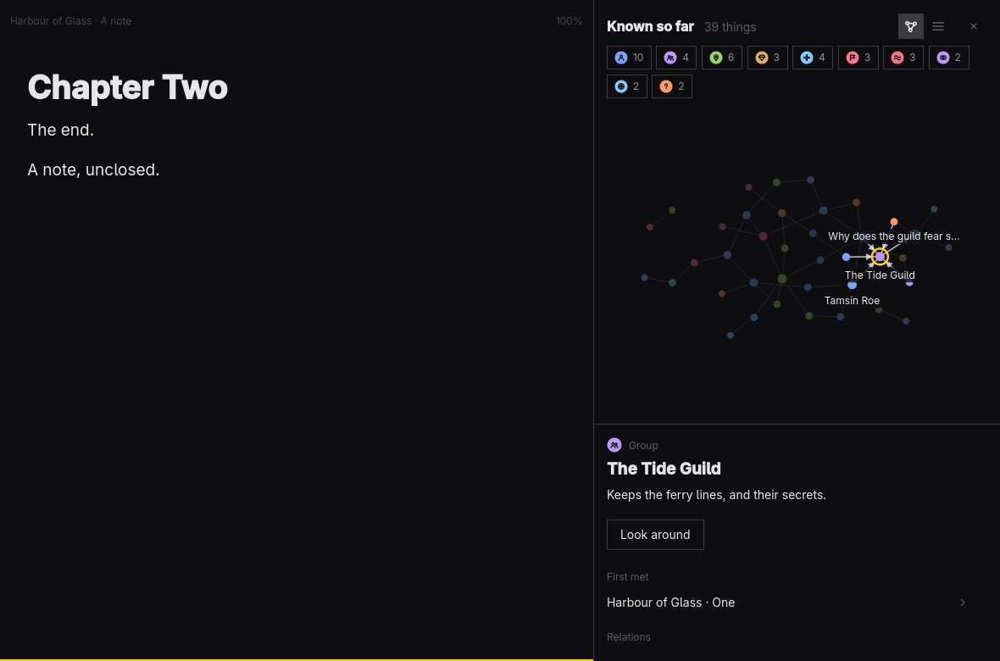

- **The picture.** Nodes are discs in the theme's colors, one per kind, each with a small drawing of its kind; the better connected a thing, the larger. Names appear where they fit, the hubs first, and more as you zoom in; what the relations say appears for the selected node and for all of them up close. Selecting a node lights it and its neighbours and dims the rest. Drag to move, scroll or pinch to zoom, `+` `-` `0` and `Shift` with a direction from the keyboard.
- **Walking it.** The arrow keys or `H` `J` `K` `L` go along a relation to the nearest neighbour that way, `Tab` goes through everything in order, `/` finds a thing by name. `Enter` puts the selected node in the centre and shows what is around it, `]` and `[` reach a step further or less, and `Backspace` goes back the way you came. `O` reads the selected book, or goes to the page a thing was first met on.
- **The details** beside it (`I`) say what a thing is and is also called, what is known of it, the books it is in and where it was first met in each, and its relations as lines to follow: "mentor of → Aldo". A book adds its status, stars and reading days; a question the gist of its answer.
- **The kinds above the picture** are its legend and its filter: a click leaves a kind out. `F` narrows by typing: a kind, one book or series, a world of its own, how far around the centre, or only what you have asked about.
- **Beyond this book.** Around a book's graph stands what its things connect to in other books: smaller, quieter, each named with the book it is from, and tied in by a dashed line in the accent color, which is how a connection between books is drawn wherever it shows. `X` or the switch beside the kinds takes the ring away. Selecting one of them says which book it is from, the connection in words and why it was made; `Enter` goes on to that book's graph around it (`Backspace` comes back) and `O` opens the book. It keeps to the same bound: beside the page, only connections noticed up to where you are. In the library's graph, `F` and *only connections between books* leaves just those and the books they join.
- **As a list.** `V` shows the same nodes as rows by kind, walked with the same keys, with what is in other books as a group of its own at the end, for when a picture isn't what is wanted or the window is small.
- **By hand.** `N` adds a thing (related to the selected one, if you say how), `E` renames it or rewrites what is said of it, `Shift+M` folds another thing into it when the two are one, and `D` removes it; a relation is removed with the cross on its line. Whatever takes something away asks first.


### In the text

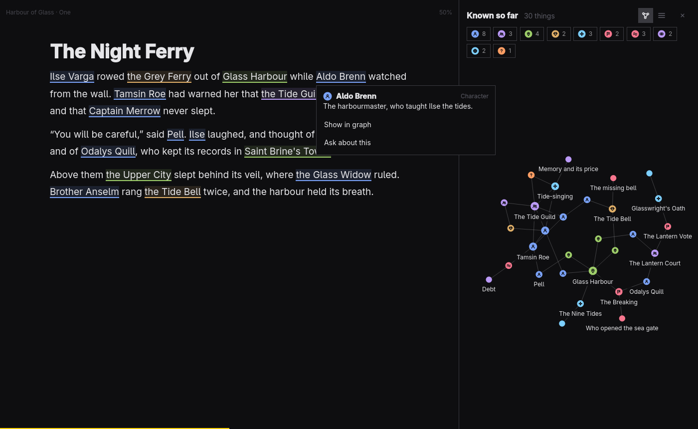

With the map beside the page, the names it knows so far are marked in the chapter: a faint tint and an underline in the color their kind has in the map, so a character is the same blue on the page as in the picture. Marking changes how letters are drawn, never their size, so the page doesn't move; `Shift+M` marks them always, or never (`"marks": "map"`, `"always"` or `"never"` in `config.json`). PDFs and comics are pictures and are not marked. Pointing at a name, or tapping it, shows a card: what it is, what is known of it, *Show in graph* and *Ask about this*. Selecting words (drag, double-click, press and hold, or `V` and then the arrow keys or `H` `J` `K` `L`, with `Shift` to widen, `Enter` for the menu) opens a menu beside them: *Ask about this*, *Who or what is this?* (answered from the graph when it knows the name, with no AI call; otherwise one short question with only the words and their paragraph), *Show in graph* or *Add to the graph*, *Find in book*, *Copy*, and up to three questions made from the graph (its threads, places and relations: "Why is Ilse at Glass Harbour?"). *More suggestions* asks the quick model once for that thing at that chapter. In the companion's answers, a who is who or a catch-up, the names the graph knows are marked the same way, and a click on one shows its card, which also goes to where it was first met.

A name is found as whole words, and its capitals count: the character "Will" is not the "will" of "she will", and a one-word name that is also an everyday word (one in a short list, or one the chapter itself uses in lower case) is only marked where it is capitalised in the middle of a sentence. A character is also found by a part of their name ("Ilse" of "Ilse Varga") when that part is no title and belongs to nobody else; the longest name wins, and a name never runs across paragraphs. Only what the reader has met up to their place is marked. A chapter's marks are worked out beside the window (about 7 ms for a chapter of 300,000 characters with 300 names), kept per book, chapter, text and names known, and taken from there when the chapter comes back; they are worked out again only when the graph of this book changed or the reader passed the place where something new was met. Nothing here asks the AI to read: the graph grows as it always did, at the end of a chapter, with the pages since; when it is behind, the card says how far it got.

The picture is laid out by a small simulation in which nodes push each other apart and relations pull them together. It starts from the same places every time, so the same graph is the same picture; it runs a few milliseconds at a time between frames, so a graph of thousands never stalls the window; and it stops when it has settled. When the graph grows while you read, what was there stays where it was. The ring of other books is held by its ties and kept outside, and the book's own things never feel it, so the picture inside is the same with it as without. The keys are a place of their own in `keys.json`, `"graph"`.

What is sent to grow it: the book's title and authors, the pages read since the last time, the names and short summaries the graph already holds for that book and the earlier books of its series, and up to forty names with one line each from the graphs of the other books you read. The connecting request sends no book text at all, only such names and lines from both sides.

## Commands

Everything the window does with the library, with no display needed. Every command takes `--json`, prints errors to standard error, and exits 0 or 1.

```text
omabook open [book]                     Open the window, and a book file or library number in it
omabook list [search]                   List the library's books
omabook show <id>                       Show one book's details and files
omabook add <file|folder>...            Copy books into the library; a Calibre library comes with its details
omabook remove <id>                     Move a book to the trash
omabook set <id> [--title ...]          Change a book's details or cover
omabook info [file]                     Show what a file says about itself, or what Omabook is set up with
omabook toc <book>                      List a book's contents
omabook text <book> [--section N]       Print a book as plain text
omabook find <book> <words>             Find words in a book
omabook lookup <id> [--ai] [--apply N]  Look a book's details up with every metadata plugin
omabook plugins [enable|disable <id>]   List plugins (built in, Calibre's, your own) or switch one
omabook plugin new|check|run|list|api   Write plugins of your own in JavaScript; see omabook plugin --help
omabook plugin install <folder|zip>     Install someone else's plugin, checked first and left off until enabled
omabook plugin remove <name>            Move one of your own plugins to the trash
omabook plugin add <github address>     Install a plugin from a GitHub repository and keep it up to date from there
omabook plugin sources [--updates m]    Where plugins came from and what each follows; what is done about updates
omabook plugin update [<name>|--all]    Install what is newer (--check only says; --yes approves new permissions)
omabook plugin pin|follow|rollback|forget-source <name>   Stay at a tag or branch; follow the latest; one version back; stop updating
omabook calibre libraries|plugins|import  What was found of Calibre here; import its libraries
omabook catalog [search] [--format f]   Write the library as csv or bibtex
omabook customize [view]                Show where the interface's files live; copy a view there to edit
omabook convert <id> [--to format]      Convert a book and add the result to it
omabook export <id> <folder>            Copy a book's file out of the library
omabook ask <book|all> <question>       Ask the AI about a book, or about the whole library
omabook graph show|find|node|build|...  The knowledge graph of what is read; see omabook graph --help
omabook tidy [--ai] [--apply]           List duplicates, author spellings and series to tidy; make the changes
omabook suggest [--no-check]            Have the AI suggest what to read next, checked against the reading sites
omabook goodreads import|sync|export|shelves  Keep your Goodreads shelves and the library in step
omabook openlibrary sync|shelves        Bring an Open Library reading log into the library
omabook sites [connect|check|disconnect|sync]  The reading sites, and how you are connected to each
omabook change <wish> | --undo          Ask the AI to change how Omabook looks or works
omabook progress <id> [--section N]     Show or set how far a book has been read
omabook sync <computer[:folder]>        Bring this library and another computer's in step over ssh
omabook manifest                        Print the whole library as JSON, as sync reads it
omabook help [topic]                    Print the help the window shows: getting started, reading, keys, ...
omabook skill [install]                 Print the skill for coding agents, or install it
omabook mcp [install [agent]]           Run as an MCP server for agents, or register it with one
```

`<book>` is a number from `omabook list` or any book file, so `omabook text ~/Downloads/paper.pdf` works on a file that isn't in the library. `--library <folder>` points a command at another library.

## MCP server

`omabook mcp` runs Omabook as a [Model Context Protocol](https://modelcontextprotocol.io) server on standard input and output, so any agent that speaks MCP can work with your library: find and read books, fix their details, track what you read, tidy up, change how Omabook looks. It needs no display and works on the same library as the window, at the same time (each has its own connection to the database, and the window shows what an agent changed a moment later).

```bash
omabook mcp install            # register it with Omarchy's default agent
omabook mcp install codex      # ...or by name: claude, codex, grok, pi, opencode, agy
omabook mcp install --print    # change nothing; show the command and the configuration to add by hand
omabook mcp --tools            # list the tools
omabook mcp --library ~/Other  # serve one library, whatever the window has open
```

`install` runs the harness's own command (`claude mcp add --scope user omabook -- omabook mcp`, `codex mcp add omabook -- omabook mcp`, ...), prints it and what it answered, and changes nothing else; it only runs when you run it. Any other client takes `{"mcpServers": {"omabook": {"command": "omabook", "args": ["mcp"]}}}`. Omarchy has no registry of MCP servers of its own: what it shares between harnesses is `~/.agents/skills` (where `omabook skill install` puts the skill) and `~/.agents/AGENTS.md`, and it carries each harness's MCP servers across your accounts, so registering once is enough.

| Tools | What they do |
|---|---|
| `omabook_info`, `library_list`, `library_switch` | What Omabook is set up with; its libraries, and which is in use |
| `books_search`, `book_get` | Find books with the search language (`author:`, `status:`, `is:paper`, `rating:`, ...), a page at a time; one book in full |
| `book_add`, `book_add_format`, `book_add_entry` | Add files, folders or a Calibre library; another format of a book; a paper or wishlist book with no file |
| `book_set_details`, `book_set_reading`, `book_remove` | Change details or the cover; status, stars, the day finished; remove (to the trash) |
| `book_contents`, `book_text`, `book_find` | Read: the table of contents, a section's text in pieces, where words occur |
| `progress_get`, `progress_set`, `bookmarks_list`, `bookmark_add`, `bookmark_remove`, `notes_get` | The reading place, bookmarks, and the companion's recap and who-is-who notes |
| `lookup_candidates`, `lookup_apply` | Details from every metadata plugin, each saying what it adds and changes; take one |
| `tidy_propose`, `tidy_apply` | Duplicates, author spellings and series as proposals; apply the chosen ones |
| `ask_book`, `ask_library`, `suggest_reading` | Omabook's own AI, for a question that needs a whole book or the whole library |
| `catalog_export`, `book_export`, `book_convert` | The library as csv or bibtex; a copy of a book's file; a conversion with Calibre |
| `sync_status`, `sync_run` | Syncing with another computer |
| `plugins_list`, `plugin_set_enabled` | Plugins, and switching one |
| `plugin_install`, `plugin_remove` | Install a plugin from a folder or a `.zip`, checked first and left off; move one of your own to the trash |
| `plugin_add`, `plugin_sources`, `plugin_update`, `plugin_forget_source` | Install a plugin from a GitHub repository; where each came from; check or update them; stop updating one |
| `graph_find`, `graph_node`, `graph_book`, `graph_add`, `graph_link`, `graph_build`, `graph_export`, ... | The knowledge graph: search it, a node and its neighbours, a book's graph up to a place, add and relate things, grow it with the AI, write it as GraphML, DOT or Cypher, the reading log |
| `customize_get`, `customize_set`, `customize_undo` | `keys.json`, `style.json` and the look settings, changed with the same checks as a file edited by hand, and undone |

Other parts of Omabook add their own (script plugins, Calibre, reading sites); `omabook mcp --tools` lists what this build has. Every tool says in its annotations whether it only reads, changes something, or takes something away (`book_remove`, `tidy_apply`, `lookup_apply`, `bookmark_remove`, `book_add_format`), so a client can ask you at the right moments. Arguments are checked against each tool's schema, and what goes wrong comes back as the tool's result, in words the agent can act on. There are also four resources (`omabook://library/books`, `omabook://book/{id}`, `omabook://book/{id}/section/{n}`, `omabook://graph/book/{id}`) and two prompts (`tidy_library`, `fix_details`).

The server speaks protocol revision `2026-07-28` (no handshake: every request carries its version, and `server/discover` says what is spoken) and, for clients that open with `initialize`, `2025-11-25` back to `2024-11-05`. Requests are answered one at a time, in order.

## Install

Each release has a ready-built package for Arch and Omarchy (x86_64), built and tested in a clean container:

```bash
sudo pacman -U https://github.com/jellespijker/omabook/releases/download/v0.1.1/omabook-0.1.1-1-x86_64.pkg.tar.zst
```

Pick the newest release on the [releases page](https://github.com/jellespijker/omabook/releases); installed this way, a newer version is installed the same way. Omabook then appears in the app launcher (`Super + Space`).

## Build

Omabook needs what every Omarchy app needs (CMake, a C++ compiler, Qt 6 base, declarative, SVG and Wayland) plus `libarchive` and `poppler-qt6`. Calibre is optional, for the formats that are converted.

```bash
bin/build            # builds into build/
build/omabook open   # run it
bin/test             # the tests, offscreen
bin/sanitize         # the tests again under AddressSanitizer and UBSan
cmake --install build --prefix ~/.local   # put it in the app launcher
```

## How it is built

Four layers, each knowing only the ones below it. The window and the command line are two front ends on the same library.

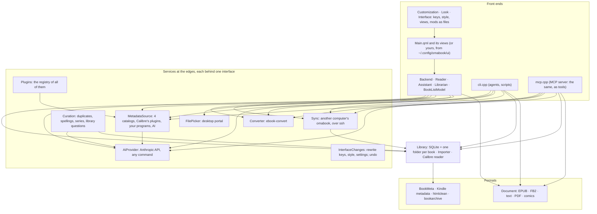

- **Formats** (`document.h`, `formats.cpp`, one `.cpp` per format). A book is a `Document`: it either flows (chapters as the small subset of HTML Qt lays out) or is made of pages (pictures). Nothing above this layer knows which format it is reading. **To add a format:** write one subclass and add one line to the table in `formats.cpp`.
- **Library** (`library.h`). The only code that touches the database or the library folder. It is plain C++ with no window in it, and each thread opens its own (SQLite's write-ahead log keeps the window, the import worker and a command in step).
- **Importing** (`importer.cpp`, `calibre.cpp`) is one function both front ends call, so a folder, a file and a Calibre library are brought in the same way from the window and the command line.
- **Calibre is one plugin behind one class** (`calibreplugin.cpp`). The registry, the importer's caller, the reader's converter and the command line all ask `CalibrePlugin` whether Calibre is used and for what it found, rather than calling Calibre's pieces, which is what makes the one switch real.
- **Sync** (`sync.cpp`) never opens the other computer's files or database itself: it runs that computer's own `omabook` commands over ssh, which is why the two databases can't corrupt each other, and why the tests can stand in for "another computer" with a second folder and a script in place of ssh.
- **Services** each sit behind a small abstract class with the real implementation and a stand-in for tests. **To add a catalog:** subclass `WebMetadataSource` and give it a line in `plugins.cpp`, or write it as a program in the plugin folder and touch no C++ at all. **To add an AI backend:** subclass `AiProvider`.
- **Plugins are processes, not shared libraries.** A plugin that is a program can be written in anything, can't crash the reader, and can't break when Qt or the compiler changes; that is also what lets Calibre's Python plugins run, inside Calibre, without Omabook embedding Python. The prompts live in `prompts.cpp`, free of any network or window code.
- **Script plugins are a service too** (`script*.cpp`). `ScriptPlugin` is one script in a `QJSEngine` of its own, timed by a watchdog thread; `ScriptPlugins` loads and follows the folder and is where the rest meets the scripts: `Backend` and `Reader` tell it what happens (`emitEvent`, `libraryChanged`), and look-ups, catalogs, the keys and the mods ask it for what the scripts added. The `omabook` object is built in `scriptprelude.js` from a host the script can't reach, and described by one table (`scriptapi.cpp`) that the reference, the guide, the skill and the MCP tool are all made from; a test holds the table and the live object to each other. None of it includes the window. **To give scripts something new:** a function in the prelude, its host method in `scriptplugin.cpp`, and its line in the table.
- **Front ends.** `Backend`, `Reader` and `Assistant` are thin `QObject`s that expose the layers below as properties for QML; `cli.cpp` exposes the same as commands and `mcp.cpp` as tools. What a command and a tool both do is written once, in `bookops.cpp`. **To add a tool:** one `Mcp::registerTool({...})` in the `.cpp` of the feature it belongs to (see `mcp.h`).
- **AI features are prompts plus plain code.** Each one is a pure function that builds a request (`prompts.cpp`, `curation.cpp`) and a pure function that reads the answer, with the deciding done in ordinary code: a tidy is a list of `Proposal`s that nothing applies until asked, and an interface change goes through the same checks as a file edited by hand. That is what lets every one of them be tested with a stand-in model.
- **Help is data too** (`manual.h`). The help's pages are text in `helptopics.cpp`, shown by the window and printed by `omabook help`; they name a command as `{library.add}` and the key is filled in from `keys.json`, so the help can't disagree with the keyboard. The list of keys is the commands table itself, and Enter in the help runs a command through the same `Key` its shortcut uses. The tour is a list of steps in `tour.cpp`, each naming the `objectName` it points at. **To announce a feature in a release:** add one entry to `whatsnew.cpp` (an id, the version it arrives in, a title, a sentence or two, and optionally the `objectName` to point at and the command it is about; the comment at the top of the file says how) and translate its two texts. Whoever last saw an older version is offered a tour of what arrived since. A test (`whatIsSaidStillExists`) fails when an entry, a tour step or a help page names a command or an `objectName` that no longer exists.
- **The interface is data.** Keys are commands with defaults (`Customization::commands()`), bound in QML through one `Key` component, so a new action is one line in that table and one `Key`. Views are loaded by `Interface`, which reloads them when a file in `ui/` changes and falls back to the built-in ones when a file doesn't load.

**Window sizes.** Omabook lives on a tiling desktop, so its window is a narrow column one moment and a whole screen the next, and is laid out for all of it down to 420 by 360. `Main.qml` names how much room there is, and the views decide by the names instead of by numbers of their own: `win.compact` (narrower than 700: one thing at a time, dialogs edge to edge, rows of fields stacked), `win.medium` (700 to 899), `win.expanded` (900 and wider: two things side by side, as in the plugin manager) and `win.low` (shorter than 520: one row of filter chips, a smaller cover over the details). Two things are measured rather than classed. The library's header gives things up in a fixed order until its words fit, because how long they are depends on the language: the count goes, then the buttons under fingers fold into one, then “Filter” and the order become drawings, then the ways to show the shelf fold into one that lists them, then the search field becomes a drawing that opens over the header, and the library's name elides last. And a pane (`SidePane.qml`: the details, the contents, the AI, the map, the plugin list) stands beside the shelf or the page while that keeps `win.contentFloor` (440), and lies over it when it wouldn't; its inner edge drags, `<` and `>` move it, a double click resets it, and its width is kept in `config.json` under `pane_widths`. A dialog is an `AppPopup`, never larger than the window, holding a `DialogBody` that scrolls its content and keeps its buttons in view. All of this is kept by `tests/layout_tests.cpp`, which shows the real window with a made-up library of very long titles at a matrix of sizes (420 to 2560 wide, 360 to 1200 high) in English and German, with a mouse and under fingers, in every view, with every pane, and with every dialog open, walks the items on screen, and fails with the item's name, text, file and size when a text or a control is outside its window, dialog or pane, a text is wider than its width without eliding or wrapping, a button's caption is cut, two neighbours overlap, or something to tap is smaller than a fingertip. `OMABOOK_SHOTS=<folder>` saves a picture of each state, and `OMABOOK_LAYOUT_FULL=1` walks every size instead of the sample that runs on every push.

| 480 wide, in German, five filters on: before and after | 1180 wide, in German, under fingers: before (above) and after |
| --- | --- |
|  | 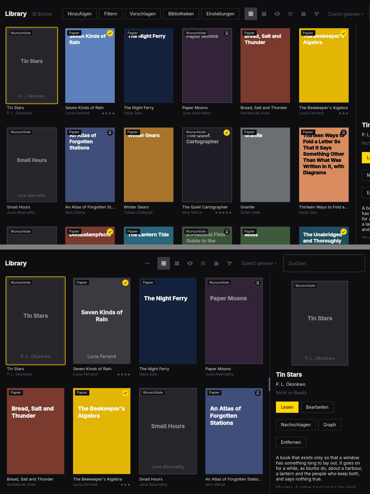 |

Two decisions worth knowing before changing things:

- **Books are set in your type, not the publisher's.** Chapters are reduced to their structure (headings, paragraphs, emphasis, lists, tables, pictures, links) and laid out by Qt's rich text. That is what makes every book follow the theme and the font size, and it keeps a browser engine out of the app. The cost is that a publisher's own layout (floats, drop caps, embedded fonts) is not reproduced; the stylesheet's italics, bold and centering are.
- **Formats Omabook doesn't read are converted, not reimplemented.** Calibre's converter does that well, so Omabook leans on it the way video apps lean on ffmpeg, and says what is missing when it isn't installed.

The layering is kept by a test (`theLayersPointOneWay` in `tests/library_tests.cpp`): a format or library file that includes anything from the window fails the build's tests. Each layer has its own test binary, the real window is driven by keyboard in `tests/ui_tests.cpp` and fails on any QML warning, and `tests/cli_tests.sh` runs the real binary with no display.

## Upgrading

A newer Omabook opens an older library and brings it up to date by itself. Nothing needs to be exported or converted.

- **A copy is kept first.** Each time an update changes the library's format, the database is copied to `.backups/` inside the library folder before anything changes (`omabook-format-<n>-<date>.db`; the last five are kept). A library that can't be copied is left untouched and Omabook says why.
- **Each change is all or nothing.** The steps from one format to the next run one at a time, each in a transaction; a step that fails is undone and the library stays as it was.
- **There is no going back in place.** An older Omabook refuses a library a newer one has opened and says so. To return to an older version, close Omabook and put the copy from `.backups/` back as `omabook.db`.
- **Two computers.** Both should run the same version. If one is newer in a way the other could misread, syncing stops and names the computer to update; nothing is exchanged until then.
- **Settings** in `config.json` carry a version too. A setting that is renamed in a later release is carried over, and settings a newer Omabook wrote are kept when an older one saves the file.
- **Plugins** keep working across updates of Omabook as long as they use the documented API (`omabook plugin api`). A plugin says the oldest Omabook it runs on with `"omabook": "<version>"` in its `plugin.json`; one written for a newer Omabook than yours is not loaded, and says which version it needs.

For whoever changes the format: add a step to the list in `Library::open` (never edit an old one), add `tests/data/library-<version>.sql` for the release being cut (a dump of a small made-up library), and the test `everyReleasedLibraryStillOpens` then holds every later version to opening it with nothing lost. A change to the sync manifest's shape raises `manifestVersion` in `sync.cpp`; a renamed setting gets a step in `Settings::upgraded`.

## Known limits

- Books with DRM can't be opened; Omabook says so rather than failing blankly.
- Highlights and notes in the text are not there yet (bookmarks are).
- Sending books to an e-reader and writing details back into a book's own file are not there yet.
- A sync carries books and reading places, not bookmarks or the AI's notes.
- Goodreads can't be written to: Omabook's reading goes back as a file you upload on Goodreads' import page. Its live shelves are shown to almost nobody who isn't signed in; the export file always works. Reviews are not brought in.
- Open Library's reading log has no word for half stars or re-reads, and its stars and finished dates come from an address its own pages use, which could change; the shelves themselves do not depend on it. Hardcover's half stars are rounded to whole ones here.
- Signing in to Hardcover through its own sign-in page (rather than a pasted token) is not there yet.
- Errors that come from the lower layers (a file that can't be read, a catalog that can't be reached) are shown in English whatever the desktop's language.
- The window ships in English, Dutch, German, French and Spanish; other Omarchy languages show English until someone adds a catalog under `src/i18n/` (`bin/i18n` regenerates `en.json` from the sources).

## License

MIT. The theme, translator, build scripts and portal file picker come from the Omarchy apps by David Heinemeier Hansson, under the same license.

### Calibre

Omabook works with [Calibre](https://calibre-ebook.com) by Kovid Goyal and contributors, which is free software under the GNU GPL v3. Calibre is not part of Omabook and none of its code is included: Omabook reads the libraries Calibre keeps (its `metadata.db`), reads Calibre's settings to find them, and runs Calibre's own programs (`calibre-debug`, `ebook-convert`) when Calibre is installed. The idea of an ebook library with plugins for metadata sources, formats, conversion and catalogs, and several of the names used for them, are Calibre's, and Omabook owes it that. The one file that runs inside Calibre and uses its Python modules is `share/omabook/calibre_bridge.py`. For that reason it alone is under the GPL v3 or later, and it is installed beside Omabook as a separate file rather than built into the program.

Omabook's Goodreads support is its own code, but it learned from two Calibre plugins by Grant Drake (kiwidude), both under the GPL v3: *Goodreads*, the metadata source, and *Goodreads Sync*. None of their code is used or was translated. The ideas taken from them are that a book's page is still served under its address with `.xml` on it when the bare address is not, and is worth asking for again when it comes back empty; that the search box answers an ISBN; that a search result filed under the author "NOT A BOOK" is not one; that the date a reader means is when the book first came out; how a series is read from a title, an omnibus counting from its start; and the names Goodreads Sync proposes for its Calibre columns (`#goodreads_tags`, `#goodreads_rating`, `#goodreads_date_read`, `#goodreads_reading_progress`), which a Calibre import now recognises.

### Libraries

Omabook is built on Qt 6 (LGPL v3), libarchive (BSD) and Poppler (GPL), which draws PDF pages. Because Poppler is under the GPL, a built Omabook that includes PDF support is distributed under the GPL's terms, although Omabook's own source stays under the MIT license.
