# Omabook


Your ebook library and reader for [Omarchy](https://omarchy.org). Add books of any kind, keep their details straight, and read them, from the keyboard, in the desktop's theme and language. AI is built in rather than bolted on: it reads along with you, names the books no catalog knows, and every part of the library is a command an agent can run.


## What it does

- **A library that is a folder.** Books are copied into `~/Books` under `Author/Title (id)/`, with their cover beside them and one SQLite file for the rest. The file you added is never touched, and the folder can be backed up or synced as it is. Keep several libraries and switch between them.
- **Reads what you have.** EPUB, FictionBook (`.fb2`, `.fb2.zip`), Markdown, HTML and plain text flow in your own font and the desktop's colors. PDF and comics (`.cbz`, `.cbr`, `.cb7`, `.cbt`) are shown page by page. Kindle (`.azw3`, `.azw`, `.mobi`), Word, OpenDocument, RTF, DjVu and the other formats Calibre knows are converted to EPUB the first time you open them, which needs Calibre's `ebook-convert`; the original stays beside the result.
- **Takes over from Calibre.** Omabook finds your Calibre libraries and offers to import them; every book comes across with the details you curated there, its cover, all its formats, and what Calibre knows of your reading: what you have read and are reading, your stars, highlights, and what Goodreads and others call the book. Calibre's folder is only read. See [Calibre](#calibre).
- **Several libraries, several computers.** `O` switches between libraries. `Y` syncs the open one with another computer over ssh (see below).
- **Works with fingers.** On a touchscreen, tap a cover to open it; while reading, a button in the corner shows the contents, find, the AI and the rest; swipe sideways to turn the page (it follows your finger) or tap the right or left edge, pinch to resize, and tap mid-page for buttons to everything else.
- **Gets the details.** `M` asks every source that is switched on (Open Library, Google Books, Apple Books, Crossref, Calibre's own metadata plugins, and any you add), shows how each one answered, and says for every result what it would add to the book and what it would change. The AI then weighs those results against the book's own opening pages and puts its recommendation, with its reason, at the top. `E` edits by hand.
- **As many pages as the window has room for.** A line of text is as long as reads well and no longer: 66 characters by default, counted in the font and size you read in, so it stays 66 characters when the type grows. Where the window has room for more than one page of comfortable lines, it is an open book of two pages side by side, or three on a wide screen, cut between lines, each carrying on from the one before, and a turn moves on by the whole spread. Where it hasn't, one page scrolls, centred, with the room to spare as margins. A pane beside the page takes from that room like a narrower window. PDFs and comics pair up on their own.
- **Pages or scroll.** `Shift+L` (or *Layout* in the *Aa* panel) chooses how a book is read through, for every book, a collection or one book. *Pages*: one column is cut into pages too, and a turn (`Space`, `→`, the wheel, a swipe or a tap at the edge) shows the next whole page, never a line again or a line cut in half; each chapter starts on a page of its own and its last page holds only what is left, so turning on from it opens the next chapter's first page, and back from a first page the previous chapter's last. A PDF or a comic page is shown whole in the window, and two side by side open as a printed book does, page 1 alone and then 2|3, 4|5 (*First page alone*, on by itself for a PDF whose first page is taller than wide, off for slides and comics, whose pages usually come paired). *Scroll*: one centred column at any width that runs on through the book: at a chapter's end a quiet line says *End of chapter · next:* and the next title, a click or a tap on it goes on, and so does scrolling on past it with the wheel, a finger pulling past the end or a step at the end; scrolling up at the top goes back to the end of the chapter before. A screen's step shows nothing twice: it goes on from the first line that wasn't wholly in sight, and in a PDF it lines up with the next page's top. *Automatic* is pages where two or more fit side by side and a scrolling column otherwise. `PgDown` and `PgUp` go by chapters, in a PDF by its outline: the next one, or the start of this one and then the one before. The place you are at is kept from one layout to the next.

  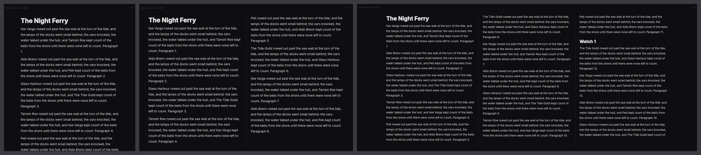
- **The text set your way.** `Shift+A` (or *Aa* in the bar under fingers) opens a panel beside the page: the font and its size, the longest line in characters, the layout (*Automatic*, *Pages* or *Scroll*), how many pages stand side by side (*Automatic*, or one, two or three), the space between lines and between paragraphs, a first-line indent, the margins, and the alignment: start, justified (filled out to both sides), centred or end, where start and end turn round in a right-to-left language. Justified text breaks long words at the end of a line by the book's language, as a printed book does, so its lines aren't filled with wide gaps (*Hyphenate*, on unless you switch it off, where a dictionary for the language is installed: `hyphen-en`, `hyphen-de`, `hyphen-nl` and so on); what you select, copy or search for has no hyphens in it. Every change shows at once and the page stays at your place. *Only this book* keeps a change to the book in front of you, in the library beside its reading place; *Reset* puts back what there was when the panel opened. The defaults are in the settings too, and `omabook format` and the MCP tools set the same. PDFs and comics are pictures and are shown as they are, but for their layout and whether their first page stands alone.

  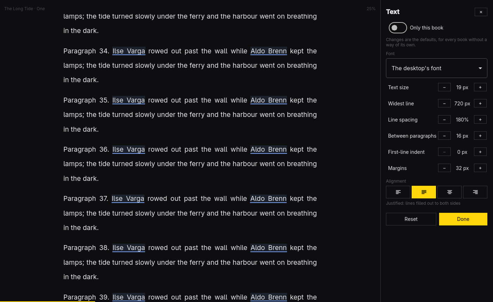
- **An index beside the page.** `T` opens the book's chapters as a tree at the side: click one to go there, fold the ones with parts, and see which you are in. `F` is the opposite: the book and nothing else, on the whole screen.
- **Remembers your place**, your bookmarks, and how far through each book you are.
- **Yours to change.** Every key, color, view and panel is a file in `~/.config/omabook/`, followed while the app runs (see *Make it yours*).

## Views

The library is one shelf looked at five ways. `1` to `5` pick one, `V` goes to the next, and so do the small drawings beside the search; each library remembers its own. Whichever it is, the same keys move, open and edit, a click selects and a double click opens, and a finger opens with a tap. A right click or a long press on a book lists what can be done with it, its details among them.

| | |
|---|---|
| 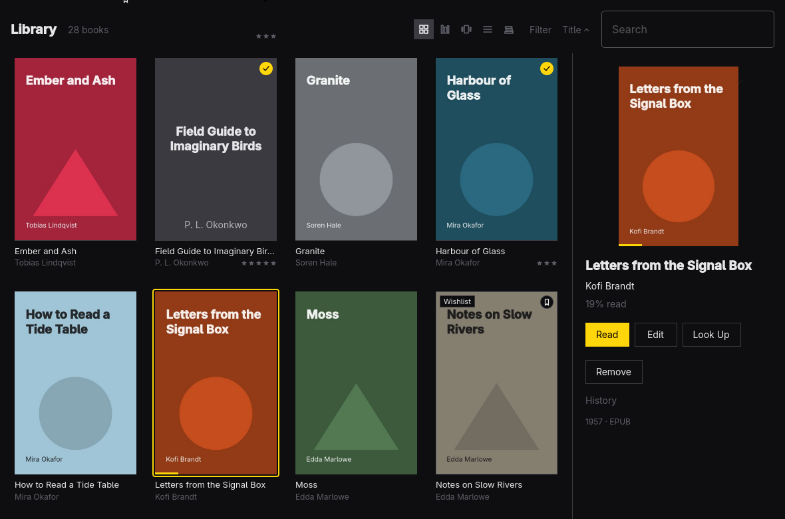 | **Covers** (`1`). Every book face out. A book on paper or only wished for says so in a corner, a finished one is checked, and stars show where you rated it. |
| 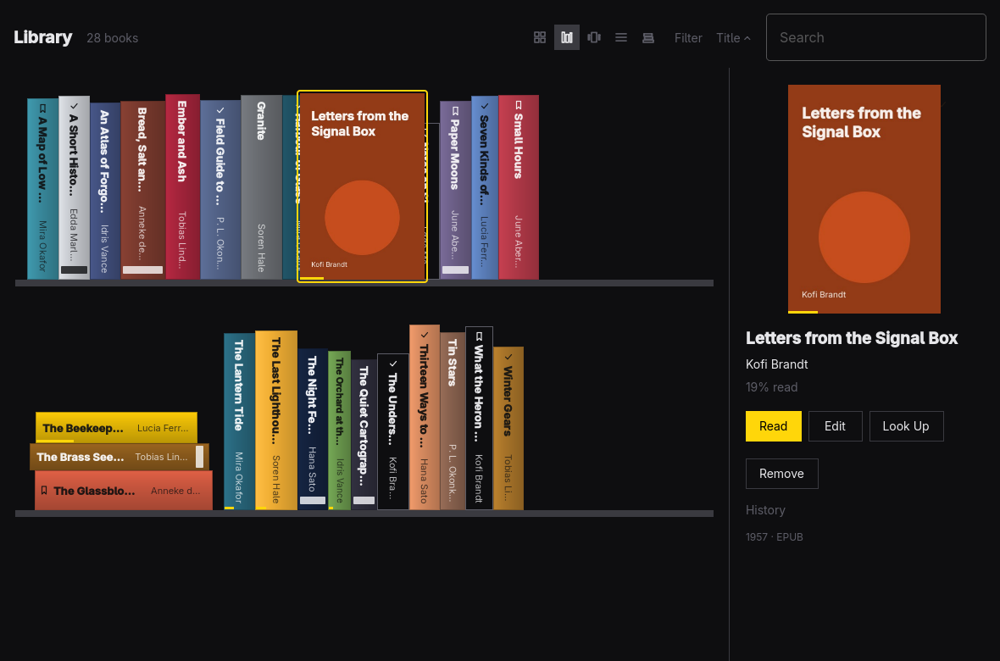 | **Spines** (`2`). A bookshelf: each spine as thick as the book is long and bound in its cover's color, a few lying flat in piles, always the same ones. The selected book is pulled out to show its face. Paper books carry a label at the foot; a wish is an outline. |
|  | **Carousel** (`3`). The selected cover large in the middle and what it is underneath; `H` `L`, the arrows or a swipe slide the row. |
|  | **List** (`4`). A line a book: title, author, series, status, rating, format, added. Click a heading to sort by it and again to turn it round; `H` `L` walk the order along the headings. |
| 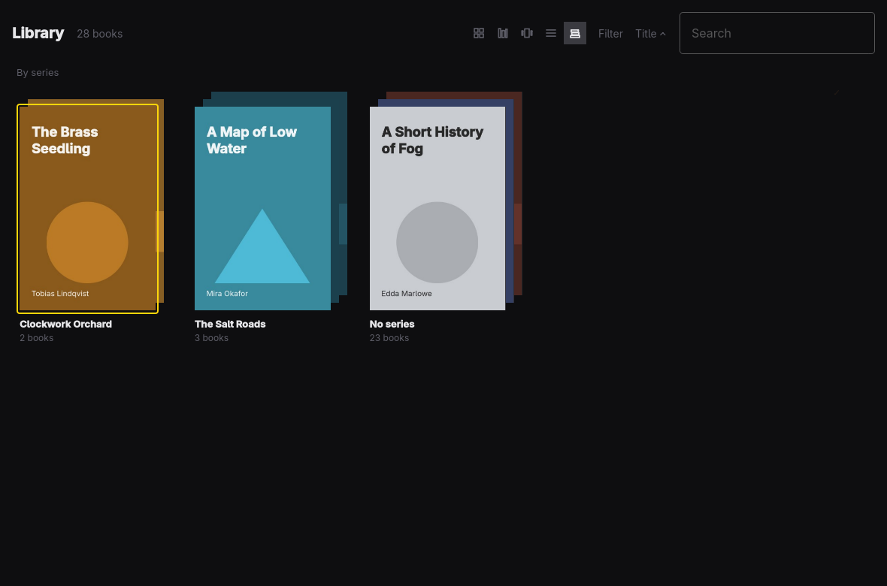 | **Stacks** (`5`). A pile per series; `G` piles by author, tag or reading status instead. `Space` opens a pile into its books, `Esc` closes it. |

The shelf is ordered with `S` (recently read, title, author by last name, series, recently added, progress, rating, published, finished) and `Shift+S` turns the order round. `F` filters it: type a few letters of a reading status, paper, digital or wishlist, a format, a language, a tag, an author, a series or a rating, and Enter takes the match. Filters add up, show as chips that a click removes, work together with the search, and `Shift+F` clears them. The order is kept for every library, the view and the filters for each.

It follows the theme, light or dark:


## Collections

One library can be split into parts of your own, such as fiction and the books you study. A collection is a saved selection, not a place: a book can be in several, and nothing is copied or moved to put it in one. The shelf and your reading history keep seeing every book; the knowledge graph, and what the AI is told from it, keeps each collection at the top apart, as a graph of its own (see [Each top-level collection is a graph of its own](#knowledge-graph)).

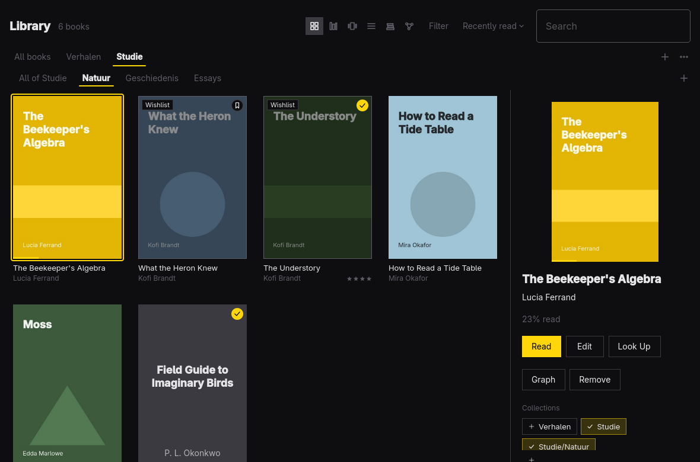

- **Tabs above the shelf.** Once there is a collection, the shelf has a row of tabs: *All books*, then each collection at the top. A click or a tap shows one, `]` and `[` step through them, and `C` lists them all with what can be done: show one, make one, change the one shown, or have the AI sort books into them. Where the window is too narrow for every tab, the row scrolls and keeps the one shown in view. A right click or a long press on a tab changes that collection.
- **Inside one another, named as you like.** A collection can hold others, to any depth and in any language: `Werk/Hydraulica` is *Hydraulica* inside *Werk*. Opening one that holds others shows them in a second row of tabs under it, after *All of* it. A collection holds its own books and every book of the collections inside it.
- **Filled by a rule, and by hand.** Each has a rule, a search as `/` and `omabook list` take it, and the books you put in or take out yourself, which win over the rule. A book that arrives later lands in every collection whose rule finds it, and one added while a collection is shown goes into that one too. `Shift+C`, or the chips under *Collections* in the details beside the shelf, put the selected book in a collection or take it out. A collection without a rule holds only what you put in.
- **Each keeps its own view and order.** The view, the stacks and the order are the collection's own, so going from one to another shows each as you left it; *All books* keeps the library's. Which one is shown is remembered per library.
- **Its own reading format.** In the *Aa* panel, *For this collection* sets the type for every book of the collection that has none of its own: justified text for novels, longer lines for technical books. A book's own way wins over its collection's, and the collection's over the defaults. A book in several collections is set as the one it was opened from, or else the deepest one that has a format.
- **Sorted by the AI, as proposals.** *Sort with AI* (in the `C` list, or *Also sort … into collections* in the tidy, `Shift+T`) asks the quick model where each book belongs that isn't yet in a collection with none inside it: in a collection you have, or in a new one anywhere in the tree, named in the style and language of yours. It is told the books' titles, authors, tags and the start of their descriptions, never their text, eighty books to a request and at most 1,200 books in one pass, so a library of a thousand books costs about thirteen small requests. A book it can't place with confidence is listed as *Yours to decide* rather than guessed. Nothing changes until you tick what you want and apply it.
- **Asking within one.** With a collection shown, *Only the books in …* in the ask dialog (`W`) keeps the question and the suggestions to that collection. The graph (`6`) shows one top-level collection's graph at a time, `C` there chooses which, and `F` narrows it to a collection inside it.

The search language a rule is written in: bare words look in the title, authors, series and tags; `author:`, `title:`, `series:`, `tag:`, `format:`, `lang:`, `publisher:` and `about:` (the description) look in one field; `status:` (to-read, reading, read, unread), `is:` (digital, paper, wishlist) and `rating:N` go by your reading; `genre:fiction` and `genre:nonfiction` know the many tags each is spelled as (*Fantasy*, *Thrillers*; *History*, *Programming*), and `genre:` with anything else looks in the tags. `"Quotes"` keep words together, `-word` leaves out, and `OR` joins alternatives: `genre:fiction OR series:Dune -tag:poetry`. Hand-picked books win over any rule, so a rule only has to be roughly right.

Collections are kept in the library's database, so they go wherever the library goes: a backup, another computer, the command line and agents all see the same ones.

## Search

`/` searches the shelf as you type, in the search language above, and finds more than a rule does:

- **What you know finds books too.** A bare word also finds a book by the characters, places, groups, ideas, items, events, plot threads, themes and topics the [knowledge graph](#knowledge-graph) met in it, and by the questions you asked of it: `venn` finds the book Mara Venn is in. `knows:` looks there and nowhere else (`knows:"control theory"`, `-knows:tobin`). A word finds a thing when it begins one of its names, or a word of one, so `venn` finds *Mara Venn* and `enn` doesn't; `knows:` also looks in what is said of it.
- **Never past where you are.** Only what you have read counts: all of a book marked as read, up to the furthest page of one you are reading, and nothing of a book you haven't begun, however far its graph was built. A name a character is given later, or what is said of a thing further on, isn't searched. What you added by hand without a place (a name, a summary, a question) is yours and always counts.
- **It says why.** A book found that way says so on the shelf, along the foot of its cover or after its title in the list (*Mara Venn (Character)*, with the mark of a shared graph when it came from one), and in full in the details beside the shelf (*Found by what you know: Mara Venn (Character)*), with *Show in the graph* (`Shift+I`) and *Go to the moment* (`Shift+Space`), which opens the book where you met it, the words lit.
- **Fast on a large library.** The graph is read into memory once, beside the window, when a search wants it and the library has changed since; typing then looks only there, a word a moment after you stop typing. On a library of 1,600 books with a graph of 120,000 things across 300 of them, that reading takes about a second and a half, and a new word about 5 to 10 ms. While the graph keeps growing (a book being read) it is read again at most every second plus four times as long as the last reading took. A collection's rule and `omabook list` keep to the books' own details: a rule holds the same books for everyone who opens the library, whatever they have read.

**Asking the AI.** For what no search can put, *the books where a mentor dies* or *something about control theory I haven't finished*, start the search with `?` and press Enter, press `Shift+W`, or the *AI* button in the search field; a search that finds nothing offers it too. The quick model reads the books of the collection shown, 120 to a request and three requests at a time, each book as its title, authors, series, tags, how far you read it, the start of its description and the things the graph knows of it as far as you got, never its text, and names the books that answer, a reason each. They come in as each batch is read, the best first; Enter or a click opens one. It can be stopped, says in plain words when it can't answer, and an answer is kept with the library's change counters, so the same question of an unchanged library isn't asked again. A library of 1,600 books is 14 requests.

## Keys

These are the keys as shipped; every one can be changed in `keys.json` (see *Make it yours*), and `?` always shows the ones in force.

| Library | | Reading | |
|---|---|---|---|
| `Space` | Read the selected book | `Space` `→` | Turn the page (scrolling, a screen on), and on to the next chapter |
| `H` `J` `K` `L` | Move around the shelf | `Shift+Space` `←` | Turn the page back (scrolling, a screen back) |
| `/` | Search (`author:`, `title:`, `series:`, `tag:`, `format:`, `lang:` look in one field) | `J` `K` | Scroll a few lines |
| `A` | Add books | `PgDown` `PgUp` | Next chapter; the start of this chapter, then the previous one (also `L` `H`) |
| `Shift+A` | Add a folder of books | `G` `Shift+G` | Start or end of the chapter |
| `E` | Edit the book's details | `T` | Show or hide the contents beside the page |
| `M` | Look the details up, online and with AI | `/` | Find in the book |
| `X` | Save a copy of the book elsewhere | `B` | Bookmark this place |
| `D` | Remove the book (it asks first) | `A` | Ask the AI about what you are reading |
| `S` `Shift+S` | Change the order, or turn it round | `+` `-` | Larger or smaller |
| `F` `Shift+F` | Filter the shelf, or clear the filters | `Shift+A` | How the text is set: font, size, longest line, pages, spacing, margins, alignment |
| `1` `2` `3` `4` `5` | Covers, spines, carousel, list or stacks | `Shift+P` | Pages side by side: as many as fit, one, two or three |
| `6` `U` | The library, or the selected book, as a graph of what is known | `M` | The map of the book so far, beside the page |
| `V` `G` | The next view, or stack by something else | `Shift+L` | Pages, one scrolling column, or automatic |
| `O` | Open another library | `F` | The book and nothing else, full screen |
| `C` | The collections: show one, make, change or sort them | | |
| `]` `[` | The next or previous collection | | |
| `Shift+C` | Put the selected book in collections, or take it out | | |
| `Shift+P` | Publish the collection shown, for others to subscribe to | | |
| `Shift+O` | Subscribe to a collection someone shared | | |
| `P` | Plugins | `C` | Have the AI catch you up |
| `Shift+T` | Tidy the library | `W` | Who is who so far |
| `T` | When the selected book's events happen, on their timelines | `Shift+T` | When this book's events happen, as far as you have read |
| `W` | Ask about your library | `V` | Select words with the keyboard, to ask about them or find them |
| `N` | Suggest what to read next | `Shift+M` | Mark the map's things in the text: while the map is open, always, or never |
| `Shift+R` | What you read, added up, and the year's goal | | |
| `Ctrl+K` | Change Omabook (anywhere) | | |
| `Y` | Sync with another computer | `Esc` | Back to the library |
| `I` | Show or hide the details | | |
| `<` `>` | The pane beside the shelf or the page, narrower or wider (or drag its edge; a double click puts it back) | `<` `>` | The same |
| `,` | Settings | | |
| `?` `F1` | Help: every key, pages on how things work, and the tour | | |
| `Q` | Quit | | |

Books can also be dropped on the window.

**With a mouse or a finger.** Nothing is the keyboard's alone. The ⋯ in the header of the shelf lists everything the shelf can do, each with its key (adding books, collections, sync, tidying, plugins, settings, help, quit), and the commands plugins add there; a right click on a book, or **More** in its details, lists what can be done with that book. Over the page the ⋯ in the corner, or **More** in the bar a finger brings up, does the same for reading, and the graph has its own. The list narrows as you type, like every list in Omabook.

## Help and the tour


`?` (or `F1`) opens the help wherever you are. It lists every key **as it is bound now**: change one in `keys.json`, or add a plugin with a command of its own, and the help shows it without anyone having written it down: a plugin's keys under its name, each saying whether it works on the shelf, while reading or anywhere, for as long as the plugin is on. After them come the keys a panel or dialog has of its own (the menu beside selected words, the contents, the Aa panel, the plugin manager, the tour...), under the panel they work in. Type what you want to do ("add a folder", "how do I bookmark") and the list narrows to the commands and pages that match; Up and Down pick one and Enter runs it, so the help is also a way to do things. Typing only ever searches. Opened over a book, the reading keys come first.

Beside the keys are a few short pages: getting started, reading, the AI companion, your library, the chronology, plugins, Calibre and Goodreads, other computers, sharing, and one for agents. Tab turns to the next. Each lists the commands it mentions, and the same pages print in a terminal:

```bash
omabook help             # the commands, and the topics
omabook help reading     # one page; --json for an agent
omabook help keys        # every key, as keys.json has it now, a plugin's and a panel's too
omabook help new         # what this version brought
```


**The tour** is a short walk through the real window: it dims everything but the part a card is about (the search, the views, a book, its details, and in a book the contents and the companion), a sentence or two each. Arrows, Space or Enter go on, Backspace goes back, Escape leaves at any step, and all of it works with a finger. On a first start it is offered once, in a note at the bottom that takes no focus; whatever you answer, it is not offered again, and it stays under `?` ("Take the Tour"). With no books yet it starts with how to get some.

**What's new.** When a newer Omabook has something to show, the same quiet note offers a tour of just the new things. "What's New" in the help shows them again at any time.

## Plugins

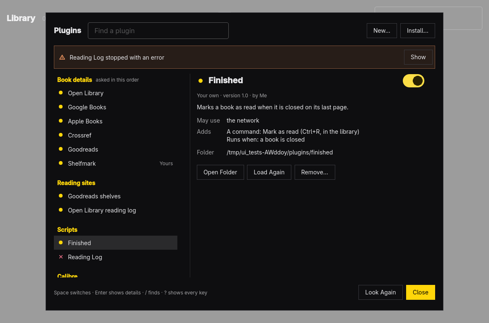

`P` opens the plugin manager (`omabook plugins` lists the same): what Omabook is made of and what has been added to it, sorted by what each plugin does (sources of book details, reading sites, your scripts, Calibre and what it found, formats, catalogs, AI) with a quiet mark for each one's state: on, off, needing something, or broken. Beside the list are the selected plugin's details: where it comes from and its version, the fields a source brings, what a script registered (commands with their keys, panels, hooks, sources) and what it asked to be allowed, in plain words, and its last error with file and line and a way to try again. When something needs attention (a script that stopped, a program plugin whose program is missing, Calibre switched off while its library is here) one line at the top says so and leads to the plugin.

Everything in it has a key; `?` shows them all in the dialog.

| Key | In the plugin manager |
|---|---|
| `Up` `Down` `J` `K` | Move through the plugins |
| `Space` | Switch the selected plugin on or off |
| `Enter` | Show its details (where the window is too narrow for both) |
| `/` | Find a plugin by name, kind, origin or state |
| `N` | Start a plugin from a template, and open its folder |
| `I` | Install a plugin: find one, or name its repository, a `.zip` or a folder |
| `T` | Try one look-up against a source and see what comes back |
| `Alt+Up` `Alt+Down` | Ask a source earlier or later |
| `A` | Show the next plugin that needs attention |
| `O` | Open the plugin's folder |
| `R` `Shift+R` | Read the plugin folder again; load this script again |
| `D` | Remove a plugin of your own (it asks first; to the trash) |

- **The order sources are asked in** is the order of the list, and yours to change; it is kept in `config.json` as `plugin_order`.
- **Installing** a plugin someone else wrote (`I`, or `omabook plugin install <folder|zip>`) checks it first: it must hold a `plugin.json` naming a script or a command, ask only for permissions Omabook knows, and stay inside its own folder (no `../`, absolute paths or links) and under 64 MB. Nothing is put in the plugin folder until then, you are shown what it asks to be allowed, and it stays switched off unless you say otherwise (`--enable`). One that replaces a plugin of the same name (`--replace`) sends the old one to the trash and keeps its `data/`.
- **Removing** (`D`, or `omabook plugin remove <name>`) is for your own plugins and moves the folder to the trash. What is built in, and what Calibre brings, can only be switched off.
- **From GitHub, and kept up to date.** `I` and a repository's address (`owner/repo`, a link to it, or a link to one of its releases, tags, branches or folders), or `omabook plugin add <address>`, fetches a plugin from a public GitHub repository without git, over HTTPS from GitHub's own addresses only, and puts it through the same check. Where it came from is remembered in `sources.json` beside the plugins (not in `config.json`, which is yours to edit; this is Omabook's bookkeeping, rewritten at every check). A source follows the repository's latest release, or its default branch where it has no releases; `omabook plugin pin <name> <tag|branch>` stays at a tag or follows another branch. Once a day, after the window is up, each source is asked whether there is something newer (an unchanged one costs GitHub nothing, and when GitHub asks to wait, Omabook does), and what happens next is a setting (`,`, or `omabook plugin sources --updates auto|tell|never`):
  - *Install by themselves* (the default): an update that asks for **no new permission** goes in, keeping the plugin's `data/` and whether it was on or off, and a line says so ("Storyteller was updated from 1.0 to 1.1"). The version before is kept for one step back (**Roll Back**, `omabook plugin rollback <name>`), and an update that doesn't load is rolled back by itself.
  - An update that asks for a **new permission**, or goes by another name, is never installed by itself: the line at the top of the plugin manager says "Storyteller has an update that asks for the network: review", and it waits for you (`omabook plugin update <name> --yes`).
  - A repository that is gone, has moved, or no longer holds a plugin leaves the installed plugin untouched and is reported the same way. **Forget the Source** (`omabook plugin forget-source <name>`) stops the updates and keeps the plugin.
  - Private repositories need a token: `omabook plugin token` reads one from standard input into the desktop's keyring (never `config.json`), and it is sent to `api.github.com` only.
- **Plugins to try.** `I` opens on "Find plugins": a list to search, with an Install button on each, which goes through the same checked install (what it asks to be allowed, then "Install and Switch On" or "Install, Leave Off"). `omabook plugin search [words]` lists the same, and `omabook plugin add <name>` installs a listed one by its name (`omabook plugin add storyteller`); agents have `plugin_search`. They come from two places:
  - *The registry*: `share/omabook/plugins.json` in Omabook's repository, a short list of plugins someone asked to have listed, each with its repository, author, licence, the permissions it will ask for and the Omabook it needs. It is compiled into Omabook, so it works with no network, and read again from GitHub at most once a day (an unchanged list costs nothing), so a plugin listed later is found without updating Omabook. A list that doesn't pass its check is refused and the last good one kept. Listed plugins come first, marked "Listed"; one the maintainer looked at before listing it is `reviewed`, which is care taken and not a guarantee.
  - *GitHub, by topic*: repositories with the topic `omabook-plugin`, found with GitHub's search. Each is looked at before it is offered: its `plugin.json` alone is fetched (at the root, or in a folder named after the plugin) and must be valid, the Omabook it asks for must not be newer than yours, and an archived repository is left out. They show their stars, last update and licence, and are marked "Not reviewed": nobody has looked at them for you, and a plugin can do whatever its permissions allow. GitHub allows few searches a minute, so a search is kept for a quarter of an hour, a repository's `plugin.json` until it is pushed to again, and when GitHub asks to wait, Omabook does; the token above, when there is one, raises the limit.
  - *Look for plugins on GitHub* (the switch under the list, `plugin_discovery` in `config.json`) is on by default. Off, only the registry Omabook was built with is searched and nothing is asked of the network.
- **Which Omabook a plugin needs.** `plugin.json` may say `"omabook": "0.1.0"`, the oldest version it runs on. An older Omabook doesn't load or install such a plugin and says "Needs Omabook 0.3.0 or newer; this is 0.1.0"; an update that needs a newer Omabook waits, and the version you have stays.

Sources of book details can be switched on and off; they come from three places:

- **Built in:** Open Library, Google Books, Apple Books, Crossref. None needs a key.
- **From Calibre:** when Calibre is installed, its metadata source plugins are run inside Calibre itself, so the ones it ships with (Amazon.com, Edelweiss, ...) and any you installed there (Goodreads, Kobo, ...) work as they are. One whose catalog Omabook already has built in stays off until you turn it on. All of them sit under the one [Calibre](#calibre) plugin, which switches everything Calibre at once.
- **Your own:** a folder in `~/.config/omabook/plugins/` holding a `plugin.json` and a program in any language. The program is handed the book as JSON on standard input and answers with candidates:

```json
{"name": "Shelfmark", "version": "1.0", "author": "You", "type": "metadata",
 "description": "My own catalog.", "fields": ["title", "series", "cover"], "command": ["./lookup.py"]}
```

```text
stdin:   {"title": "dune", "authors": ["Frank Herbert"], "isbn": "", ...}
stdout:  {"candidates": [{"title": "Dune", "authors": ["Frank Herbert"], "series": "Dune", "series_index": 1,
                          "published": "1965", "description": "...", "tags": ["..."], "cover_url": "https://..."}]}
         or {"error": "why it could not answer"}
```

### Script plugins

A plugin can also be a script that runs inside Omabook, and then it can do far more than answer look-ups: add sources of book details, catalog formats, importers that have a say in every new book, commands with a key of their own, panels in the window, views of their own in place of the shelf or beside the page (a notebook, say), and hooks on everything that happens to a book (added, changed, removed, opened, closed, a page turned, a look-up finished, another library opened).

```text
~/.config/omabook/plugins/finished/plugin.json   {"name": "Finished", "script": "main.js", "permissions": []}
~/.config/omabook/plugins/finished/main.js
```

```js
// Marks a book as read, with today's date, when it is closed on its last page.
omabook.on("book.closed", (event) => {
    const book = omabook.library.get(event.id);
    if (!book || event.percent < 99)
        return;
    omabook.library.setReading(book.id, {shelf: "read", finished: new Date().toISOString().slice(0, 10)});
    omabook.say("Finished " + book.title + ".");
});
```

Scripts are **JavaScript, on the engine Qt already brings** (`QJSEngine`): it adds no dependency, since Omabook links Qt's QML module anyway; the engine starts with nothing in it (no files, no network, no processes), so what a plugin can reach is exactly what Omabook hands it; its values are JSON, which is what the library, the command line and the MCP server already speak; and it is a language coding agents write fluently. What the engine runs is ECMAScript 2016 with promises, and without `async`/`await`, modules, a DOM or Node.

- **One object.** A script sees `omabook` and nothing else: `omabook.library`, `omabook.metadata.register`, `omabook.commands.register`, `omabook.on`, `omabook.ui`, `omabook.settings`, `omabook.ai`, and so on. `omabook plugin api` prints all of it.
- **Permissions.** Reaching the network (`http`), files in its own folder (`files`, written only under its `data/`), starting programs (`run`) and recording from the microphone (`microphone`) are asked for in plugin.json and shown in the Plugins dialog; without the permission the function isn't there.
- **Books of its own, kept private.** A plugin whose books are the person's alone, as a notebook is, says so in plugin.json: `"private": ["omanotebook"]`, the extensions of its formats. Such a book stays in your own collections and goes to your other computers like any other, but nothing of it (its details, its file, what is known or written of it) goes into a shared or published space, whether the collection holds it by hand or by its rule, until you let that one book go: publishing says which books stay out and why, with *Share it…*, asked once more, and *Keep it private* to undo it (`omabook spaces private [<book> share|keep]`). Once said, it stays so when the plugin is removed.
- **Sound.** `omabook.audio.record({file})` records from the microphone into an Opus file under the plugin's `data/` folder, about 4 KB a second of speech, for hours, with the moment it began, pauses and a level for a meter; `omabook.audio.play(file)` plays one back, seeks, and says where it is ten times a second so a view can follow along. The first time a plugin records you are asked in the window, and while it records a red mark at the top of the window says who, for how long, with *Stop*; a command, with nobody to ask, can't record.
- **Live, and safe to get wrong.** The running window follows the folder: save a file and the plugin is loaded again. A script that doesn't load, or throws later, writes why (file and line) to `plugins/<name>.error` and the last version that loaded keeps running; one that never comes back is stopped after five seconds. Each plugin has an engine of its own.
- **Forms.** `omabook.ui.form({title, intro, accept, fields})` asks the reader several things at once, and Omabook draws it in its own style, language and theme, for the keyboard and for fingers: lines and paragraphs of words, a choice of one or several, numbers within bounds, switches, and fields that show only when another says so. The promise gives back a value of the right type for every field, or `null` when the reader left it or there is no window. `omabook.ui.ask` stays for one line of words.
- **Entries on the shelf.** `omabook.ui.launcher({id, title, author, open})` puts an entry among the books that is not a book: shown first in every view, found by a search, opened as a book is (Space, Enter, a double click, a tap), and calling the plugin instead of the reader. Without a cover of its own it gets one drawn from the theme, marked to start rather than to read. It lives in the window and nowhere else: it is not in the library, so not in any count, the reading statistics, suggestions, the knowledge graph, tidying, sync, catalogs, the exports or the file manager's view, and it is gone when its plugin is switched off or removed. Taking it off the shelf tells the plugin (`removed`), which keeps that choice. The [Storyteller](https://github.com/jellespijker/omabook-storyteller) plugin starts its stories this way.
- **Written by agents.** `omabook plugin new <name> --template metadata|command|hook|catalog|panel|format` starts one, `omabook plugin check <name>` loads it with no window and reports errors with line numbers, `omabook plugin run <name> <function> [json]` runs part of it, and the whole reference, with worked examples, is in `~/.config/omabook/AGENTS.md`, in the agent skill and behind the MCP tool `plugin_api`.

### Adding a format

A format that flows (chapters of text) is added as a *provider*, and never has to draw a page or know the reader. A provider says two things: which files are its books, and what the book in them is, as plain data:

```cpp
FormatProvider provider;
provider.id = "plugin:chapters";
provider.name = "Chapters";
provider.extensions = {"chapters"};          // files of this format; the first is what a folder is packed as
provider.claims = [](const BookSource &source) { … };   // optional: is this folder or zip one of mine?
provider.describe = [](const BookSource &source, QString *error) -> std::optional<BookDescription> {
    BookDescription book;                    // meta, a cover's file name, and chapters:
    book.chapters.append({"One", "<p>Any HTML.</p>", "one.txt", 0});   // title, html, file, depth in the contents
    return book;
};
Formats::addProvider(provider);
```

Omabook does the rest from that description: it cleans the HTML and sets it in the reader's font, finds the pictures a chapter refers to among the book's files, makes a link to another chapter's file lead to that chapter, and gives search, the command line, the MCP server and the AI the chapter's text. `BookSource` is the book's files whether they are a folder, an archive or one file, so a folder of chapters and the same folder zipped are one format with no extra work; a folder a provider claims is packed into one file when it joins a library, which holds a book as a file.

**Markdown books** are a provider and nothing more (`src/markdownbook.cpp`, the example to copy): a folder of Markdown files, or that folder zipped (`.mdz`, or any `.zip` that holds only Markdown and its pictures). Chapters follow `SUMMARY.md` where there is one (mdBook, GitBook), with its titles and nesting; otherwise `README` or `index` first and the rest by name. Title, authors, series, tags and the rest come from the front matter of the first file or from mdBook's `book.toml`, and a picture called `cover` is the cover. `omabook add ~/notes/my-book` or dropping the folder on the window adds it; `omabook toc ~/notes/my-book` reads it where it lies.

**From a script, with no C++ at all.** A [script plugin](#script-plugins) registers a format the same way, and is given the book's files as `source`:

```js
omabook.format.register({
    name: "Text book",
    extensions: ["txtbook"],                               // the first is what a folder is packed as
    claims(source) { return source.contains("index.txt"); },   // optional: is this folder or zip one of mine?
    open(source) {                                         // the book, as plain data
        const chapters = source.entries().filter((name) => /^\d.*\.txt$/.test(name));
        return {title: source.name, chapters: chapters.map((file) => ({title: file, text: source.text(file), file}))};
    }
});
```

A chapter gives `html`, `markdown` or `text`, and Omabook makes HTML of the last two; `omabook.markdown.toHtml` does the same for a script that mixes them. `source` is that one book and nothing else (`entries()`, `text(file)`, `bytes(file)`, `resolve(from, relative)`), so a format needs no permission. `omabook plugin new <name> --template format` writes a complete one, and `omabook plugin run <name> format:"Text book" '"/path/to/book"'` shows what `open` answers. The format is read by the window, by every command (`omabook toc book.txtbook`, `add`, `text`, `find`, `ask`), by the MCP server and by the file manager's helper; switching the plugin off takes the format away again. A script runs on one thread and books are opened on several, so opening hops to the script's thread and waits for it, for a bounded time; a mistake in `open` is the reason the book can't be opened, with its file and line.

A format of fixed pages (like PDF) still needs a `Document` subclass in C++ and a line in `formats.cpp`.

## Calibre

Everything Omabook does with Calibre is one plugin, **Calibre**, at the top of the plugin list (`P`, or `omabook plugins disable calibre`). It is on when Calibre or a Calibre library is found on the computer. Switched off, nothing of Calibre's is run, read, offered or shown: its libraries aren't looked for, its plugins aren't asked, there is no converter, and a Calibre library you add is a plain folder of books. The places that would have used it say so.

- **Your libraries are found.** Omabook reads Calibre's own settings (`~/.config/calibre`, or `CALIBRE_CONFIG_DIRECTORY`) for the libraries it knows, and looks in `~/Calibre Library`. One that was never imported is offered once, quietly, at the bottom of the shelf, with its name and size: **Import**, **Not now** (asked again in a week) or **Never**. The libraries popup (`O`) lists them all, and imports one again whenever you like. `omabook calibre libraries` lists them; `omabook calibre import` brings in the ones not imported yet.
- **What you have read comes along.** Calibre's viewer remembers how far each book was read, on every device: that becomes the book's place, and a book read to the end is read. Calibre's stars become one to five stars, its identifiers (Goodreads, ISBN, Amazon, ...) come across, and so do the viewer's highlights, in their colours and with their notes as margin notes, and its bookmarks, each found by its words in the book. The columns people add are recognised by name: a yes/no or text column called `read`, `status` or `shelf`, a date column like `date_read` or `finished`, your own `myrating`, a `progress` percentage, and the columns the Goodreads Sync plugin keeps. The import says how many books it found read and being read.
- **Importing again brings it up to date.** A book already in the library is found by its file, so nothing is added twice; its shelf, stars, place and identifiers follow Calibre, except where you changed them in Omabook since, which stays as you left it. A later reading wins over an earlier one, wherever it happened.
- **Calibre's plugins are found, of every kind.** The metadata sources Calibre ships with, and whatever is installed in its plugins folder, each with its kind and whether it is on in Calibre. Omabook can use two kinds, metadata sources (each switchable on its own) and conversion plugins (through `ebook-convert`); the others, such as device drivers and file type plugins, are listed with the reason they aren't used. The list is kept between runs, so Calibre is only started when it or its plugins changed, or when you ask (`Look Again`, `omabook calibre plugins --refresh`).

How Calibre's fourteen kinds of plugin map onto Omabook:

| Calibre | Omabook |
|---|---|
| Metadata source | Native sources, plus Calibre's own run through a bridge, plus your own programs |
| Metadata reader, Conversion input | Native readers for EPUB, FictionBook, text, Markdown, HTML, PDF, comics; Kindle details |
| Conversion input and output | Every Calibre conversion plugin, through `ebook-convert`, when a book is opened or with `omabook convert` |
| File type | Native: books packed in a `.zip`, `.rar`, `.7z` or `.tar` are unpacked as they are added; a Calibre library is taken whole |
| Catalog generator | Native: `omabook catalog --format csv` or `bibtex` |
| AI provider | Native: Omarchy's default agent (Claude Code, Codex, Antigravity, Grok, Pi), the Anthropic API, or any command (Ollama, ...) |
| Device interface, Metadata writer | Not yet: sending to an e-reader, and writing details back into a book's file |
| Store, Input and output profiles | Not planned: Omabook doesn't sell books, and leaves conversion tuning to Calibre |
| User interface action, Preferences | Can't be: these are pieces of Calibre's own window |

## Goodreads and reading sites

A library is more than its files: Omabook also holds paper books and books you only know of (see `is:paper`, `is:wishlist`), so what you read elsewhere counts. A *reading site* is where you keep that record. There are three, each a native plugin (no Calibre involved), and `R` opens them:

| Site | Reading your shelves | Writing your changes back | You connect with |
|---|---|---|---|
| **Goodreads** | The file it lets you download, always. Live, only where it shows a profile's shelves to someone who isn't signed in, which it now rarely does | Not possible: it closed its API in 2020. Omabook writes a file for its own import page, which you upload | A link to your profile or a shelf, your user id, or your name there |
| **Open Library** | A public reading log by user name; a private one once signed in, with your stars and finished dates | Shelf, stars, finished date, signed in | Your user name; to sign in, the two keys of your Internet Archive account (archive.org/account/s3.php) |
| **Hardcover** | Your library, with status, stars, dates and what you own | Status, stars, finished date | A token you make in your account there (the button opens the page with the four permissions Omabook uses ticked) |

**One way of connecting.** Every site is a row with a plain state: *Not connected*, *Connected as* somebody, or *Needs attention*, with why. A row takes whatever you have of yourself there (a profile link, a shelf link, a feed address, a bare name or number) and works out who that is; "Find Me" opens the site's own page for it in the browser. The moment you connect, the site is looked at once, and the row says what it found ("312 books on 3 shelves") or exactly why not: no such user, a private profile, a token it won't take, the site turning requests away or not answering. The same three actions are there for all: Connect, Sync Now, Disconnect. Disconnecting forgets who you are on the site and its token, and never touches a book.

**Goodreads, in three steps.** Goodreads shows who somebody is to anyone, but their shelves to almost no app, so its row opens to a guide: open its import and export page (a button), download the file it makes, and drop the file on the card or pick it. While the guide is open Omabook watches your Downloads folder for `goodreads_library_export*.csv` and offers the file the moment it arrives; nothing is brought in without your click. Each row remembers when it was last brought in and says so, and after six weeks suggests doing it again.

**Tokens and keys are never in `config.json`.** They go to the desktop's keyring through the Secret Service (GNOME Keyring on Omarchy), and `config.json` only notes that there is one. Where no keyring is running the dialog says so and keeps the token until Omabook closes; it is never written to a file instead. On the command line a token is read from standard input or a file, never taken as an argument.

**What a sync does.** Each entry is matched to a book you have: by the site's own number for it (which a Calibre import brings along for Goodreads), then by ISBN (either form), then by title without its series and first author. Of two copies of one book here, the one the site doesn't already know as another edition is taken. A match takes the site's shelf, stars and finished date; an entry that is no book here becomes one: a *paper* book when the site says you own a copy and the edition isn't an ebook or audiobook, otherwise a book that is only *known of*, with its series read from the title and a cover fetched. **Nothing is ever removed by a sync, here or on the site**, and a book missing from the shelves is left alone. A shelf the site has and Omabook has no word for ("did not finish", "stopped reading") comes in as a tag and is never written over.

**Whose change wins.** No site says when a shelf or a rating changed, so Omabook remembers with each book what the last sync brought (the identifier `<site>:synced`), and decides field by field:

- empty here: filled in from the site;
- still what the last sync brought: follows the site;
- changed here, and the site still has what the last sync brought: stays here, and goes to the site when writing back is on (otherwise it waits for an export);
- changed on both sides, or different from the start: stays as it is here, is *not* sent, and the summary says so (counted as *kept*) until the two agree;
- empty on the site: never empties a field here; a value the site took off is not put back there either.

A book read here to the end is never moved back to "to-read" by a site.

**Writing back is yours to turn on**, per site ("Also update Open Library"), and is off until you do. The first time changes would go to a site the sync shows them and waits for "Send Them"; after that a sync sends what changed and says what it sent, and what the site refused. `omabook sites sync --dry-run` shows what a sync would change here and send there, and changes nothing.

```bash
omabook sites                                   # every site and how you are connected to it
omabook sites connect goodreads https://www.goodreads.com/user/show/12345-you
omabook sites connect openlibrary you           # a public reading log
omabook sites connect openlibrary --token-stdin # signed in: paste access:secret, then Ctrl+D
omabook sites connect hardcover --token-file ~/hardcover-token --write yes
omabook sites sync                              # every connected site
omabook sites sync hardcover --dry-run          # what would change here and be sent there; nothing changes
omabook sites sync hardcover --send             # the first write, once you looked it over
omabook sites disconnect hardcover              # forgets you there and the token; the books stay
omabook goodreads import ~/Downloads/goodreads_library_export.csv   # Goodreads' file
omabook goodreads export for-goodreads.csv      # Omabook's reading, for goodreads.com/review/import
```

**Looking a book up.** Goodreads and Hardcover are also metadata plugins (`builtin:Goodreads`, `builtin:Hardcover`): series and number, genres as tags, description, cover, date, ISBN, and what their readers rate the book. Goodreads is asked through its search box (by ISBN, or by title and author without the series and subtitle) and then one book page, never a page per result; a page that comes back empty is asked for again, twice at most. Hardcover is asked with your token, one search a look-up, and is of no use until you connected it. Turning a plugin off (`omabook plugins disable builtin:Goodreads`) stops everything that asks that site; Goodreads' files can still be imported and exported.

**Suggestions.** `omabook suggest` (and N in the window) sends the model a summary of all your reading, not only the files: what you read with your stars and when, what you are reading and how far, your to-read list, and what else is unread here, paper books and books only known of included. A large library is summed up (counts, most-read authors and tags, the 60 most telling books read, titles for the rest), a few thousand tokens however many books there are. Each suggestion is then looked up on the sites that can be asked (Goodreads, Open Library, and Hardcover once connected): it shows its readers' rating, says when it is already on your to-read list or on your shelf, and is marked when no site knows it (models do invent books). "Add to to-read" puts one in the library as a book only known of.

**What each site's own rules ask**, and Omabook does: Open Library wants no more than a request a second from a client that doesn't say whom to write to, and nothing ever taken off a shelf by accident (every shelf change is sent with the word that keeps a repeat from being a removal). Hardcover allows sixty requests a minute for everything you use the token for, so changes go one at a time; its API is in beta and may change, in which case Omabook says so rather than guessing. Hardcover's documentation would rather an app people install signed them in through its own sign-in page than asked for a pasted token; that needs Omabook registered with Hardcover, which it is not yet, so for now the token is yours, made by you, with only the permissions named above.

A new site is one subclass of `ReadingSite` (`src/readingsite.h`): who somebody is from what they pasted, a look at their account, their shelves, a book by title, and, where the site has them, a file to read, a file to write, and changes to send. `SiteDesk` (`src/sitedesk.h`) is the connection model the window, the command line and the MCP tools share.

## Make it yours

Omabook's interface is files in `~/.config/omabook/`, and it follows them while it runs: save a change and the window has it a moment later. `omabook customize` prints the folder and writes `AGENTS.md` there, a guide to all of it written for a person or a coding agent, so "make it warmer" or "put my reading list beside the shelf" is something you can ask an agent for.

| File | What it changes |
|---|---|
| `config.json` | The settings, including ones the dialog doesn't show: `cover_size`, `pages` (`"auto"`, `1`, `2`, `3`), `pane_widths` (how wide each side pane was dragged, in pixels: `{"assistant": 440}`), and the reading format's defaults: `font_size`, `font_family`, `measure` (the longest line, in characters), `line_height` (percent), `paragraph_spacing`, `indent`, `margins`, `align` (`start`, `justify`, `center`, `end`; the older `"justify": true` still counts) and `hyphenation` (`on` or `off`: whether justified text breaks words) |
| `keys.json` | Any key: `{"reader": {"Space": "next", "N": ""}, "library": {"R": "read"}}` |
| `style.json` | The theme, then colors, corners and the interface font over it: `{"theme": "nord", "colors": {"accent": "#8a4b2a"}, "radius": 8}` |
| `themes/<name>/colors.toml` | A theme of your own, in Omarchy's format, listed with the built-in ones |
| `ui/<View>.qml` | A view of your own in place of the built-in one. `omabook customize ReaderView` copies the real one there to start from |
| `mods/<name>/` | A panel of your own (`mod.json` + `Main.qml`) beside the shelf or the page, added without replacing anything |
| `plugins/<name>/` | A source of book details of your own (see *Plugins*) |

A file with a mistake in it never takes the window down: Omabook keeps the last version that worked and writes what is wrong to `keys.error`, `style.error` or `ui.error` beside it. A copied view is yours to merge when Omabook changes; a mod isn't affected.

### Themes

Omabook always looks like Omarchy, with or without it. Its colors come from one theme, chosen in Settings → Theme (`,`), with `omabook theme use <name>`, by the `theme_use` MCP tool, or by asking (`Ctrl+K`, "make it Nord"):

| `theme` | Where the colors come from |
|---|---|
| `auto` (the default) | Omarchy's current theme where Omarchy is; else what [Aether](https://github.com/omacom/aether) writes (`~/.config/aether/theme/colors.toml`); else Tokyo Night, Omarchy's default |
| `omarchy` | Omarchy's current theme, followed as it changes |
| `aether` | Aether's palette, followed as it changes: on Omarchy the theme Aether writes into Omarchy, elsewhere its own `colors.toml` |
| `tokyo-night`, `catppuccin-latte`, ... | One of Omarchy's 23 themes, built into Omabook (`omabook theme list`), or one of yours in `themes/` by that name |
| `~/somewhere/colors.toml` | Any `colors.toml`, an Omarchy community theme's for instance, followed as it changes |

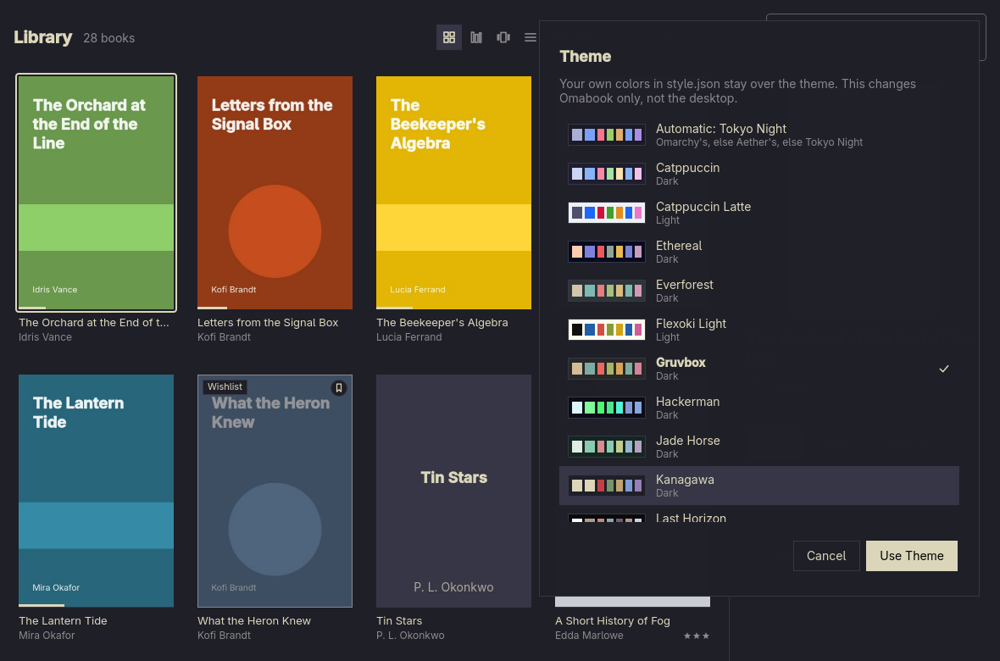

In the picker the arrow keys show each theme on the whole window as you reach it; `Enter` keeps it and `Esc` puts back what there was. Per color, the colors in `style.json` win over the theme, the theme over Tokyo Night, so a theme that lacks a color still has one. The theme's `muted` is made readable when it is too faint for text (Omarchy's themes use it for borders): it is moved towards the foreground until it reaches 4.5:1. `omabook theme import <name>` turns a saved Aether blueprint (`~/.config/aether/blueprints/<name>.json`) into a theme of your own. Choosing a theme changes Omabook only; `omarchy theme set` changes the desktop. `omabook info --json` and `omabook theme show` say which theme is in use and why.

## Several computers

Each computer keeps its own whole library. A sync brings two of them in step over ssh, so anything ssh reaches works, and with [Tailscale](https://tailscale.com) that is every computer you own, by name, from anywhere:

```bash
omabook sync laptop              # or laptop:Books/Fiction for a library other than its current one
omabook sync laptop --dry-run    # what a sync would do on each side, book by book; nothing changes
```

or name the computer once under Settings and press `Y`. Each side gets the books it lacks, with their details, covers and formats, and books without a file too (paper copies, wishes, books read elsewhere), known by their identifiers or else by title and authors. Shelves, stars and finished days travel with every book, filled in where a side says nothing; for books both have, the more recent reading place wins, and so do the details changed last (title, authors, series, tags, description and the rest, with the cover): each library keeps when a book's details last changed, and details a sync brings keep the time they had, so they never go back and forth. A book you remove on one computer is removed on the other at the next sync too, to its trash, unless it was added, read, changed or shelved there since you removed it; then it stays there, and isn't brought back to where you removed it. A file that a merge (Tidy) gave to the book it kept is still in the library, so that book is never removed elsewhere. A book you have twice on one computer, say a Goodreads entry and the book's file with the same ISBN, and once on the other is one book to a sync: its details are decided once, both copies get them, and a dry run names it once from either side. Omabook must be installed on both, and ssh must log in without asking for a password (Tailscale SSH or a key).

Books from before Omabook kept when their details changed have no such time on either computer, so where their details differ a sync can't tell which are newer: it leaves them as they are and says how many. `omabook sync laptop --details mine` settles them with this computer's, `--details theirs` with the other's; details with a time still go by it. `--dry-run` changes nothing on either side and lists, by title, what a sync would receive, send, update (details, reading places, shelves and stars) and remove on each, which is worth a look before the first sync that removes books.

Why not one library on a shared folder (sshfs, NFS, Syncthing)? Because a library is a live database: two computers writing it through a network filesystem can corrupt it, a file syncer can split it in two, and none of them work on a train. With a sync, each database is only ever written by its own computer, a dropped connection leaves both whole, and every computer reads offline. A library folder on a network mount does still open (Omabook switches the database to the journal mode that works there); just don't open it from two computers at once.

A sync carries the collections too: the books each holds by hand, its rule, its view and its reading format, and a removal. Of a collection both computers have, the one changed last wins whole. A computer with an Omabook from before collections still syncs its books, and gets no collections.

A sync carries the knowledge graph as well, merged rather than copied: what the AI noted on either computer while you read (the people, places, ideas and threads, what was revealed where, the relations, the questions you asked, the reading log) is on both afterwards, each fact with the moment it was revealed, so the map (`M`) of a book is never ahead of where you are on either. A thing is the same thing on both when it has the same kind and name, or one of its other names. The story worlds of Storyteller stay with their stories. Both computers need an Omabook that carries the graph (0.1.5.2 or newer); with an older one on the other side, the books still sync and the graph waits.

A sync between your own computers carries the bookmarks too, and the highlights and bookmarks taken in from Calibre: one made on either is on both afterwards, at the same place in the book's own terms (its section and how far into it), so it lands at the same words on a window of another size. One renamed (`omabook bookmarks 3 --rename 7 --as "The storm"`) is renamed on the other, and one removed is removed there too, unless it went with its book. Both computers need Omabook 0.1.7 or newer; with an older one on the other side, the books still sync and the bookmarks wait.

What a sync doesn't carry yet: Storyteller's story worlds. Between your own paired computers it carries the collections you subscribed to and the shared spaces you are in (see [Sharing](#sharing)). The first sync between two computers also pairs them into one person, so both sign what they write as you; see [Your own computers](#your-own-computers).

## Sharing

A collection can be shared with other people who use Omabook. You publish it, and they subscribe to it. What they get is a space of its own: the collection's books and their details, and whatever else you chose. It is never merged into their library, and nothing they do changes yours.

### Publishing a collection

With a collection shown, `Shift+P` publishes it; so do the ⋯ menu, the list of collections (`C`) and the collection's own dialog. First it says what goes in, counted, with a switch for each part of your own and one for the books' files, all off until you switch them on. The first time, it asks the name you go by. Then it saves an `.omabook-space` file to give by mail or chat, or sends it as a link: a gist, secret unless you say so, its link copied for pasting.

```bash
omabook collections share Fiction --dry-run                          # what would go in and what stays out; writes nothing
omabook collections share Fiction --as Ada --output Fiction.omabook-space
omabook collections share Fiction --with-graph --with ratings --gist # as a secret gist; --public for a public one
```

The space follows the collection. Rename it, put books in or take them out, change their details, and the next snapshot says so. Sharing by gist again updates the same gist, so the link stays. Switch a part off later and it is taken back: the next snapshot holds none of it, and those who follow are told to drop it, as they are when you delete the collection. A gist is sent by GitHub's command line, `gh`; Omabook keeps no GitHub account or token of its own.

### What is never shared

- **The books' files, unless you switch them on** (below). Whoever subscribes is matched against the books they have, and the ones they don't have become wishes.
- **Your own reading**, unless you switch it on, each part by itself: your knowledge graph (`--with-graph`), the questions you asked, your stars, and your reading places and days (`--with questions,ratings,progress`).
- **Anything outside the collection.** The collections it sits in at home don't go: in the space it is at the top. Nor does the rest of your library.
- **Your computers.** Their names don't go. The space numbers them instead, which says only how many wrote it.
- **Where your files lie**, nor the books' covers or tags, even with their files switched on.

### The books' files

The books you own you may share with anyone you allow, so a space can carry its books' files too, when its owner switches them on: you, for a collection you publish (the dialog's *The books' files*, or `--with files`), and any writer of a shared space (`omabook spaces files <space> on`). It is off until someone does, and when it is on the files go to everyone the space reaches: whoever you give the space's file to and whoever they pass it on to, or every member of a shared space and whoever is made one later. Omabook says so before anything goes, and `omabook spaces` shows which spaces carry them.

```bash
omabook collections share Fiction --with files --as Ada --output Fiction.omabook-space   # its files go in Fiction.omabook-files
omabook spaces files "Book club" on            # as a writer; off again with off
omabook spaces fetch 42                        # a book's file, now, rather than when you open it
```

A space names each file by its format, its hash and its size, never by where it lies. A file is fetched only when you want it: when you open the book, or with `spaces fetch`, never all at once. It is taken only when it has the hash the space names, and only for a book of yours with no file: a copy you have already, found as subscribing finds it, stays as it is. How the files go depends on how the space goes:

- **A shared space's folder.** Each member who has a book's file puts it beside the space's batches at their next sync, sealed with the space's key like everything else there and named so that the folder says nothing of which file it is.
- **A published space's file.** The files go beside it, in a folder of their own (`Fiction.omabook-files` beside `Fiction.omabook-space`), never inside it, so the space's file stays small enough to mail. Give the folder with it; whoever subscribes from the file fetches from beside it.
- **A gist** carries no files: it is no place for books. Publishing by link with the files on says so; whoever follows the link is told to ask for the space's file.

Switching it off stops it: nothing more goes, and the space no longer names the files. What a member fetched before stays theirs; nothing takes it back.

Not yet: a shared space's switch is on the command line and the MCP server only, as the window has no place for shared spaces yet. Where a space's files come from (the folder you sync it through, the file you subscribed from) is each computer's own: on your other computers, sync the space there, or import its file there again, before its files come.

### No spoilers

Of your graph, only what you have read goes: nothing past your place in a book, nothing of a book you haven't begun, and what you read later follows. On the other side, the receiver's own reading place decides again. They see a shared graph only as far as they have read each book themselves: nothing of a book they haven't begun or only wish for, more as they read on, and never more for a place asked for further on. A shared graph can't spoil a book for either of you.

### A plugin's worlds

A plugin that writes books, such as Storyteller, keeps what it makes up in a world of its own, apart from the graph of what you read. A collection you publish or share takes such a world only as the plugin offers it and only when the graph goes: a world the plugin made, of a book it made, never a book by a person or anything of one, and never what the plugin keeps beside it unnamed (a story's plan, with what is still to come). What goes of it is cut at your place in its book, and on the other side it is a layer of its own, read-only, cut at their place in their copy of the book; nothing of it shows before they have the book and begin it. In a shared space where they write, their plugin can put a book of its own in, with its world (`omabook.spaces.add`). Plugins see the worlds shared with you with `omabook.graph.layers()`; see `omabook plugin api`.

### A plugin's own data

A plugin can keep data of its own in Omabook's change log rather than in a file (`omabook.log.set`, `add`, `remove`, `read` and `list`): a notebook's pages, say, with their title and strokes. It goes to your other computers at a sync and merges there as everything else does: of a field the one written later stays, and what both computers added to a set is all kept, so strokes drawn on the laptop and on the desktop are both on the page. It is the plugin's alone, never a book or part of the graph, and stays on your own computers.

### Subscribing

`Shift+O`, or the ⋯ menu, picks an `.omabook-space` file to subscribe to. One dropped on the window is offered too, and a link can be pasted. Before anything is written it says which of its books you have, which become wishlist entries, the collection they go in (its name is yours to change), and that its graph stays a layer of its own.

```bash
omabook collections import Fiction.omabook-space --dry-run        # what it would do; changes nothing
omabook collections import https://gist.github.com/ada/<id> --as "Ada's fiction"
omabook collections unsubscribe "Ada's fiction"                   # drop the space, keep the collection
```

- **Matched, or wished for.** A book you have is found by its file, an identifier or ISBN, or its title and authors, as the tidy finds them. The others become wishlist entries. They go in a collection of yours, with a collection inside it for each shared one. One of that name already there is added to, never emptied. Add a wished-for book's file later and it fills the wish, found the same way (the very file, even when its own details say otherwise), rather than becoming a second copy beside it.
- **A layer, read-only.** The shared space is kept beside your library. Its graph shows beside yours, saying whose it is ("From Ada's shared graph"): in the graph's window, as marks on the page, in a search by what is known (`knows:`), in `omabook graph show` and the MCP server, and in what the AI is told. None of it is written into your own graph. The collection is marked as someone else's, on its tab and in the list.
- **Unsubscribing**, in the collection's dialog or with `collections unsubscribe`, drops the space and its graph, and keeps your collection.

### Following updates

A newer file of the same space brings only what is new, and the same file twice changes nothing. A collection subscribed to by its link (a gist's link or id, or a file in a GitHub repository, its page or its raw link) is followed from there. The window looks there for a newer version and says what changed; nothing is taken in until you say so.

```bash
omabook collections import --follow           # what a newer version would change: books, collections, the graph
omabook collections import --follow --yes     # take it in
```

### Shared spaces: a household, a book club

A published collection has one writer. A shared space has several: a household library, or a book club's list. Each member links a collection of their own to it, and its books' files go too once a writer switches them on (see [The books' files](#the-books-files)). Writers change the space by changing that collection; readers get every change and write nothing. Who is a member, and as what, travels in the space itself, and whatever isn't signed by someone who was a writer at its time is refused, and said. The space never changes your own books, only your collection of it.

```bash
omabook identity --export                                     # your id: give it to whoever invites you
omabook spaces create "Book club" --collection Club           # found a shared space of a collection of yours
omabook spaces invite "Book club" <person-id> --role reader --out bo.omabook-invite   # only that person opens it
omabook spaces join bo.omabook-invite                         # on their computer
omabook spaces sync "Book club" --folder ~/Sync/club          # in step through a folder something else syncs
omabook spaces                                                # the spaces you are in, your role, the members
omabook spaces remove "Book club" <person-id>                 # what they write from now on is refused
```

The folder is one that something else keeps in step between the members' computers: Syncthing, or a mounted share. Each computer writes only its own batches there, sealed with the space's key, so the folder never holds anything readable. Invite someone and sync before they join, so the change that makes them a member is in the folder before they write. A member removed has what they write from then on refused. What they wrote before stays, and so does their copy of what they had. Removing a member also changes the space's key: the members who stay get the new one, the one removed can't read what is written after, and what they write later is refused even when they date it before their removal. Every key the space has had goes with it to your other computers at the next sync, so what was written before stays readable there.

### Your own computers

All your computers are one person. The first `omabook sync` between two of them pairs them: from then on both sign what they write as you, and a sync refuses a change that isn't as it was signed. `omabook identity` shows your id, its fingerprint and the computers paired; compare fingerprints by eye, or read them out, to be sure an id is whose it says. The key is made the first time it is asked for and kept in your Omabook data folder (`~/.local/share/omabook/person.key`), readable only by you, never in a library folder. Its secret half leaves a computer only to another of your own, over the ssh the sync runs on. A computer that gave up its own key at a pairing keeps what it was in spaces: an invite to it still opens, and in a shared space it goes on writing or reading as before.

A sync between your own computers also carries the shared spaces you are in and the collections you subscribed to. Join a space or subscribe on one computer, and after the next sync the others are in it too, with the space's key (readable only by you), your collection of it, and where a subscription is followed from. It is sealed to your key and signed with it, so it goes to no computer that isn't you, and what arrives is checked as anything from elsewhere is: a shared space's writes by its members' roles and signatures. A subscription's graph shows as far as you have read on each computer. Unsubscribing on one computer unsubscribes the others at their next sync. An Omabook from before gets none of it.

## In the file manager

Omabook comes with a plugin for [Folio](https://github.com/omacom/folio), Omarchy's file manager, installed beside it the way Folio's own Tailscale plugin is. Folio's sidebar gets a **Libraries** section, one row per library, and opening one shows the library in Folio as a folder: one file per book, named `Title - Author.epub`, that you browse, sort, search and preview like any other folder.

- **Open a book** by opening its file (double click or Enter): it opens in Omabook's reader where you left it. The file is the book's own, so Omabook knows which book it is by where it is, without reading it through. That needs Omabook to be the app that opens ebooks, which is your choice: press *Open Ebooks with Omabook* in Omabook's settings, or run `xdg-mime default omabook.desktop application/epub+zip` (and the same for any other type you want). *Open in Omabook* in the right-click menu opens a book in Omabook whatever the default is, anywhere on your computer.
- **Copy books in.** Copy, move or drop a book file into the folder, or onto the library's row in the sidebar, and within a few seconds it is in the library: copied into the library's own folders, its details read from the file, and the file you dropped replaced by the book's entry. A file still being copied is left until it has stopped changing; the same book twice is recognised by its content and not added again; anything that isn't a book stays where it is, and the library's row says how many weren't added (its details say which, and why).
- **Delete a book** by deleting its file, as you would any other: the book goes to the trash, its folder with its files and cover. Undo in Folio, or restoring the file from the trash, brings the book back with its details, stars, reading place, bookmarks and highlights; a file deleted for good leaves the book's folder in the trash all the same. Deleting every file of a library at once removes nothing, since that is a folder emptied rather than books thrown away, and neither does the folder itself going.
- **The right-click menu** of a book: *Open in Omabook*, *Look Up Details* (opens Omabook with the look-up for that book), *Mark as Read*, *Mark as Reading* and *Remove from Library*, which sends it to the trash as deleting does. *Add to Library*, with a library to pick, is on book files and folders anywhere else.
- **The details pane** of a book shows its title, author, series, how far you read it or when you finished it, your stars, its formats and its library. For a book file elsewhere it says which library has it.

- **Collections are folders too.** Each collection is a folder in the library's folder, holding its books in the same way; one inside another is a folder beside it named by its path, *Werk - Hydraulica*. A collection is a selection rather than a place, so its folder changes the selection and never the library: deleting a book there takes it out of that collection only, and it stays in the library and in its other collections. That is as easy to undo as it was to do: put the file back (Undo, the trash, or a copy from the library's folder) and the book is in the collection again. A book copied in from elsewhere is added to the library and to that collection. Emptying a collection's folder at once, or deleting the folder, changes nothing, and the folder comes back.

A file's name comes from the book's details and follows them: change the details in Omabook (`E`, or *Look Up Details*) and the file is renamed. Renaming the file in Folio changes nothing in the library, and the file gets its name back, because a name like "Dune - Frank Herbert" can't be told apart into a title and an author reliably.

The folders are Omabook's view of each library and live in this computer's state folder, `~/.local/state/omabook/folio/<library>/`, not in the library: a library synced to another computer or backed up carries nothing extra, and a sync that has only got halfway can never look like books deleted here. Each entry is a hard link to the book's file in the library, so it is the file itself to every app (copying one onto an e-reader copies the book) and it stays right when Omabook renames the book's folder; for a library on another drive, where a hard link can't reach, it is a symbolic link instead, and a book deleted there comes back from the library drive's trash rather than with Undo in Folio. The views follow the library whenever it changes: the window keeps the open library's view in step and watches it, every `omabook` command that changes a library brings its view along on the way out, and Folio asks every five seconds, which costs a look at the library's change counter and a listing of the folder when nothing changed. Switching *Show my libraries in the file manager* off in Omabook's settings takes the section, the menu entries and the folders away.

The plugin holds no logic of its own: Folio runs `omabook folio …` and shows what it prints. It installs to `share/folio/plugins/`, so `cmake --install build --prefix ~/.local` puts it where Folio looks for your own plugins; press F5 in Folio to pick it up. The install also teaches the desktop the `.mdz` type, a zipped Markdown book, so file managers open it with Omabook (after `update-mime-database ~/.local/share/mime` for an install in your home folder; a package does that itself). Book formats that script plugins add have no type the desktop knows, so they open with *Open in Omabook*.

## AI

Everything here goes through one setting, and none of it happens until you ask.

- **A reading companion** (`A` while reading). Ask about the chapter in front of you, or select a passage and ask about that. It is sent the chapter, and never what comes after where you are, so it can't spoil the ending.
- **Catch me up** (`C`). Picking a book up after a while, the companion tells you where things stand in under 200 words. It keeps its answer as notes with the book, so the next time it is sent those notes and only the pages you read since, not the book again; and if you have barely read on, it shows the notes and sends nothing at all.
- **A judge for look-ups.** Catalogs return near misses: another edition, the graphic novel, the sequel. When you press `M` the model is given the book's own opening pages and everything the catalogs found, picks what is really this book field by field, and says in a sentence what it relied on. For a file no catalog knows, it works from the opening pages alone.
- **Who is who** (`W` while reading). The people and places that matter so far, kept and brought up to date the same way as the catch-up, so it never knows more than you have read.
- **Series.** In a later book of a series, the catch-up, who is who and your questions build on the notes the companion kept for the earlier books, so people and events carry over without those books being sent again. It only knows the earlier books you asked a catch-up or who-is-who in.
- **Tidy the library** (`Shift+T`). The whole library looked over at once and shown as one list to tick or untick: the same book twice (folded into one, with every format), an author spelled several ways or written "Last, First", books the model knows belong to a series, and, if you ask for it, details looked up and judged for every book that lacks a description or cover. Nothing changes until you say so.
- **Ask about your library** (`W` on the shelf): "which of these are about the sea?", "what did I give up on?". The model is given what each book is about, how far you got, and its own notes on the ones you started.
- **Suggest what to read next** (`N`). Books you don't have, chosen from what you read and how far you got with it, and the unread one on your shelf to pick up first.
- **Change Omabook** (`Ctrl+K`). Say what you want ("make it warmer", "bigger covers", "Space for the next chapter") and the model rewrites the interface files for you; the window follows at once, a change that doesn't check out is not made, and one click puts back what the last change replaced.
- **Agents.** Every library action is a command with `--json` and a tool of Omabook's MCP server (see *Commands* and *MCP server*); `omabook skill install` teaches your coding agents the commands, and `omabook mcp install` connects them to the server.

Which model answers is chosen under Settings (`,`):

- **Automatic** is Omarchy's default agent: the one you picked with `omarchy default agent` (kept in `~/.config/omarchy/defaults/agent`) answers in Omabook too, with the subscription it is signed in with, and with the account `omarchy agent account use` selected. Omabook follows that file while it runs, so switching the desktop's default switches the companion without a restart, and Settings says which agent is in use and why ("Omarchy's default: Claude Code"); so does `omabook info --json`. Omabook runs the agent for one answer and nothing else, so only harnesses that can be kept from acting are used: Claude Code and Pi with every tool off and no session kept; Codex without your config (so none of its MCP servers), in its read-only sandbox, in an empty folder, keeping no session; Grok in plan mode with no subagents or web, in an empty folder; Antigravity as below. If your default is another harness (OpenCode, Crush, Cursor, ...) or isn't installed, Omabook says so and uses Claude Code, then Antigravity, then the Anthropic API if `ANTHROPIC_API_KEY` is set. Without Omarchy, automatic is what it always was: the API when a key is set, else Claude Code, else Antigravity. Automatic never picks a server by itself, not even a running local model, so where your text goes changes only when you change it. A local model (`omarchy agent local`) is not a default agent in Omarchy but a way to launch one, so to keep everything on your machine choose it under **A server**.
- **Claude Code, with your subscription** and **Antigravity, with your subscription** pick one of the two. Claude Code runs with every tool off. Antigravity has no such switch, so it runs in plan mode, sandboxed, in an empty folder, with nobody to approve a tool.
- **Claude, with an API key** always uses the API (`claude-opus-5-5` unless you name another model).
- **A server (OpenAI-compatible)** talks to any server that speaks the OpenAI-compatible API (Chat Completions, streamed), on this computer, on another one of your tailnet, or hosted. Settings offers:
  - *Omarchy's local model*, when Omarchy's local models are installed: the one running (`omarchy agent local use best`), found with `omarchy-agent-local status --json`, or, when none runs here, one another computer on your tailnet shares and you paired with (`network --json`). Its address and key come from Omarchy, and the key is read again for every question, since Omarchy may change it. Each running model is offered in the model picker; the one picked is the server asked.
  - *Ollama*: `http://localhost:11434/v1`, through its OpenAI-compatible API. Type another address for Ollama on a desktop with a GPU, such as `http://desktop:11434/v1` on your tailnet.
  - *OpenAI*: `https://api.openai.com/v1`, with the key from `OPENAI_API_KEY` or the one you paste in Settings.
  - *Another server*, by its address and, if it takes one, its key: OpenRouter (`https://openrouter.ai/api/v1`), Groq (`https://api.groq.com/openai/v1`), Mistral (`https://api.mistral.ai/v1`), DeepSeek (`https://api.deepseek.com/v1`), xAI (`https://api.x.ai/v1`), Gemini (`https://generativelanguage.googleapis.com/v1beta/openai`), LM Studio (`http://localhost:1234/v1`), llama.cpp's `llama-server` (`http://localhost:8080/v1`), vLLM (`http://localhost:8000/v1`).

  A key is kept in the desktop's keyring by the server's address, never in `config.json` or the log; `omabook info --json` says whether one is set, never what it is. Both model rows list the models the server has. Until you pick one, answers come from the first it lists that runs on the server itself, and reading and parsing from the same one: no small model is known for an arbitrary server. A model whose name says it runs elsewhere (Ollama's `…:cloud` models) is marked *runs elsewhere*: it sends your text on to that service, so it is used only when you pick it. An address that starts with `http://` and is neither this computer nor on your tailnet is allowed, and Settings says that the text then crosses the network unencrypted. A server that can't be reached is an error that says so ("Can't reach the AI server at ..."): nothing else is asked instead. On the command line, `omabook ai use <omarchy-local|ollama|openai|custom> [address]` chooses one, `omabook ai models` lists its models, and `omabook ai key` keeps its key, read from standard input. This is the way to keep everything on your machines.
- **A command** is any program that reads a prompt on standard input and writes the answer to standard output: `llm`, a script of your own. It is started for each answer, and is given the whole conversation as one prompt.
- **Off.**

**Two models, by the kind of work.** Under the AI choice, Settings has a model picker with two rows. *For answers and writing* is the model for what you read: answers, catch-ups, who is who, suggestions, changing Omabook, and whatever a plugin writes. *For reading and parsing* is the model for what Omabook reads into structure: growing the knowledge graph, judging look-ups, finding series. That second kind is most of what a library costs, and a small model does it well, so it defaults to the AI's small one where one is known: `haiku` for Claude Code, `claude-haiku-5-5` for the API, `gemini-3.8-flash-medium` for Antigravity, `gpt-6-luna` for Codex; for Grok, Pi and a command of your own it is the same model as for answers until you name one. Each row offers the models known for the AI in use, with the default first, and takes any other name typed in; the choice is kept per AI (`ai_models` in `config.json`), so switching Omarchy's default agent doesn't hand one harness another's model names. A model the AI refuses never breaks reading: the request is asked once more of the main model (or the AI's default), and a note says which name was refused. A command of your own is told the kind of work and the model as `OMABOOK_AI_TIER` (`main` or `quick`) and `OMABOOK_AI_MODEL`. For one run, any command takes `--model main|quick|<name>`, the MCP tools that ask take `model`, and a plugin says `omabook.ai.ask(prompt, {model: "quick"})`; `omabook info --json` reports both models.

What is sent: the question, the book's title and authors, and the text of the part you ask about, to the AI chosen and nowhere else: to Anthropic for the API, through the harness's own service for Claude Code, Codex, Antigravity, Grok and Pi, to the server's address for a server (and on to the service of a `…:cloud` model, if you pick one), and to nobody but the program for a command. Looking details up online sends the title and first author (or the ISBN) to Open Library and Google Books. Nothing is sent until you ask.

**Handwriting and speech.** A plugin can have ink recognised and recordings written out (`omabook.recognize`): ink goes as a picture to a vision model on the AI server (`recognition.ink_model` in `config.json`, else the server's main model), and a recording to voxtype on this computer (Omarchy's dictation, `voxtype transcribe`; `recognition.voxtype_program` and `voxtype_model` name another command or model), else to whisper.cpp on this computer (`whisper-cli` with a `ggml-*.bin` model in `~/.local/share/whisper.cpp/models`, or `recognition.whisper_program` and `whisper_model`), else to the server's OpenAI-compatible transcription service (`/audio/transcriptions`, as a whisper server has it; `recognition.transcription_url` and `transcription_model` name another). Where you named a transcription server or whisper.cpp, that goes first, and voxtype last. voxtype gives the text without each word's moment: a transcript says whether it has them (`timed`), and whisper.cpp or a server is the choice where they are needed. They go only to your own servers: this computer, your tailnet, and the addresses you list in `recognition.own`. A hosted server is sent them only when *Recognise handwriting and speech on hosted servers too* is on in Settings and the plugin asks for it (a notebook you chose it for), and never a model that runs elsewhere (`…:cloud`) otherwise. What was recognised is kept in the change log by the hash of the ink or the recording and the model, so your other computers have it without asking again. While the server can't be reached, it waits and tries again.

## Knowledge graph

Omabook keeps a graph of what you read, in the library's own database: the **characters, places, groups, concepts** (a magic system, a technology, a rule of the world), **items, events, plot threads and themes** of each book; the **topics** beyond the book that it touches (history, science, myth, the works and authors it alludes to); the **questions** you asked; and the books, authors, series and tags themselves, with your stars, status and the day you finished. Nodes are things, edges say how two things relate ("mentor of", "member of", "alludes to"), and every fact remembers the book and the place in it where it was learned. So the graph of a book is never ahead of its reader, and asking for it up to a place leaves out what comes after.

- **Each fact with its moment.** What is said of a thing changes as a book goes on, and every version is kept with where it was revealed: each summary a thing had, each other name it was given (a character's true name, say), each relation, and where it was first met. With each goes a few words of the text there, at most a short sentence, to find the very spot again; the database holds those words beside the rest of what it knows of the book, and the log never holds any text of a book. Asked for at a place, a thing is as it was known there: its summary then, only the names it had by then, only the relations learned by then. That holds for everything that shows or sends the graph at a place: the map beside the page, the card on the page and *Who or what is this?*, what the AI is told with a question, a catch-up or a who-is-who, and `omabook graph show|node --upto`. When the model notes a chapter it says where each thing it reports appears, by its section and a few words quoted from the text; the fact is placed where those words are, and where the text doesn't hold them, where the thing's name first shows. A library from before 0.1.4 keeps what it had, known from where each thing was first met.

- **It grows as you read.** When you finish a chapter, and with every catch-up or who-is-who, the model is sent the pages read since the last time, together with the names of what the graph already holds and, for the things those pages mention, what is known of them. It answers with nodes and relations as JSON, which are laid into the graph. A marker with the book says how far that got, so no page is sent twice, a jump through the contents sends nothing, and nothing past your place is ever sent. A request carries at most some 24,000 characters of the book (about a chapter or two) plus a few thousand of the known graph; a long stretch goes in several requests, three at most at a time while reading.
- **It costs AI calls**, so it is a setting (`,`): *grows as you read* (the default), *only when you ask for it* (`omabook graph build <book>`), or *off*, in which case nothing is read from the graph or written to it while reading. In `config.json` it is `"graph": "auto"`, `"ask"` or `"off"`.
- **What you did is in it.** Every question you ask of a book or of the library becomes a question node with the gist of its answer, tied to the book, the place and the things it names. The reading log keeps, for each day, from what percent to what percent a book was read. A book's node carries its status, stars and the day it was finished.
- **The AI uses it.** A question about the book is sent with the few lines the graph holds on the things it names and their neighbours, up to where you are, which keeps answers consistent from one day to the next. The first who-is-who or catch-up of a book builds on the graph and the pages since, not on the whole book again. A question of the library and the suggestions get a short picture across your books: what you read when and how you rated it, the themes, ideas and topics met in the most books, and what you asked lately. That picture is cut to a few thousand characters whatever the library's size.
- **Two books' people are two people.** A character, place or thing of one series is never merged with one of the same name in an unrelated book ("Tom (The Other Series)"), while a theme or a real-world topic is one node shared by every book that touches it. That is what links your reading together.
- **It looks beyond the book.** When a part of a book is read, the model is also shown what the general graph holds from your *other* books that the new pages could be about: up to thirty themes, real-world topics and ideas (the ones the text's words point at first), and up to ten places and groups whose name is in the text, each by name and one line, with the book it is from. When it is the very same thing, the model says so and the two books meet in one node, so "coming of age" is one theme and not three spellings of it; a thing that merely shares a name stays apart, as before. Only what you have reached in those other books is shown.
- **Connections across books.** Once per build of a book (not per chunk), one more small request puts the book's most telling things (themes, ideas, plot threads, main characters; thirty at most) beside up to fifty of the same kinds from the other books you read, chosen by nearness: the same author, series or tags first, then shared words. The model answers with what connects them: *echoes*, *contrasts with*, *same idea as*, *answers*, *inspired by*, *refers to*, each with a sentence saying why, and for a real-world work both lean on, a topic both point at. These are edges like any other, told from a book's own facts by their kind, which starts with `across: ` (`across: echoes`; in JSON also `"across": true`), and learned at the place in this book where you were when it was noticed. The spoiler rule holds on both sides: of this book only what its graph holds, of the others only what you have reached in them. Asking again when nothing new is there to compare sends nothing. `omabook graph connect <book>` does it on demand (`--estimate` says whether it would ask, `--read` takes every book read), `omabook graph show <book> --beyond` shows what a book reaches, and the companion, the librarian and the suggestions are told of these connections.
- **Each top-level collection is a graph of its own.** A library split into collections at the top, say one for study and one for leisure, is split in the graph too: each collection at the top, with the collections inside it, is a part of the graph of its own (a *tenant*), and the books in no collection are one more, *Unfiled*. Nothing of one is shown, searched, linked or told to the AI in another: not a thing, a fact or a relation, nor a theme or an author two of them share, which each sees only as its own books tell it. What lies beyond a book, the connections between books, the AI's context for a question, a catch-up and a who-is-who across a series, and what a build is shown of the other books all keep to the book's tenant. Each thing is stored once, with the tenants that see it, so a book in two top-level collections is in both and what it told is seen from both without being copied, and a book moved to another collection takes what it told along. A connection made between books of two tenants is kept, but seen in neither until they share one. The graph's window shows one tenant at a time and switches between them (see [Browsing it](#browsing-it)). A library without collections is one tenant, as before. To keep one graph for the whole library, tick *Knowledge graph: one for the whole library, not one per top-level collection* in the settings (`,`), or set `"graph_one_tenant": true` in `config.json` (`"graph_across_collections"` from before 0.1.8 still says so); then there is nothing to switch.
- **Scopes.** The general graph is what the books say. A graph can also live under a name of its own, such as `world:42`: a made-up world that a plugin keeps, copied from the general graph or started empty, and never mixed into it.

```bash
omabook graph show 12 --upto 5 --json     # a book's graph as it stood after section 5
omabook graph find tide --kind concept    # search names, other names and summaries
omabook graph node 31 --depth 2           # one thing, where it was met, and what is around it
omabook graph node 31 --timeline --book 12 --upto 5   # when each thing known of it was revealed, as of section 5
omabook graph build 12                    # grow it with the AI as far as the book was read (--upto N, --all, --again)
omabook graph add --kind topic --name "The Odyssey" --summary "Homer's epic." --book 12
omabook graph link 31 44 "alludes to"     # also: unlink <edge>, merge <keep> <other>, remove <id>
omabook graph export 12 --format graphml --output saltmere.graphml   # or json, dot (Graphviz), cypher (Neo4j)
omabook graph scopes                      # also: copy-scope <from> <to>, remove-scope <scope>
omabook graph connect 12                  # have the AI link its themes and ideas to the other books read (--estimate, --read, --again)
omabook graph show 12 --beyond            # the book's graph with what it connects to in other books
omabook graph log                         # the reading log: what was read on which day
```

Over MCP the same are `graph_find`, `graph_node`, `graph_book`, `graph_scope`, `graph_scopes`, `graph_add`, `graph_link`, `graph_unlink`, `graph_merge`, `graph_remove`, `graph_build`, `graph_connect`, `graph_export`, `graph_copy_scope`, `graph_remove_scope` and `graph_reading_log` (`graph_node` takes `timeline`, and `book` with `up_to_section` for a thing as known at a place; each step past the reader's furthest place is marked `"ahead"`), and a book's graph is the resource `omabook://graph/book/{id}`. Script plugins have it as `omabook.graph` (`find`, `node`, `around`, `ofBook`, `beyond`, `connect`, `whole`, `upsert`, `link`, `unlink`, `merge`, `remove`, `scopes`, `copyScope`, `removeScope`, `exported`, and `layers`, the worlds shared with you); see `omabook plugin api`.

### Browsing it

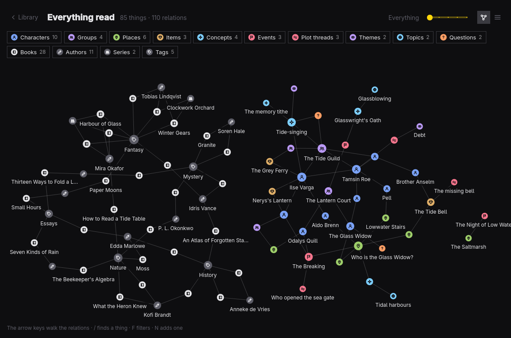

`6` shows the library as that graph instead of a shelf, of the top-level collection shown last, `U` the graph of the selected book (as does *Graph* in its details), and while reading `M` puts the map of the book so far beside the page. That one stops where you are: it holds what the pages up to the furthest you have read have told, and neither its search nor a node's relations know more. A book opened from the library is shown as far as it was left, a finished one whole.


- **One collection at a time.** In a library split into collections at the top, the graph shows one of them, or *Unfiled*, the books in none, and never a mix. Its name stands at the top: a click or a tap lists the others with how many books each holds, as `C` does, and `PgDown` and `PgUp` go to the next and the previous. The counts beside it are of the collection shown, a book's graph opens in a collection the book is in, and the one shown last is shown again the next time. The chronology opened from the graph shows the same one, and switches the same way. With one graph for the whole library there is nothing to choose, and the name isn't there.
- **The picture.** Nodes are discs in the theme's colors, one per kind, each with a small drawing of its kind; the better connected a thing, the larger. Names appear where they fit, the hubs first, and more as you zoom in; what the relations say appears for the selected node and for all of them up close. Selecting a node lights it and its neighbours and dims the rest. Drag to move, scroll or pinch to zoom, `+` `-` `0` and `Shift` with a direction from the keyboard.
- **Walking it.** The arrow keys or `H` `J` `K` `L` go along a relation to the nearest neighbour that way, `Tab` goes through everything in order, `/` finds a thing by name. `Enter` puts the selected node in the centre and shows what is around it, `]` and `[` reach a step further or less, and `Backspace` goes back the way you came. `O` reads the selected book, or goes to the page a thing was first met on.
- **The details** beside it (`I`) say what a thing is and is also called, what is known of it, the books it is in and where it was first met in each, when what is known of it was revealed, and its relations as lines to follow: "mentor of → Aldo". A book adds its status, stars and reading days; a question the gist of its answer.
- **Going to the moment.** Each step of *When it was revealed*, and each place it was first met, opens the book there (`R` puts the keyboard on them, `Tab` moves on, `Enter` goes, `Escape` is back in the picture): the reader finds the words kept with it in that chapter, lands on them, and lights them for a moment. The card on the page does the same with *First met* and *Latest*, the place where what is said of the thing now was told.
- **Spoilers.** Anything past the furthest you have read in a book is a spoiler, also after you go back to an earlier page. It is never shown by default: the details keep it under *Later in the book (n)*, which says how many and nothing more, not in a tooltip, a search, nor to a screen reader, and never to the AI. Opening it asks first ("This shows what happens after …"), opens it for that one thing until Omabook closes, and marks each step in it as ahead. The library's *more past your page* asks the same before showing a book whole; a thing then met only later says so, and keeps what is known of it in the same closed section. A book marked as read, or never opened in Omabook (its graph built whole on request), has no spoilers.
- **The kinds above the picture** are its legend and its filter: a click leaves a kind out. `F` narrows by typing: a kind, one book or series, a world of its own, how far around the centre, or only what you have asked about.
- **Beyond this book.** Around a book's graph stands what its things connect to in other books: smaller, quieter, each named with the book it is from, and tied in by a dashed line in the accent color, which is how a connection between books is drawn wherever it shows. `X` or the switch beside the kinds takes the ring away. Selecting one of them says which book it is from, the connection in words and why it was made; `Enter` goes on to that book's graph around it (`Backspace` comes back) and `O` opens the book. It keeps to the same bound: beside the page, only connections noticed up to where you are. In the library's graph, `F` and *only connections between books* leaves just those and the books they join.
- **As a list.** `V` shows the same nodes as rows by kind, walked with the same keys, with what is in other books as a group of its own at the end, for when a picture isn't what is wanted or the window is small.
- **By hand.** `N` adds a thing (related to the selected one, if you say how), `E` renames it or rewrites what is said of it, `Shift+M` folds another thing into it when the two are one, and `D` removes it; a relation is removed with the cross on its line. Whatever takes something away asks first.

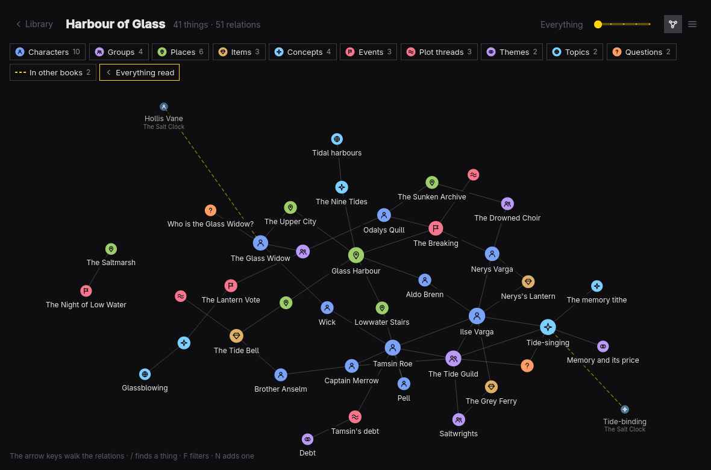

### In the text


The names the map knows so far are marked in the chapter, always, from the first book on: a faint tint and an underline in the color their kind has in the map, so a character is the same blue on the page as in the picture. A book with no graph yet simply shows its text. Marking changes how letters are drawn, never their size, so the page doesn't move; `Shift+M` (also in the page's ⋯ list) marks them only while the map is beside the page, or never, and back to always; the choice is kept (`"marks": "always"`, `"map"` or `"never"` in `config.json`) for every book, every start and every window. PDFs and comics are pictures and are not marked. Pointing at a name, or tapping it, shows a card: what it is, what is known of it, *Show in graph* and *Ask about this*. Selecting words (drag, double-click, press and hold, or `V` and then the arrow keys or `H` `J` `K` `L`, with `Shift` to widen, `Enter` for the menu) opens a menu beside them: *Ask about this*, *Who or what is this?* (answered from the graph when it knows the name, with no AI call; otherwise one short question with only the words and their paragraph), *Show in graph* or *Add to the graph*, *Find in book*, *Copy*, and up to three questions made from the graph (its threads, places and relations: "Why is Ilse at Glass Harbour?"). *More suggestions* asks the quick model once for that thing at that chapter. In the companion's answers, a who is who or a catch-up, the names the graph knows are marked the same way, and a click on one shows its card, which also goes to where it was first met.

A name is found as whole words, and its capitals count: the character "Will" is not the "will" of "she will", and a one-word name that is also an everyday word (one in a short list, or one the chapter itself uses in lower case) is only marked where it is capitalised in the middle of a sentence. A character is also found by a part of their name ("Ilse" of "Ilse Varga") when that part is no title and belongs to nobody else; the longest name wins, and a name never runs across paragraphs. Only what the reader has met up to their place is marked. A chapter's marks are worked out beside the window (about 7 ms for a chapter of 300,000 characters with 300 names), kept per book, chapter, text and names known, and taken from there when the chapter comes back; they are worked out again only when the graph of this book changed or the reader passed the place where something new was met. Nothing here asks the AI to read: the graph grows as it always did, at the end of a chapter, with the pages since; when it is behind, the card says how far it got.

The picture is laid out by a small simulation in which nodes push each other apart and relations pull them together. It starts from the same places every time, so the same graph is the same picture; it runs a few milliseconds at a time between frames, so a graph of thousands never stalls the window; and it stops when it has settled. When the graph grows while you read, what was there stays where it was. The ring of other books is held by its ties and kept outside, and the book's own things never feel it, so the picture inside is the same with it as without. The keys are a place of their own in `keys.json`, `"graph"`.

What is sent to grow it: the book's title and authors, the pages read since the last time, the names and short summaries the graph already holds for that book and the earlier books of its series, and up to forty names with one line each from the graphs of the other books you read. The connecting request sends no book text at all, only such names and lines from both sides.

## Chronology

The chronology puts the events of the books you read in the order they **happen** in their world, not the order you read them in. A flashback lands where it belongs, and two novels set in the same war line up on one axis. It is not the same as *When it was revealed* in the graph's details: that is the order in which you learned things about one thing; this is story time.

- **Never ahead of you.** Every time and every order is a fact with the place in the book where it was told, like the rest of the graph. So the chronology holds only what you have read: an event you haven't reached isn't on it, not even on a timeline it shares with a book you finished.
- **Timelines.** An event is on one or more: the book's own, its series', a world several books share, or real history. A real date or a real event (a war, a coronation) puts it on real history, which is how books with nothing else in common meet. A series' or a world's timeline is shared only by books on the same side of a library split into top collections.
- **The AI notes the times.** As it builds a book's graph, the model also notes when each event happens, as far as the book says: a date, a year or a span, on the real calendar or the story's own, "around" where the book hedges, or only the book's words ("three years before the war"). It notes what comes before or after what, and marks an order it concluded as inferred. It never guesses a date: what the book doesn't say stays unknown. `omabook graph build <book> --again` reads the times into a book built before.
- **Or by hand.** Say when an event happens, put two in order, place one on a timeline, or make a timeline of your own (see below). What you put in is marked as yours and wins over what the books say.
- **What can't be ordered is said.** Events with no time and no order are listed apart. A contradiction (A before B and B before A, two books giving times that can't both be, a date that disagrees with an order) is shown with where each statement was said and which one is followed, never quietly resolved.

### In the window

`T` on the shelf shows the selected book's chronology, `Shift+T` the open book's while reading, and `T` in the graph that of what the graph shows: a book, a series, a collection or everything read in the top-level collection shown, which `C`, `PgDown` and `PgUp` switch here too.

- **Lanes on a ruler.** One lane per timeline, under the ruler of its calendar, from centuries down to minutes. Lanes that line up share one axis: by date where the books give one, in order where they don't. A moment is a mark, a span a bar, and an event during another sits under it. *You are here* marks the event you came to last.
- **What is unplaced and what disagrees.** `U` shows the events no time or order is known of. An event in a contradiction is ringed, and its card says what was said where and which was followed.
- **The card.** A click or a tap on an event shows what is known of it, with **Back to the page** it was revealed on (`O` or `Enter`) and **Show in the graph** (`G`).
- **Filters.** `F` filters by timeline, book, series, collection, character, place, group or theme, or only what was met in a book; `R` shows only a stretch of time, from one year or date to another. Filters show as chips that a click takes off, and `Shift+F` clears them all.
- **Moving around.** `H` `J` `K` `L` or the arrows go from event to event, `/` finds one by name, `+` `-` zoom and `0` fits it all; `Shift` with a direction moves the view. The wheel, a drag and a pinch do the same. In a right-to-left language time runs from right to left.
- **Shared graphs.** The graphs of collections you subscribe to are laid in, hollow, and only as far as you have read each book yourself.

### On the command line and over MCP

```bash
omabook chronology 12                    # a book's events in the order they happen, cut where you are
omabook chronology --collection Novels --timeline "Real history" --from 1940 --to 1942   # every novel set then
omabook chronology 12 --upto 5 --json    # as known at section 5; --whole takes everything, read or not
omabook chronology --format csv --output story.csv   # or json, graphml, dot: with times, the order as edges
omabook chronology set-when "The siege" 1944-06-06   # or a span 1939..1945; --calendar, --approximate, --said
omabook chronology order "The flood" before "The siege"   # before, after, during or same
omabook chronology timeline add "The Third Age" --kind world
omabook chronology place "The siege" on "The Third Age"
```

With no book it takes every book you read; `--collection` takes one collection's. `omabook graph chronology` is the same command. An event or a timeline is its number or its name, and what doesn't check out is refused with why. Over MCP the same are `chronology`, `chronology_set_when`, `chronology_order`, `chronology_place` and `chronology_timeline_add`.

## Commands

Everything the window does with the library, with no display needed. Every command takes `--json`, prints errors to standard error, in English for scripts (in the desktop's language with `--translated`), and exits 0 or 1.

```text
omabook open [book]                     Open the window, and a book file or library number in it
omabook list [search] [--collection c]  List the library's books, or one collection's
omabook search <words> [--ai] [--collection c]  Find books by their details and what you know of them; --ai asks the AI
omabook collections [list|add|rule|rename|move|include|exclude|follow|remove|show|format|sort]  Collections, nested as you like
omabook collections share|import|unsubscribe  Publish a collection, or subscribe to one someone shared; see Sharing
omabook show <id>                       Show one book's details and files
omabook add <file|folder>...            Copy books into the library; a Calibre library comes with its details
omabook remove <id>                     Move a book to the trash
omabook set <id> [--title ...]          Change a book's details or cover
omabook info [file]                     Show what a file says about itself, or what Omabook is set up with
omabook toc <book>                      List a book's contents
omabook text <book> [--section N]       Print a book as plain text
omabook find <book> <words>             Find words in a book
omabook meaning [index|search|use]      Find a book's text by what it means, with the embeddings of your own server
omabook lookup <id> [--ai] [--apply N|ID]  Look a book's details up with every metadata plugin
omabook plugins [enable|disable <id>]   List plugins (built in, Calibre's, your own) or switch one
omabook plugin new|check|run|list|api   Write plugins of your own in JavaScript; see omabook plugin --help
omabook plugin install <folder|zip>     Install someone else's plugin, checked first and left off until enabled
omabook plugin remove <name>            Move one of your own plugins to the trash
omabook plugin add <github address>     Install a plugin from a GitHub repository and keep it up to date from there
omabook plugin sources [--updates m]    Where plugins came from and what each follows; what is done about updates
omabook plugin update [<name>|--all]    Install what is newer (--check only says; --yes approves new permissions)
omabook plugin pin|follow|rollback|forget-source <name>   Stay at a tag or branch; follow the latest; one version back; stop updating
omabook calibre libraries|plugins|import  What was found of Calibre here; import its libraries
omabook catalog [search] [--format f]   Write the library as csv or bibtex
omabook customize [view]                Show where the interface's files live; copy a view there to edit
omabook theme [list|use <name>|show]    Which theme the colors come from: Omarchy's, Aether's, or a built-in one
omabook convert <id> [--to format]      Convert a book and add the result to it
omabook export <id> <folder>            Copy a book's file out of the library
omabook embed <id>...|--all [--restore] Write books' details into their EPUBs, or put the files back as they came
omabook ask <book|all> <question>       Ask the AI about a book, or about the whole library
omabook ai use|models|key               A server as the AI (Omarchy's local models, Ollama, OpenAI, ...); its models; its key
omabook graph show|find|node|build|...  The knowledge graph of what is read; see omabook graph --help
omabook chronology [book] [--timeline t]  The events read, in the order they happen in their world; see Chronology
omabook tidy [--ai] [--apply]           List duplicates, author spellings and series to tidy; make the changes
omabook suggest [--no-check]            Have the AI suggest what to read next, checked against the reading sites
omabook goodreads import|sync|export|shelves  Keep your Goodreads shelves and the library in step
omabook openlibrary sync|shelves        Bring an Open Library reading log into the library
omabook sites [connect|check|disconnect|sync]  The reading sites, and how you are connected to each
omabook change <wish> | --undo          Ask the AI to change how Omabook looks or works
omabook progress <id> [--section N]     Show or set how far a book has been read
omabook stats [--year y] [goal N books|hours]  Your reading added up: time, days in a row, books finished; the year's goal
omabook format [id] [--align justify]   Show or change how books are set: type, spacing, margins, alignment
omabook sync <computer[:folder]>        Bring this library and another computer's in step over ssh
omabook manifest                        Print the whole library as JSON, as sync reads it
omabook identity [--export]             Print your id and its fingerprint, to share spaces with others
omabook spaces [create|invite|join|sync|remove]  The spaces you are in; shared ones several people write
omabook help [topic]                    Print the help the window shows: getting started, reading, keys, ...
omabook skill [part|install] [--all]    Print the skill for coding agents (parts: library, graph, plugins), or install it
omabook mcp [install [agent]]           Run as an MCP server for agents, or register it with one
```

`<book>` is a number from `omabook list` or any book file, so `omabook text ~/Downloads/paper.pdf` works on a file that isn't in the library. `--library <folder>` points a command at another library for that run only, before or after the command's name; `omabook libraries --use <folder>` changes the one in use, and `omabook open --library <folder>` opens a window on another library without changing it.

`omabook collections` lists the collections as a tree. `add Werk/Hydraulica --rule "tag:hydraulics"` makes one (and *Werk* with it, if it isn't there yet; `--parent` says where instead), `rule`, `rename` and `move` change one (a new path moves it, and what is inside goes along), `include`, `exclude` and `follow` put books in by their numbers, take them out, or leave them to the rule again, `show` lists its books, and `format <path> --set align=justify` gives it its own reading format. `sort` has the AI propose where the books not yet placed belong, numbered, with a list of the ones to decide yourself; `sort --pick 1,3` or `--apply` takes them from that same list without asking again, and `--pick 3=Werk/Regeltechniek` puts that one under another name. `sort Werk` sorts within one collection: its books that are in none of the collections inside it are proposed a place inside it, there or new, and stay in *Werk* too. `omabook ask all --collection c` and `omabook suggest --collection c` keep to one collection.

`omabook format` with no options says how every book is set; with a book's number, how that book is, marking what it has of its own. With options it changes them, for the defaults or for that book alone: `--font-size N`, `--font F` (`""` for the desktop's), `--line-width N`, `--line-height N` (percent), `--paragraph-spacing N`, `--indent N`, `--margins N` (pixels) and `--align start|justify|center|end`; `--reset` puts a book back to the defaults, or the defaults back to Omabook's own. A value out of bounds is refused with the range it may be in, and nothing changes. A book's own way is kept in the library's database, so it is backed up with the library and goes when the book does; a sync with another computer doesn't carry it (yet).

## MCP server

`omabook mcp` runs Omabook as a [Model Context Protocol](https://modelcontextprotocol.io) server on standard input and output, so any agent that speaks MCP can work with your library: find and read books, fix their details, track what you read, tidy up, change how Omabook looks. It needs no display and works on the same library as the window, at the same time (each has its own connection to the database, and the window shows what an agent changed a moment later).

```bash
omabook mcp install            # register it with Omarchy's default agent
omabook mcp install codex      # ...or by name: claude, codex, grok, pi, opencode, agy
omabook mcp install --print    # change nothing; show the command and the configuration to add by hand
omabook mcp --tools            # list the tools
omabook mcp --library ~/Other  # serve one library, whatever the window has open
```

`install` runs the harness's own command (`claude mcp add --scope user omabook -- omabook mcp`, `codex mcp add omabook -- omabook mcp`, ...), prints it and what it answered, and changes nothing else; it only runs when you run it. Any other client takes `{"mcpServers": {"omabook": {"command": "omabook", "args": ["mcp"]}}}`. Omarchy has no registry of MCP servers of its own: what it shares between harnesses is `~/.agents/skills` (where `omabook skill install` puts the skill) and `~/.agents/AGENTS.md`, and it carries each harness's MCP servers across your accounts, so registering once is enough.

| Tools | What they do |
|---|---|
| `omabook_info`, `library_list`, `library_switch` | What Omabook is set up with; its libraries, and which is in use |
| `books_search`, `book_get` | Find books with the search language (`author:`, `status:`, `is:paper`, `rating:`, ...), a page at a time; one book in full |
| `books_find` | Search as the window does, by what the user met in the books too (never past their page), saying what found each; with `ai`, a question for the quick model, answered with books and a reason each |
| `book_add`, `book_add_format`, `book_add_entry` | Add files, folders or a Calibre library; another format of a book; a paper or wishlist book with no file |
| `book_set_details`, `book_set_reading`, `book_remove` | Change details or the cover; status, stars, the day finished; remove (to the trash) |
| `book_contents`, `book_text`, `book_find` | Read: the table of contents, a section's text in pieces, where words occur |
| `progress_get`, `progress_set`, `bookmarks_list`, `bookmark_add`, `bookmark_remove`, `notes_get` | The reading place, bookmarks, and the companion's recap and who-is-who notes |
| `annotations_list`, `annotation_add`, `annotation_change`, `annotation_remove`, `annotations_export` | Highlights, margin notes, bookmarks and book ink: listed, added on words of the book, changed, removed; exported as Markdown, for Readwise, or into a copy of a PDF |
| `lookup_candidates`, `lookup_apply` | Details from every metadata plugin, each saying what it adds and changes; take one |
| `tidy_propose`, `tidy_apply` | Duplicates, author spellings and series as proposals; apply the chosen ones |
| `ask_book`, `ask_library`, `suggest_reading` | Omabook's own AI, for a question that needs a whole book or the whole library |
| `catalog_export`, `book_export`, `book_convert`, `book_embed_details` | The library as csv or bibtex; a copy of a book's file; a conversion with Calibre; the book's details written into its EPUB, or the file put back |
| `sync_status`, `sync_run` | Syncing with another computer |
| `plugins_list`, `plugin_set_enabled` | Plugins, and switching one |
| `plugin_install`, `plugin_remove` | Install a plugin from a folder or a `.zip`, checked first and left off; move one of your own to the trash |
| `plugin_add`, `plugin_sources`, `plugin_update`, `plugin_forget_source` | Install a plugin from a GitHub repository; where each came from; check or update them; stop updating one |
| `graph_find`, `graph_node`, `graph_book`, `graph_add`, `graph_link`, `graph_build`, `graph_export`, ... | The knowledge graph: search it, a node and its neighbours, a book's graph up to a place, add and relate things, grow it with the AI, write it as GraphML, DOT or Cypher, the reading log |
| `chronology`, `chronology_set_when`, `chronology_order`, `chronology_place`, `chronology_timeline_add` | The events read, in the order they happen in their world, cut where the user is; say when one happens, put two in order, place one on a timeline, make a timeline |
| `customize_get`, `customize_set`, `customize_undo` | `keys.json`, `style.json` and the look settings, changed with the same checks as a file edited by hand, and undone |

Other parts of Omabook add their own (script plugins, Calibre, reading sites); `omabook mcp --tools` lists what this build has. Every tool says in its annotations whether it only reads, changes something, or takes something away (`book_remove`, `tidy_apply`, `lookup_apply`, `bookmark_remove`, `book_add_format`), so a client can ask you at the right moments. Arguments are checked against each tool's schema, and what goes wrong comes back as the tool's result, in words the agent can act on. There are also four resources (`omabook://library/books`, `omabook://book/{id}`, `omabook://book/{id}/section/{n}`, `omabook://graph/book/{id}`) and two prompts (`tidy_library`, `fix_details`).

The server speaks protocol revision `2026-07-28` (no handshake: every request carries its version, and `server/discover` says what is spoken) and, for clients that open with `initialize`, `2025-11-25` back to `2024-11-05`. Requests are answered one at a time, in order.

## Install

Each release has a ready-built package for Arch and Omarchy (x86_64), built and tested in a clean container:

```bash
curl -LO https://github.com/jellespijker/omabook/releases/download/v0.1.5.1/omabook-0.1.5.1-1-x86_64.pkg.tar.zst
sudo pacman -U omabook-0.1.5.1-1-x86_64.pkg.tar.zst
```

The package is downloaded first because pacman asks for a signature file next to a package it fetches from a link, and these packages are not signed; the release page lists each file's SHA-256 to check it against (`sha256sum omabook-*.pkg.tar.zst`). Pick the newest release on the [releases page](https://github.com/jellespijker/omabook/releases); installed this way, a newer version is installed the same way. Omabook then appears in the app launcher (`Super + Space`).

## Build

Omabook needs what every Omarchy app needs (CMake, a C++ compiler, Qt 6 base, declarative, SVG and Wayland) plus `libarchive`, `poppler-qt6`, `libsodium`, and `qt6-multimedia` with `opus` for plugins' recordings (`qt6-multimedia-ffmpeg` is the backend that reaches PipeWire). Calibre is optional, for the formats that are converted. The `hyphen-*` dictionaries are optional too, for justified text broken by its language; the tests of it need `hyphen-en`, `hyphen-de` and `hyphen-nl` (or a folder of `hyph_*.dic` files in `OMABOOK_HYPHENATION_PATH`) and are skipped without them.

```bash
bin/build            # builds into build/
build/omabook open   # run it
bin/test             # the tests, offscreen
bin/sanitize         # the tests again under AddressSanitizer and UBSan
cmake --install build --prefix ~/.local   # put it in the app launcher
```

## How it is built

Four layers, each knowing only the ones below it. The window and the command line are two front ends on the same library.

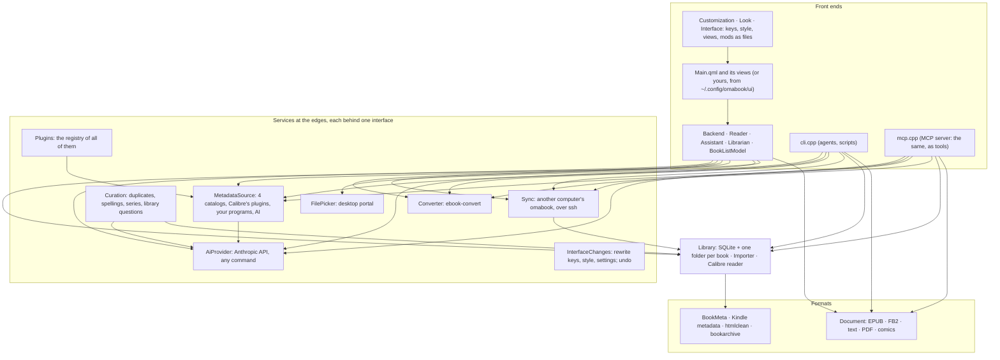

- **Formats** (`document.h`, `formats.cpp`, one `.cpp` per format). A book is a `Document`: it either flows (chapters as the small subset of HTML Qt lays out) or is made of pages (pictures). Nothing above this layer knows which format it is reading. **To add a format:** write one subclass and add one line to the table in `formats.cpp`.
- **Library** (`library.h`). The only code that touches the database or the library folder. It is plain C++ with no window in it, and each thread opens its own (SQLite's write-ahead log keeps the window, the import worker and a command in step).
- **Importing** (`importer.cpp`, `calibre.cpp`) is one function both front ends call, so a folder, a file and a Calibre library are brought in the same way from the window and the command line.
- **Calibre is one plugin behind one class** (`calibreplugin.cpp`). The registry, the importer's caller, the reader's converter and the command line all ask `CalibrePlugin` whether Calibre is used and for what it found, rather than calling Calibre's pieces, which is what makes the one switch real.
- **Sync** (`sync.cpp`) never opens the other computer's files or database itself: it runs that computer's own `omabook` commands over ssh, which is why the two databases can't corrupt each other, and why the tests can stand in for "another computer" with a second folder and a script in place of ssh.
- **Services** each sit behind a small abstract class with the real implementation and a stand-in for tests. **To add a catalog:** subclass `WebMetadataSource` and give it a line in `plugins.cpp`, or write it as a program in the plugin folder and touch no C++ at all. **To add an AI backend:** subclass `AiProvider`.
- **Plugins are processes, not shared libraries.** A plugin that is a program can be written in anything, can't crash the reader, and can't break when Qt or the compiler changes; that is also what lets Calibre's Python plugins run, inside Calibre, without Omabook embedding Python. The prompts live in `prompts.cpp`, free of any network or window code.
- **Script plugins are a service too** (`script*.cpp`). `ScriptPlugin` is one script in a `QJSEngine` of its own, timed by a watchdog thread; `ScriptPlugins` loads and follows the folder and is where the rest meets the scripts: `Backend` and `Reader` tell it what happens (`emitEvent`, `libraryChanged`), and look-ups, catalogs, the keys and the mods ask it for what the scripts added. The `omabook` object is built in `scriptprelude.js` from a host the script can't reach, and described by one table (`scriptapi.cpp`) that the reference, the guide, the skill and the MCP tool are all made from; a test holds the table and the live object to each other. None of it includes the window. **To give scripts something new:** a function in the prelude, its host method in `scriptplugin.cpp`, and its line in the table.
- **Front ends.** `Backend`, `Reader` and `Assistant` are thin `QObject`s that expose the layers below as properties for QML; `cli.cpp` exposes the same as commands and `mcp.cpp` as tools. What a command and a tool both do is written once, in `bookops.cpp`. **To add a tool:** one `Mcp::registerTool({...})` in the `.cpp` of the feature it belongs to (see `mcp.h`).
- **AI features are prompts plus plain code.** Each one is a pure function that builds a request (`prompts.cpp`, `curation.cpp`) and a pure function that reads the answer, with the deciding done in ordinary code: a tidy is a list of `Proposal`s that nothing applies until asked, and an interface change goes through the same checks as a file edited by hand. That is what lets every one of them be tested with a stand-in model.
- **Help is data too** (`manual.h`). The help's pages are text in `helptopics.cpp`, shown by the window and printed by `omabook help`; they name a command as `{library.add}` and the key is filled in from `keys.json`, so the help can't disagree with the keyboard. The list of keys is the commands table itself, and Enter in the help runs a command through the same `Key` its shortcut uses. The tour is a list of steps in `tour.cpp`, each naming the `objectName` it points at. **To announce a feature in a release:** add one entry to `whatsnew.cpp` (an id, the version it arrives in, a title, a sentence or two, and optionally the `objectName` to point at and the command it is about; the comment at the top of the file says how) and translate its two texts. Whoever last saw an older version is offered a tour of what arrived since. A test (`whatIsSaidStillExists`) fails when an entry, a tour step or a help page names a command or an `objectName` that no longer exists.
- **The interface is data.** Keys are commands with defaults (`Customization::commands()`), bound in QML through one `Key` component, so a new action is one line in that table and one `Key`. Views are loaded by `Interface`, which reloads them when a file in `ui/` changes and falls back to the built-in ones when a file doesn't load.

**Window sizes.** Omabook lives on a tiling desktop, so its window is a narrow column one moment and a whole screen the next, and is laid out for all of it down to 420 by 360. `Main.qml` names how much room there is, and the views decide by the names instead of by numbers of their own: `win.compact` (narrower than 700: one thing at a time, dialogs edge to edge, rows of fields stacked), `win.medium` (700 to 899), `win.expanded` (900 and wider: two things side by side, as in the plugin manager) and `win.low` (shorter than 520: one row of filter chips, a smaller cover over the details). Two things are measured rather than classed. The library's header gives things up in a fixed order until its words fit, because how long they are depends on the language: the count goes, then the buttons under fingers fold into one, then “Filter” and the order become drawings, then the ways to show the shelf fold into one that lists them, then the search field becomes a drawing that opens over the header, and the library's name elides last. And a pane (`SidePane.qml`: the details, the contents, the AI, the map, the plugin list) stands beside the shelf or the page while that keeps `win.contentFloor` (440), and lies over it when it wouldn't; its inner edge drags, `<` and `>` move it, a double click resets it, and its width is kept in `config.json` under `pane_widths`. A dialog is an `AppPopup`, never larger than the window, holding a `DialogBody` that scrolls its content and keeps its buttons in view. All of this is kept by `tests/layout_tests.cpp`, which shows the real window with a made-up library of very long titles at a matrix of sizes (420 to 2560 wide, 360 to 1200 high) in English and German, with a mouse and under fingers, in every view, with every pane, and with every dialog open, walks the items on screen, and fails with the item's name, text, file and size when a text or a control is outside its window, dialog or pane, a text is wider than its width without eliding or wrapping, a button's caption is cut, two neighbours overlap, or something to tap is smaller than a fingertip. `OMABOOK_SHOTS=<folder>` saves a picture of each state, and `OMABOOK_LAYOUT_FULL=1` walks every size instead of the sample that runs on every push.

**Pages.** How a flowing book is laid out is decided in one place, `src/pagelayout.{h,cpp}`, and every reader follows it through `reader.format`. The longest line is a measure in characters, not pixels, because the count of characters is what decides whether a line reads well: Bringhurst (*The Elements of Typographic Style*, 2.1.2) counts 45 to 75 characters, letters and spaces, as satisfactory for a page of one column and 66 as ideal, Butterick's *Practical Typography* allows up to 90, and WCAG 2.1's success criterion 1.4.8 asks for no more than 80. So the measure is 40 to 90 characters and 66 when not set, and it is turned into pixels from the body font itself: the advance of each lowercase letter, weighted by how often it is met in English prose, and the space after each word. `PageLayout::columns` then takes the width the text has (the window less the panes beside the page), the margins at the outer edges and a gutter of three times the type's size between pages, and shows as many pages as each keep 80% of the measure (53 characters at 66), up to three; a page never gets wider than the measure, and the room to spare goes to the margins. Each page of a spread is a page of one column, so none is set below 45 characters, Bringhurst's lower bound for one. A choice of one, two or three pages is shown where each page keeps those 45 characters, and otherwise the most that do, which the *Aa* panel says. Once a spread has its pages it keeps them until each would lose three characters more, so a window dragged across the boundary doesn't flicker between counts. Pages are cut between lines by `PageLayout::pageBreaks`, from the lines Qt's text layout gives: Qt itself knows a paragraph's `page-break-before` and `-after` and lines kept together, which are honoured, and has no widow or orphan control, so that is done there: no paragraph leaves one line alone at the foot or the head of a page, and a heading goes over to the next page with the paragraph it heads. A chapter always starts a page, and pictures are as wide as a page at most. The cuts are whole pixels, each below the whole of the line before and above the whole of the line after, so no line shows on two pages and none is cut off at a page's foot, and pages after the last line with anything to see on it are left out, so a chapter that fills its last page is followed by the next chapter, not by a blank page. A column that scrolls steps a screen at a time by `PageLayout::screenStep`, from the first line that wasn't wholly in sight, so nothing is shown twice either; the layout (`auto`, `pages` or `scroll`) is a reading-format option, a book's own over its collection's over the defaults, and `pages` cuts even one column into pages. The reading place is where the first page starts, and it is kept by the text there when the pages are cut anew or there are more or fewer side by side.

| 480 wide, in German, five filters on: before and after | 1180 wide, in German, under fingers: before (above) and after |
| --- | --- |
| 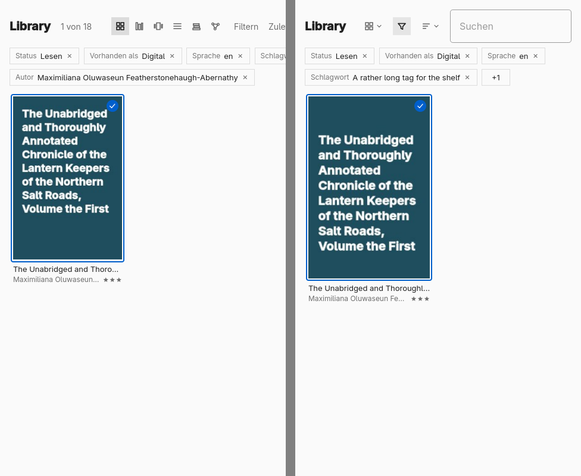 |  |

Two decisions worth knowing before changing things:

- **Books are set in your type, not the publisher's.** Chapters are reduced to their structure (headings, paragraphs, emphasis, lists, tables, pictures, links) and laid out by Qt's rich text. That is what makes every book follow the theme and the font size, and it keeps a browser engine out of the app. The cost is that a publisher's own layout (floats, drop caps, embedded fonts) is not reproduced; the stylesheet's italics, bold and centering are.
- **Formats Omabook doesn't read are converted, not reimplemented.** Calibre's converter does that well, so Omabook leans on it the way video apps lean on ffmpeg, and says what is missing when it isn't installed.

The layering is kept by a test (`theLayersPointOneWay` in `tests/library_tests.cpp`): a format or library file that includes anything from the window fails the build's tests. Each layer has its own test binary, the real window is driven by keyboard in `tests/ui_tests.cpp` and fails on any QML warning, and `tests/cli_tests.sh` runs the real binary with no display.

## Upgrading

A newer Omabook opens an older library and brings it up to date by itself. Nothing needs to be exported or converted.

- **A copy is kept first.** Each time an update changes the library's format, the database is copied to `.backups/` inside the library folder before anything changes (`omabook-format-<n>-<date>.db`; the last five are kept). A library that can't be copied is left untouched and Omabook says why.
- **Each change is all or nothing.** The steps from one format to the next run one at a time, each in a transaction; a step that fails is undone and the library stays as it was.
- **There is no going back in place.** An older Omabook refuses a library a newer one has opened and says so. To return to an older version, close Omabook and put the copy from `.backups/` back as `omabook.db`.
- **Two computers.** Both should run the same version. If one is newer in a way the other could misread, syncing stops and names the computer to update; nothing is exchanged until then.
- **Settings** in `config.json` carry a version too. A setting that is renamed in a later release is carried over, and settings a newer Omabook wrote are kept when an older one saves the file.
- **Plugins** keep working across updates of Omabook as long as they use the documented API (`omabook plugin api`). A plugin says the oldest Omabook it runs on with `"omabook": "<version>"` in its `plugin.json`; one written for a newer Omabook than yours is not loaded, and says which version it needs.

For whoever changes the format: add a step to the list in `Library::open` (never edit an old one), add `tests/data/library-<version>.sql` for the release being cut (a dump of a small made-up library), and the test `everyReleasedLibraryStillOpens` then holds every later version to opening it with nothing lost. A change to the sync manifest's shape raises `manifestVersion` in `sync.cpp`; a renamed setting gets a step in `Settings::upgraded`. A change to a shared space's file (`.omabook-space`, `spacesnapshot.h`) raises its minor version when it only adds, its major version otherwise, and adds `tests/data/space-<format version>.omabook-space`, written from the test's fixtures with `OMABOOK_WRITE_SPACE_SAMPLE=<file> build/sharing_tests theSampleIsMadeFromFixtures`; `everySharedSpaceSampleStillReads` then holds every later version to reading it.

## Known limits

- Books with DRM can't be opened; Omabook says so rather than failing blankly.
- Sending books to an e-reader is not there yet. Details are written back into EPUBs only (`omabook embed`), not into PDFs, comics or other formats.
- A sync carries books, reading places, collections, the graph and bookmarks, not the AI's notes or a book's own reading format.
- A line's length in characters is counted from the widths of the font's lowercase letters, weighted as often as each is met in English; in a script whose letters run wider or narrower (Chinese, Japanese, Korean) a line holds fewer or more characters than the measure says.
- Pages are cut by Omabook, from the lines Qt's text layout gives, so a paragraph's first or last line is never left alone on a page and a heading goes over with what follows it; a page can come out a line or two short for that. A picture taller than a page is cut across pages.
- Words are broken only in justified text, and only in a language whose hyphenation dictionary is installed (`hyphen-en`, `hyphen-de`, `hyphen-nl` and the other `hyphen-*` packages); otherwise justified lines are filled with wider spaces, but for a soft hyphen the book has itself. A word is broken where its letters allow, never respelled: the old German *Schiffahrt* is not broken as *Schiff-fahrt*.
- Goodreads can't be written to: Omabook's reading goes back as a file you upload on Goodreads' import page. Its live shelves are shown to almost nobody who isn't signed in; the export file always works. Reviews are not brought in.
- Open Library's reading log has no word for half stars or re-reads, and its stars and finished dates come from an address its own pages use, which could change; the shelves themselves do not depend on it. Hardcover's half stars are rounded to whole ones here.
- Signing in to Hardcover through its own sign-in page (rather than a pasted token) is not there yet.
- The reasons the window gives for a book that can't be opened, a catalog that can't be reached and a file that can't be added are in the desktop's language; some rarer ones from the layers below (the AI's, a sync's, a space's) are still in English.
- The window ships in English, Dutch, German, French and Spanish; other Omarchy languages show English until someone adds a catalog under `src/i18n/` (`bin/i18n` regenerates `en.json` from the sources).

## Development

Omabook is developed in the [omabook-workspace](https://github.com/jellespijker/omabook-workspace),
the main workspace for Omabook and its plugins. It holds the shared Kanban board, the labels
and the milestones; see its README and `AGENTS.md`.

Every change is checked by the harness in `.agents/`: modern C++23 (clang-tidy and
ast-grep), the layers of `src/`, file-size and complexity budgets, formatting, secrets
and an issue number in each commit. Set it up once with `uvx pre-commit install`; run it
on a branch with `bin/check`. The rules are in `.agents/rules/`, and what changed
between releases in [CHANGELOG.md](CHANGELOG.md).

## License

MIT. The theme, translator, build scripts and portal file picker come from the Omarchy apps by David Heinemeier Hansson, under the same license.

The palettes in `share/omabook/themes/` are the `colors.toml` of Omarchy's built-in themes, unchanged, from [Omarchy](https://github.com/omacom/omarchy) v4.5.0 (commit `ac2690c`), © David Heinemeier Hansson under the MIT license (`share/omabook/themes/LICENSE.omarchy`); the palettes they port (Catppuccin, Tokyo Night, Nord, Gruvbox, Rosé Pine, Everforest, Kanagawa, Flexoki) are MIT upstream too. No wallpapers or other files of the themes are included. `bin/update-themes` fetches them again from a pinned release.

### Calibre

Omabook works with [Calibre](https://calibre-ebook.com) by Kovid Goyal and contributors, which is free software under the GNU GPL v3. Calibre is not part of Omabook and none of its code is included: Omabook reads the libraries Calibre keeps (its `metadata.db`), reads Calibre's settings to find them, and runs Calibre's own programs (`calibre-debug`, `ebook-convert`) when Calibre is installed. The idea of an ebook library with plugins for metadata sources, formats, conversion and catalogs, and several of the names used for them, are Calibre's, and Omabook owes it that. The one file that runs inside Calibre and uses its Python modules is `share/omabook/calibre_bridge.py`. For that reason it alone is under the GPL v3 or later, and it is installed beside Omabook as a separate file rather than built into the program.

Omabook's Goodreads support is its own code, but it learned from two Calibre plugins by Grant Drake (kiwidude), both under the GPL v3: *Goodreads*, the metadata source, and *Goodreads Sync*. None of their code is used or was translated. The ideas taken from them are that a book's page is still served under its address with `.xml` on it when the bare address is not, and is worth asking for again when it comes back empty; that the search box answers an ISBN; that a search result filed under the author "NOT A BOOK" is not one; that the date a reader means is when the book first came out; how a series is read from a title, an omnibus counting from its start; and the names Goodreads Sync proposes for its Calibre columns (`#goodreads_tags`, `#goodreads_rating`, `#goodreads_date_read`, `#goodreads_reading_progress`), which a Calibre import now recognises.

### Libraries

Omabook is built on Qt 6 (LGPL v3), libarchive (BSD) and Poppler (GPL), which draws PDF pages. Because Poppler is under the GPL, a built Omabook that includes PDF support is distributed under the GPL's terms, although Omabook's own source stays under the MIT license.
